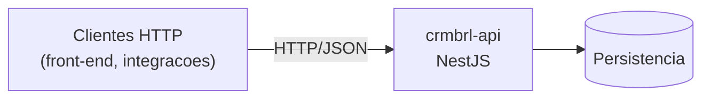

# Arquitetura — crmbrl-api

## Contexto

<!-- Escreva aqui, a mao, o porque das decisoes. Esta secao nunca e sobrescrita. -->

API HTTP do CRM BRL — a única fonte de regra de negócio do produto. Atende o
front-end `crmbrl`.

Fluxo de inicialização hoje:

1. `src/main.ts` cria a aplicação com `NestFactory.create(AppModule, { instrument:
   ObserveInstrument })` e escuta em `process.env.PORT ?? 3000`.
2. `src/app.module.ts` é o módulo raiz: registra `ObserveModule.forRoot(...)`
   (`@nestjs/observe` — tracing, logs correlacionados e métricas), o
   `AppController` e o `AppService`.
3. `AppController` expõe apenas `GET /`, que devolve o texto do `AppService`.

Ou seja: scaffold do Nest CLI com o módulo de observabilidade ligado. Ainda não há
camada de persistência, validação, autenticação nem versionamento de rota.

### Consumidores

O front-end `crmbrl` (Angular) vive em um repositório separado, com ciclo de release
próprio. Não há pacote compartilhado nem tipo exportado para ele: o contrato é só o
HTTP, então **toda mudança na tabela de endpoints acima é mudança de contrato** e
precisa ser descrita aqui — o que o endpoint espera e o que devolve.

> **Atenção:** `appKey` e `appSecret` do `ObserveModule` estão com os valores
> placeholder `YOUR_APP_KEY` / `YOUR_APP_SECRET` em `src/app.module.ts`. Mover para
> variável de ambiente antes de qualquer deploy.

## Inventario tecnico

<!-- doc-updater:inicio — gerado automaticamente, nao edite a mao -->

> Atualizado por `tools/doc-updater` em 20/10/2026, 14:19 a partir do commit `b28fd4c`.

### Resumo

| Item | Valor |
| --- | --- |
| Projeto | `crmbrl-api` |
| Versao | 0.0.1 |
| Framework | NestJS ^12.0.1 |
| Papel | Back-end / API |
| Gerenciador de pacotes | bun |
| Arquivos versionaveis | 18 |
| Linhas de codigo | 139 |
| Arquivos de teste | 2 |
| Branch | dev |
| Commit documentado | `b28fd4c` |
| Repositorio remoto | https://github.com/GitBRL/crmbrl-api.git |

### Topologia

### Estrutura de pastas

| Caminho | Arquivos |
| --- | --- |
| `(raiz)` | 11 |
| `src` | 5 |
| `test` | 2 |

### Modulos

| Modulo | Arquivo |
| --- | --- |
| `AppModule` | `src/app.module.ts` |

### Endpoints HTTP

| Metodo | Rota | Controller | Handler |
| --- | --- | --- | --- |
| `GET` | `/` | `AppController` | `getHello` |

### Providers / servicos

| Classe | Arquivo |
| --- | --- |
| `AppService` | `src/app.service.ts` |

### Chamadas HTTP saindo deste projeto

_Nada registrado ainda._

### Scripts disponiveis

| Comando | Executa |
| --- | --- |
| `bun run build` | `nest build` |
| `bun run deploy` | `nest deploy` |
| `bun run docs` | `node tools/doc-updater/index.mjs` |
| `bun run format` | `prettier --write "src/**/*.ts" "test/**/*.ts"` |
| `bun run start` | `nest start` |
| `bun run start:dev` | `nest start --watch` |
| `bun run start:debug` | `nest start --debug --watch` |
| `bun run start:prod` | `node dist/main` |
| `bun run lint` | `oxlint --type-aware src/ test/` |
| `bun run test` | `node --experimental-vm-modules ./node_modules/jest/bin/jest.js` |
| `bun run test:watch` | `node --experimental-vm-modules ./node_modules/jest/bin/jest.js --watch` |
| `bun run test:cov` | `node --experimental-vm-modules ./node_modules/jest/bin/jest.js --coverage` |
| `bun run test:debug` | `node --inspect-brk --experimental-vm-modules -r tsconfig-paths/register -r ts-node/register node_modules/.bin/jest --runInBand` |
| `bun run test:e2e` | `node --experimental-vm-modules ./node_modules/jest/bin/jest.js --config ./test/jest-e2e.json` |

### Variaveis de ambiente usadas no codigo

- `PORT`

### Dependencias de producao

| Pacote | Versao |
| --- | --- |
| `@nestjs/common` | ^12.0.1 |
| `@nestjs/core` | ^12.0.1 |
| `@nestjs/observe` | ^0.3.0 |
| `@nestjs/platform-express` | ^12.0.1 |
| `reflect-metadata` | ^0.2.2 |
| `rxjs` | ^7.8.1 |

Dependencias de desenvolvimento (19)

| Pacote | Versao |
| --- | --- |
| `@nestjs/cli` | ^12.0.0 |
| `@nestjs/mau` | ^0.2.6 |
| `@nestjs/schematics` | ^12.0.0 |
| `@nestjs/testing` | ^12.0.1 |
| `@types/express` | ^5.0.0 |
| `@types/jest` | ^30.0.0 |
| `@types/node` | ^24.0.0 |
| `@types/supertest` | ^7.0.0 |
| `jest` | ^30.0.0 |
| `oxlint` | ^1.58.0 |
| `oxlint-tsgolint` | ^7.0.2001 |
| `prettier` | ^3.4.2 |
| `source-map-support` | ^0.5.21 |
| `supertest` | ^7.0.0 |
| `ts-jest` | ^29.4.0 |
| `ts-loader` | ^9.5.2 |
| `ts-node` | ^10.9.2 |
| `tsconfig-paths` | ^4.2.0 |
| `typescript` | ^6.0.2 |

<!-- doc-updater:fim -->

## Decisoes de arquitetura

<!-- Registre aqui trade-offs, padroes adotados e o que foi descartado. -->

Decisões já visíveis no código (2026-10-20):

- **NestJS sobre Express** (`@nestjs/platform-express`). Fastify foi descartado por
  ora; nada no código depende do adaptador.
- **Observabilidade desde o scaffold**, via `@nestjs/observe` instrumentando a
  aplicação no `NestFactory.create`. É a única dependência não essencial do módulo
  raiz.
- **Bun como gerenciador de pacotes** (`bun.lock`), mas o runtime de execução
  continua sendo Node — os scripts chamam `nest` e `node`.
- **oxlint com `--type-aware`** no lugar do ESLint, e **Jest** (com
  `--experimental-vm-modules`) para unitários e e2e.
- **Porta por variável de ambiente** (`PORT`), com 3000 como padrão.

Decisões que valem para os dois repositórios:

- **Repositórios separados**, sem monorepo e sem pacote compartilhado — o contrato
  com o `crmbrl` é só o HTTP.
- **Documentação versionada junto com o código**, em `docs/`, atualizada por
  [`tools/doc-updater`](../tools/doc-updater/README.md). Nada de documentação fora
  do repositório.
- **TypeScript 6** e **Prettier** nos dois lados.

Pendente de decisão — registrar aqui quando resolvido:

- Banco e camada de acesso a dados.
- Validação de entrada (`ValidationPipe` global + DTOs) e formato padrão de erro.
- Autenticação/autorização e CORS para o domínio do front.
- Versionamento das rotas (`/api/v1`) antes do primeiro endpoint público.
- Tirar `appKey`/`appSecret` do `ObserveModule` do código e levar para variável de
  ambiente.
