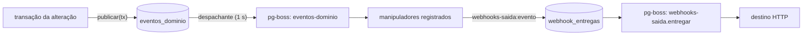
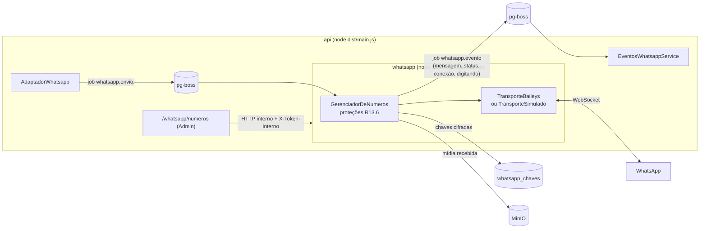
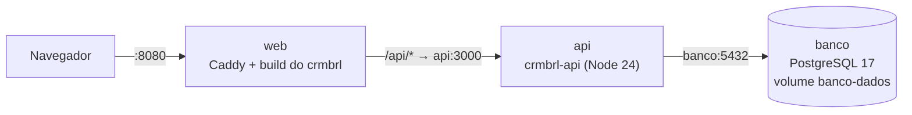
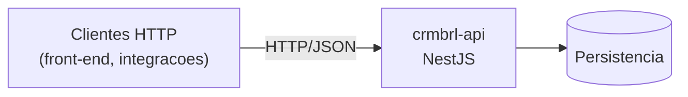

# Arquitetura — crmbrl-api

## Contexto

<!-- Escreva aqui, a mao, o porque das decisoes. Esta secao nunca e sobrescrita. -->

API HTTP do BRL CRM — a única fonte de regra de negócio do produto. Atende o
front-end `crmbrl`. A Fase 1 (núcleo do CRM) está implementada: autenticação por
sessão, usuários e hierarquia com desligamento e encaminhamento, contatos e
empresas com deduplicação e LGPD, funis em kanban com passagens automáticas e
rodízio, atividades com lembretes, auditoria e logs técnicos consultáveis,
webhooks de entrada e de saída, notificações internas e a configuração inicial.
A primeira parte da Fase 2 (Onda A, 2026-10-26) também: arquivos no MinIO,
tempo real com Socket.IO, **Atendimento omnichannel** (filas, distribuição,
transferência, SLA, horário, satisfação, respostas rápidas, métricas), o
**gateway de WhatsApp próprio** (Baileys, num segundo processo da mesma imagem),
os canais chat do site (widget próprio), e-mail (IMAP/SMTP), Instagram e
Messenger (Graph API da Meta) e o **chat interno** da equipe.
As regras ficam em [REGRAS-DE-NEGOCIO.md](REGRAS-DE-NEGOCIO.md) (códigos R…,
citados nos testes); os 15 cenários de aceitação da seção 13 (Fase 1) e os 18
da seção 20 (Onda A, cenários 16 a 33) têm teste de integração contra um
PostgreSQL real.

### Inicialização

1. `src/main.ts` carrega o `.env` com `process.loadEnvFile()` **só se o arquivo
   existir** — no container as variáveis vêm do ambiente. O que já está definido
   no ambiente tem prioridade sobre o arquivo.
2. `lerAmbiente()` (`src/config/ambiente.ts`) lê e valida as variáveis. Erro de
   configuração encerra o processo (código 1) com a lista do que corrigir, sem
   repetir valores secretos (`DATABASE_URL`, chave, senhas). Avisos que não
   impedem a subida (ex.: chave de criptografia de desenvolvimento) vão para o log.
3. `criarLogger()` (`src/logs/logger.ts`) monta o `ConsoleLogger` do Nest: JSON
   em produção (`LOG_FORMATO`), com campos sensíveis mascarados.
4. `carregarObservabilidade()` (`src/observabilidade.ts`) importa o
   `@nestjs/observe` — import dinâmico, o pacote é só ESM — apenas quando
   `OBSERVE_APP_KEY` e `OBSERVE_APP_SECRET` existem.
5. `NestFactory.create(AppModule.forRoot(ambiente, observe), OPCOES_DA_APLICACAO)`
   — `bodyParser: false` (os parsers são registrados à mão, com limites) e
   `rawBody: true` (o corpo bruto fica em `req.rawBody`, para o HMAC dos
   webhooks). O módulo raiz é dinâmico: recebe o ambiente já validado.
6. `configurarAplicacao()` (`src/aplicacao.ts`, o mesmo dos testes): CORS (só
   com `CORS_ORIGENS`, com credenciais), prefixo global `api`, versionamento por
   URI com versão padrão `1` (`/api/v1/...`), `trust proxy` = 1 (a API fica atrás
   do Caddy), sem `X-Powered-By`, o **middleware de requisição**
   (`X-Request-Id`, contexto e log HTTP), os body parsers (JSON até 1 MB,
   formulário até 256 KB), a reabertura do contexto e o `ValidationPipe` global.
7. `configurarTempoReal()` (`src/tempo-real/adaptador-socket-io.ts`): o
   adaptador Socket.IO do Nest no mesmo servidor HTTP, caminho `/api/socket.io`
   (os gateways `/tempo-real` e `/webchat` usam as mesmas
   `OPCOES_DO_SOCKET_IO`). Depois, `configurarDocumentacao()`
   (`src/documentacao.ts`): Swagger em `/api/docs` e `/api/docs-json`; com
   `DOCS_PUBLICAS=false` (padrão em produção) um middleware exige sessão de
   Admin antes.
8. Na inicialização dos módulos (antes do `listen`): o `FilaService` sobe o
   pg-boss (schema `pgboss`; com o banco fora, tenta de novo em segundo plano);
   a **configuração inicial** (`SeedsService`) roda numa transação com trava
   consultiva e cria só o que falta — funis-base e etapas (R5.2), as duas
   passagens (R5.7), os rodízios por área (R5.8) e, com a base sem usuários, o
   Admin de `ADMIN_EMAIL` com troca de senha obrigatória (R2.6); com
   `PROCESSAR_FILAS=true`, os módulos registram os trabalhadores e agendamentos
   (abaixo) e o despachante da outbox começa a rodar a cada segundo. Na Onda A,
   também: o `ArquivosService` cria o bucket se faltar (sem MinIO, a API sobe e
   os envios respondem 503 até ele voltar); o `OuvinteDoBanco` abre um `LISTEN`
   (sessões revogadas e notificações novas, com varredura de reserva a cada
   60 s); o chat interno sincroniza os canais padrão (R15.1); e os módulos de
   canal registram os adaptadores no `RegistroCanais`.
9. `enableShutdownHooks()` e `listen(PORT ?? 3000)`. No SIGTERM o Nest para os
   módulos na ordem inversa: módulos de negócio, depois eventos e fila (o pg-boss
   espera os jobs em curso) e por último o Prisma, que encerra o pool.

### Ciclo de uma requisição

1. **Middleware de requisição** (`src/logs/requisicao.middleware.ts`): aceita o
   `X-Request-Id` do cliente (curto e sem caracteres estranhos) ou gera um,
   devolve-o em toda resposta (R3.7), cria o contexto da requisição (id, IP, user
   agent) e, ao terminar, escreve o log HTTP estruturado (R3.6). A rota do log é
   o padrão casado (`/api/v1/negocios/:id`), nunca a URL crua. `GET /api/saude`
   com 200 não entra no log.
2. **Body parsers** e **reabertura do contexto** (`AsyncLocalStorage`, em
   `src/comum/contexto`): `contextoAtual()` responde, em qualquer ponto do
   código, quem é o ator, o IP e o id da requisição.
3. **Guards globais** (`src/auth`), nesta ordem: `OrigemGuard` (CSRF por origem,
   R2.9: métodos que alteram dados precisam de `Origin`/`Referer` em
   `ORIGENS_PERMITIDAS`; `@SemVerificacaoDeOrigem()` isenta), `SessaoGuard`
   (cookie `crmbrl_sessao` → sessão válida de usuário ativo; `@Publico()` libera;
   troca de senha pendente só deixa passar `auth/eu`, `auth/senha` e `auth/sair`)
   e `PapeisGuard` (`@Papeis(...)`).
4. **`ValidationPipe`** com lista branca: campo desconhecido é erro.
5. **Handler** — toda alteração numa transação Prisma com a auditoria (R3.1), os
   eventos de domínio (R10.1) e as notificações (R10.2) da mesma operação.
6. **Filtro global de erros** (`src/comum/erros`): toda falha sai como
   `{ statusCode, erro, mensagem, detalhes?, requisicaoId }`. Erros do Prisma
   conhecidos viram 404/409 (deadlock e conflito de serialização viram 409
   "tente de novo"); 500 não mostra detalhe e vai para os logs técnicos.

### Contexto, auditoria e efeitos colaterais

Toda escrita segue o mesmo molde, dentro de **uma** `prisma.$transaction`:

```ts
await this.prisma.$transaction(async (tx) => {
  const negocio = await tx.negocio.update({ … });             // a mudança
  await this.auditoria.registrar(tx, { acao: 'negocio.movido', … }); // R3.1
  await this.eventos.publicar(tx, 'negocio.movido', { … });        // outbox, R10.1
  await this.notificacoes.notificar(tx, responsavelId, { … });     // R10.2
});
```

- **Quem fez**: o `AuditoriaService` e a outbox leem o ator de
  `contextoAtual()` — o usuário que o `SessaoGuard` pôs no contexto, com IP,
  user agent e id da requisição. Fora de uma requisição de usuário o código roda
  em `executarComoAtor(ator, fn)`: `WEBHOOK` (processamento de um recebimento,
  com o nome do ponto e o IP de quem chamou), `AUTOMACAO` (passagens entre
  funis, "Passagem <nome>", guardando quem disparou) e `SISTEMA` (configuração
  inicial, lembretes, retenção).
- **Linha do tempo** (R3.5): cada evento de auditoria guarda em `relacionados`
  as entidades ligadas (`contato:<id>`, `empresa:<id>`, `negocio:<id>`…). O
  `LinhaDoTempoService` (módulo de contatos, exportado) junta esses eventos e as
  atividades visíveis numa só lista paginada, para contato, empresa e negócio.
- **Concorrência**: deduplicação de contato (R4.2), CNPJ, negócio automático
  (R5.6), rodízio (R5.8), passagens (R5.7) e mudanças de hierarquia usam travas
  consultivas (`travarChave`) ou `SELECT … FOR UPDATE` antes de procurar; os
  índices únicos parciais são a última barreira. O desligamento é repetido
  sozinho quando o banco o aborta por deadlock.
- Se qualquer passo falha, nada fica: nem a mudança, nem a auditoria, nem o
  evento, nem a notificação. Os testes de integração conferem isso por módulo.

### Outbox, fila e jobs



1. `EventosDominioService.publicar(tx, tipo, dados)` grava o evento na mesma
   transação da alteração, com o ator.
2. O despachante (a cada 1 s, com `PROCESSAR_FILAS=true`) cria um job
   `eventos-dominio` por evento pendente, na mesma transação que marca
   `enfileiradoEm` (adapter `fromPrisma` do pg-boss): nada se perde se a API cair.
3. O trabalhador entrega o evento aos manipuladores registrados
   (`registrarManipulador(tipo, fn, nome)`) e guarda quais concluíram; numa
   falha, o pg-boss reentrega e só os que faltam rodam. Entrega "pelo menos uma
   vez": os manipuladores são idempotentes.

Manipuladores da Fase 1: `webhooks-saida:<evento>`, um por evento da R9.2, cria
uma entrega por destino ativo que assina o evento (única por destino e evento);
`webhooks-entrada:lgpd` e `webhooks-saida:lgpd`, em `contato.anonimizado`,
apagam os dados pessoais dos recebimentos e das entregas daquele contato
(R4.6). Notificações não passam pela outbox: são gravadas na própria transação.

| Fila (pg-boss) | Quem cria o job | O que faz |
| --- | --- | --- |
| `eventos-dominio` | despachante da outbox | entrega o evento aos manipuladores |
| `webhooks-entrada.processar` | `POST /webhooks/entrada/:token`, na transação do recebimento                              | por item do corpo: mapeia, deduplica, cria ou atualiza o contato e o negócio (modos, etapa, dono e status, R32.3, R32.4), distribui (R8.5); até 3 tentativas, só para falha passageira    |
| `webhooks-saida.entregar` | manipulador da outbox, reenvio, nova tentativa | envia o envelope assinado (R9.3); cada nova tentativa (1 min … 24 h, R9.4) é um job novo, agendado na transação do resultado |
| `atividades.lembretes` | agendamento `*/15 * * * *` (America/Sao_Paulo) | avisa 1 h antes do vencimento e uma vez no atraso (R6.5) |
| `administracao.retencao` | agendamento `30 3 * * *` (America/Sao_Paulo) | apaga logs técnicos e recebimentos de webhook com mais de 90 dias, em lotes (R3.6, R8.6) |
| `atendimento.enviar` | envio da equipe (mensagem `PENDENTE`), na transação da mensagem | chama o adaptador do canal pelo `RegistroCanais`; 3 retentativas com espera crescente (15 s, dobrando) para falha passageira; falha definitiva vira `FALHOU` (R12.10) |
| `atendimento.sla` | agendamento `* * * * *` | avisa o líder uma vez por prazo de SLA estourado (R12.12) |
| `whatsapp.envio.<numeroId>` | `AdaptadorWhatsapp` (API), um job por mensagem | **consumida pelo gateway**: proteções (R13.6, R13.7) e envio pelo Baileys, uma por vez por número; as tentativas ficam no contrato (`contrato-gateway.ts`), gravadas pela API em cada job |
| `whatsapp.evento` | gateway (mensagem recebida, status, conexão, digitando) | **consumida pela API** (`EventosWhatsappService`): `receber`, `atualizarStatus`, `whatsapp.conexao` em tempo real |
| `meta.webhook` | `POST /publico/meta/webhook` assinado | entrega os eventos da Meta ao Atendimento (mensagens, anexos, entregas, leituras) |
| `whatsapp-oficial.webhook` | `POST /publico/meta/webhook` com `object: whatsapp_business_account`, uma mudança por job | entrega mensagens e status do WhatsApp oficial ao Atendimento (R28.2, R28.3, R28.7); roteia por campo (`messages`; `calls` na fatia das ligações); 5 tentativas com espera crescente |
| `whatsapp-oficial.templates` | agendamento `0 3 * * *` (America/Sao_Paulo) | sincroniza os templates de todos os canais oficiais ativos (R28.8) |
| `email.varrer` | agendamento `* * * * *` | lê as caixas IMAP (só UIDs novos) e entrega ao Atendimento (R14.5) |
| `chat-interno.sincronizar` | agendamento a cada minuto | acerta os membros dos canais padrão pelo papel (R15.1) |
| `arquivos.apagar-conteudo` | `ArquivosService.remover`, na transação da remoção | apaga o objeto do MinIO depois do commit (R11.7) |

Manipuladores da outbox da Onda A: `tempo-real:emissao` (evento interno
`tempo-real.emissao`, gravado por `emitirAposCommit`: emite as cargas prontas
depois do commit, descartando as com mais de 5 min), os tradutores do chat
interno (`chat_mensagem.criada|editada|excluida`, `chat_canal.atualizado` →
`chat.mensagem`, `chat.atualizado` e `nao-lidas`), `atendimento.contagens`
(recalcula `nao-lidas.atendimento` de quem foi afetado), o aviso de mensagem
nova a quem está fora do CRM (`mensagem.recebida`) e, em `usuario.desligado`,
o encaminhamento das conversas (R12.17) e a saída dos canais do chat (R15.1).
Os eventos de domínio do Atendimento (`conversa.criada|atribuida|transferida|
resolvida|reaberta|avaliada`, `mensagem.recebida|enviada`) ficam na outbox
para uso interno e para as automações das próximas ondas; não vão aos webhooks
de saída.

Nos testes, `PROCESSAR_FILAS=false`: nada roda sozinho, e os utilitários
`processarEventos()` e `drenarFilas()` executam a outbox e as filas na hora.

### Módulos

- `AppModule` (raiz, dinâmico) importa, nesta ordem: `ObserveModule` (quando
  ligado), `AmbienteModule`, `PrismaModule`, `LogsModule`, `ComumModule`,
  `EmailModule`, `FilaModule`, `EventosModule`, `AuditoriaModule`,
  `NotificacoesModule`, `AuthModule`, `SeedsModule`, `SaudeModule` e os módulos
  de negócio (`UsuariosModule`, `ContatosModule`, `FunisModule`,
  `AtividadesModule`, `AuditoriaConsultaModule`, `AdministracaoModule`,
  `WebhooksModule`, e, na Onda C, `BiModule`, `AnaliseModule` e `FinanceiroModule`, nesta ordem). Os de infraestrutura são globais: qualquer módulo injeta os
  serviços deles sem importá-los.
- `AmbienteModule`: o ambiente validado, pelo token `AMBIENTE`. Nenhum outro
  arquivo de `src/` lê `process.env`.
- `PrismaModule`: o `PrismaService` (client gerado + `PrismaPg`) e o tipo `Tx`
  das transações; `travarChave()` (`src/prisma/travas.ts`) para travas
  consultivas.
- `LogsModule`: `LogsTecnicosService` — 5xx, avisos e falhas de jobs gravados em
  `logs_tecnicos` (R3.6).
- `ComumModule`: `CriptografiaService` (scrypt, tokens, SHA-256, AES-256-GCM,
  HMAC) e o filtro global de erros. Em `src/comum` ficam também o contexto, as
  exceções, a paginação, a validação e os utilitários de domínio (papéis e
  permissões, e-mail, telefone, CNPJ, etiquetas, UTM, valores).
- `EmailModule`: `EmailService` (nodemailer; sem SMTP só registra no log).
- `FilaModule`: `FilaService` sobre o pg-boss (schema `pgboss`).
- `EventosModule`: `EventosDominioService` — outbox (R10.1).
- `AuditoriaModule`: `AuditoriaService` — gravação da auditoria (R3.1).
- `NotificacoesModule`: `NotificacoesService` e os endpoints do usuário (R10.2).
- `AuthModule`: login, sessões, senhas e os guards globais (R2).
- `SeedsModule`: a configuração inicial idempotente, rodada a cada subida.
- `SaudeModule`: `GET /api/saude` (abaixo).
- `ArquivosModule` (Onda A, global): `ArquivosService` (`salvar`, `abrirLeitura`,
  `abrirConteudo`, `lerConteudo`, `remover` e os verificadores de acesso por
  contexto, R11), a política de tipos e limites (`politica.ts`) e o driver
  (`s3` com envio em partes, ou `memoria` nos testes). As rotas
  (`POST`/`GET /arquivos`) ficam no `ArquivosHttpModule`.
- `TempoRealModule` (Onda A, global): o gateway `/tempo-real` (cookie +
  origem, salas), o `TempoRealService` (`emitir`, salas, autorizadores de sala
  registrados pelos módulos donos), o `TempoRealPublicador` (manipulador da
  outbox: `emitirAposCommit` e `registrarTradutor`) e o `OuvinteDoBanco`
  (`LISTEN` de sessões revogadas e de notificações novas). O catálogo de salas,
  eventos e cargas (`catalogo.ts`) é o contrato com o front.
- `RegistroCanaisModule` (Onda A, global, em `CanaisModule`): o
  `RegistroCanais`, onde cada canal registra o seu `AdaptadorCanal`
  (`src/canais/adaptador-canal.ts`).

Módulos de negócio (Fase 1), cada um na sua pasta de `src/`:

| Módulo | Regras | O que expõe a outros módulos |
| --- | --- | --- |
| `UsuariosModule` (`usuarios/`) | R1, R2.8 (senha temporária, convite), R7 (desligamento, reativação), visão de equipe | `UsuariosService` (exportado; nenhum outro módulo usa na Fase 1) |
| `ContatosModule` (`contatos/`) | R4 (contatos e empresas), R3.5 (linha do tempo) | `ContatosService.encontrarOuCriar(tx, …)` (deduplicação, usada pelos webhooks) e `definirResponsavelSeVazio`, `EmpresasService`, `LinhaDoTempoService` |
| `FunisModule` (`funis/`) | R5 (funis, etapas, negócios, kanban, passagens, rodízio, visibilidade, métricas) | `NegociosService.criarAutomatico(tx, …)` (cria ou reconverte, distribui, notifica e roda as passagens) e `DistribuicaoService.escolherResponsavel(tx, …)` |
| `AtividadesModule` (`atividades/`) | R6, incluindo o job de lembretes | `AtividadesService`, `LembretesAtividadesService` (usados pelos testes) |
| `AuditoriaConsultaModule` (`auditoria/consulta/`) | R3.4 (consulta com filtros e cursor) | `AuditoriaConsultaService` |
| `AdministracaoModule` (`administracao/`) | logs técnicos e resumo do Admin, retenção de 90 dias (R3.6, R8.6) | `RetencaoService` |
| `WebhooksModule` (`webhooks/`) | R8 (entrada) e R9 (saída) | — |
| `AtendimentoModule` (`atendimento/`, Onda A) | R12 (conversas, filas, distribuição, SLA, horário, satisfação, respostas rápidas, métricas) | `AtendimentoService.receber(entrada)`, `atualizarStatus(canalId, idExterno, status, erro?, quando?)` e `avaliar(conversaId, nota, comentário?)`, chamados pelos canais; `AcessoAtendimentoService` (sala `conversa:<id>` e mídia `MENSAGEM`) |
| `CanaisModule` (`canais/`, Onda A) | R13 (lado da API do WhatsApp) e R14 — submódulos `whatsapp/`, `webchat/` (com o widget), `email/`, `meta/`, `whatsapp-oficial/` (Onda E, R28) e `comum/` (segredos cifrados, limitador, configuração auditada, links públicos assinados) | um `AdaptadorCanal` por tipo no `RegistroCanais`; `ClienteGatewayWhatsapp` (HTTP interno do gateway) |
| `ChatInternoModule` (`chat-interno/`, Onda A) | R15 | `AcessoChatService` (sala `chat:<canalId>` e anexos `CHAT`) |

O **gateway de WhatsApp** (`src/whatsapp/`) é outro processo, com o próprio
módulo raiz (`GatewayWhatsappModule`): usa ambiente, Prisma, logs técnicos,
criptografia, fila, auditoria e arquivos da API, mas **não** o
`EventosModule` (a outbox fica só na API). Expõe só o HTTP interno (token
`X-Token-Interno`) e consome as filas de envio dos números.

Dependências entre eles: `WebhooksModule` importa `ContatosModule` e
`FunisModule`; `FunisModule` importa `ContatosModule` (linha do tempo do
negócio). O desligamento (`UsuariosModule`) escreve direto, na própria
transação, nas tabelas de atividades, negócios, contatos, empresas, rodízios,
webhooks de entrada e passagens (responsável fixo) — é o único ponto que mexe
em dados de vários módulos de uma vez; a anonimização de contato também
reescreve títulos de negócios e atividades. A visibilidade de negócios (R5.9) e
de atividades (R6.4) sai de `permissoesDoPapel` (`src/comum/dominio`), a mesma
matriz que o `auth/eu` devolve ao front.

Na Onda A: `AtendimentoModule` importa `ContatosModule` (deduplicação e
identificadores) e `FunisModule` (criar negócio a partir da conversa); cada
submódulo de canal importa `AtendimentoModule` (entrada pelo `receber`) e,
o chat do site, também `ContatosModule` (formulário do visitante). O
Atendimento não conhece os canais: envia pelo `RegistroCanais` e recebe pelas
interfaces da §4 do contrato da onda. O chat interno não depende do Atendimento.
Arquivos, tempo real e registro de canais são globais: os módulos donos
registram neles os verificadores de acesso (`registrarVerificadorDeAcesso`),
os autorizadores de sala (`registrarAutorizadorDeSala`) e os adaptadores.

### Fluxos da Onda A (atendimento, gateway, tempo real, arquivos)

**Entrada de uma mensagem** (qualquer canal):

```mermaid
sequenceDiagram
  participant Canal as Canal (gateway / IMAP / webhook Meta / widget)
  participant Atd as AtendimentoService.receber
  participant Banco as Postgres (uma transação)
  participant Outbox as outbox → TempoRealPublicador
  Canal->>Atd: entrada normalizada (canalId, remetente, mensagem)
  Atd->>Banco: trava (canal, idExterno) — repetida devolve nova=false
  Atd->>Banco: contato pelo identificador / e-mail / telefone (R4.2) ou novo
  Atd->>Banco: nota de satisfação pendente? (R12.13) senão conversa em aberto ou nova
  Atd->>Banco: fila padrão, SLA, distribuição (R12.4), mensagem, resposta fora do horário
  Atd->>Banco: auditoria + eventos + emissões (emitirAposCommit) + notificação
  Banco-->>Outbox: depois do commit
  Outbox-->>Outbox: conversa.nova / mensagem.nova / nao-lidas nas salas
```



**Saída** (a equipe responde): `POST /atendimento/conversas/:id/mensagens`
grava a mensagem `PENDENTE` e o job `atendimento.enviar` na mesma transação →
o trabalhador chama `RegistroCanais.obter(tipo).enviar()` → o adaptador
devolve `{ idExterno }` (síncrono: `ENVIADA`; chat do site, e-mail,
Instagram e Messenger) ou
`{ idExterno, enfileirado: true }` (WhatsApp: fica `PENDENTE` até o gateway
avisar) ou lança `FalhaDefinitivaDeEnvio` (`FALHOU` com o motivo) → os status
seguintes chegam por `atualizarStatus` (só avançam) e saem em
`mensagem.status` na sala da conversa.

**Gateway de WhatsApp** (processo `node dist/whatsapp/main.js`, serviço
`whatsapp`):



Comandos síncronos (conectar, desconectar, status, verificar número,
digitando) vão por HTTP interno na rede do compose (`WHATSAPP_URL_INTERNA`),
com o ator no cabeçalho `x-ator` (o gateway audita em nome de quem pediu).
Tudo o que o gateway conta à API vai pela fila `whatsapp.evento`, consumida
com concorrência 1 (a ordem dos eventos de um número importa). No modo
simulado, `POST /simulador/receber` injeta mensagens recebidas.

**Tempo real**: o cliente conecta em `/api/socket.io` (namespace
`/tempo-real`) com o cookie da sessão e uma origem permitida; entra sozinho em
`usuario:<id>`, `papel:<papel>` e `area:<area>` e pede `conversa:<id>` e
`chat:<canalId>` (com o autorizador do módulo dono). As emissões saem da
outbox depois do commit (`emitirAposCommit` ou tradutores de eventos de
domínio); a notificação nova chega pelo `NOTIFY` do gatilho da tabela; a
sessão revogada (gatilho com `NOTIFY`) derruba os sockets dela, e uma
varredura a cada 60 s pega o que o `LISTEN` perdeu e as sessões expiradas.
"Digitando" é o único evento emitido direto (`TempoRealService.emitir`). O
chat do site usa o namespace `/webchat` no mesmo caminho, com o token do
visitante e a origem conferida contra os domínios do canal.

**Arquivos**: `POST /arquivos?contexto=…` (multipart) passa pelo
armazenamento do multer da API, que confere tipo, assinatura e limite
enquanto envia ao MinIO (sem arquivo temporário em disco) e grava o
registro com SHA-256; o `id` vai depois na mensagem, no chat ou na resposta
rápida. `GET /arquivos/:id` pergunta ao verificador do contexto (R11.4) e
devolve o conteúdo com `Range`/`ETag` e cabeçalhos seguros. Canais e gateway
usam `ArquivosService.salvar` direto (mídia recebida, sem `criadoPorId`).

### Peças e fluxos da Onda B (importação, disparos, chatbot, automações)

**Peças compartilhadas** (`src/comum/`, `AutomacaoComumModule`, global — usadas por mais de
um módulo da onda):

- `modelos/` — renderizador de modelos de mensagem (`{{contato.primeiro_nome}}`, padrão
  `{{x|padrão}}`, variações `{a|b}` sorteadas pela semente do destinatário) e a validação de
  variáveis; rotas `/modelos/*` para o editor do front.
- `segmentos/` — filtro declarativo em JSON → consulta Prisma, com contagem e amostra
  (`/segmentos/*`); é o público dos disparos e a condição das automações.
- `passos/` — **executor de passos** genérico (`PassosService`): definição em lista com
  ramos, `aguardar` via `startAfter` do pg-boss, estado e histórico por passo, retomada
  depois de reinício, idempotência por passo e limite de 1.000 passos por execução. Chatbot
  e automações só registram tipos de passo (`registrarTipo`); as tabelas são `Execucao` e
  `ExecucaoPasso`.
- `gatilhos/` — manipulador da outbox que entrega eventos de domínio a quem se registra
  (automações, chatbot, disparos), com a **cadeia** (profundidade 5, 3 repetições da mesma
  automação) e o catálogo de gatilhos; `agenda.ts` calcula as ocorrências de data
  relativa e recorrência.

**Módulos** (cada um registra seus manipuladores e jobs quando `PROCESSAR_FILAS=true`):

| Módulo | Regras | Observações |
| --- | --- | --- |
| `ImportacaoModule` (`importacao/`) | R16 | `exceljs` lê CSV/XLSX e gera o relatório; fila `importacao.processar`, lotes de 100 linhas; usa `ContatosService.encontrarOuCriar` e `EmpresasService`, então herda R4.1/R4.2 e a auditoria por contato |
| `DisparosModule` (`disparos/`) | R17 | motor de envio (`EnvioDeCampanha`) com fila `disparos.enviar` (um destinatário por job, o `quando` do job evita cadeia dupla) e varredura `disparos.varredura` a cada minuto (agendadas, retomada, aprovação); entrega pelo `MotorDoAtendimento.criarSaida`; respostas e opt-out pelo evento `mensagem.recebida` |
| `ChatbotModule` (`chatbot/`) | R18 | `EntradaDoBot` escuta os eventos do Atendimento e decide o fluxo (`seletor-de-fluxo`); passos `mensagem`, `pergunta.*`, `condicao`, `acao.*`, `transferir`; simulador sobre o mesmo executor com ações simuladas; registra o verificador de acesso da mídia (contexto `CAMPANHA`) dos passos de mensagem |
| `AutomacoesModule` (`automacoes/`) | R19 | `GatilhosDeAutomacao` (eventos), `AgendasDeAutomacao` (varredura a cada 5 min e agenda), `IniciadorDeExecucao` (escopo, condições, limite por entidade, cadeia, `ultimaExecucaoEm`), ações pelos serviços de domínio, modo teste |

**Importação.** `POST /arquivos?contexto=IMPORTACAO` → `POST /importacoes` (rascunho com
colunas, prévia e mapeamento sugerido) → `PATCH` do mapeamento e das opções → `iniciar`
(enfileira) → o processador grava o resultado de cada linha (`ImportacaoLinha`), os
contadores e o progresso por lote (`importacao.progresso` na sala do usuário) → relatório
XLSX no MinIO e evento `importacao.concluida`.

**Campanha.** O público é montado em lotes de 500 no início (opt-out, sem canal e duplicados
fora). Cada envio: confere janela, limite diário do número e verificação de WhatsApp,
renderiza o modelo, acha ou cria a conversa do contato (nova nasce `RESOLVIDA`), cria a
mensagem de saída com autor `AUTOMACAO` e agenda o próximo envio com intervalo aleatório.
Status do destinatário e da campanha seguem o status da mensagem (`mensagem.status`). O
progresso vai em `campanha.progresso`; pausa, conclusão e aprovação geram notificações
(`campanha.*`, link `/disparos/:id`). A resposta (7 dias) e a palavra de saída (30 dias)
são tratadas pelo evento `mensagem.recebida`.

**Chatbot.** Mensagem recebida → `EntradaDoBot` (a conversa já foi criada e distribuída
pelo Atendimento) → escolhe o fluxo → `PassosService.iniciar` com `executarAgora`. Perguntas
suspendem a execução (`aguardandoEntrada`); a próxima mensagem do contato a retoma; o prazo
sem resposta é um `startAfter`. Eventos de atendente (resposta, assumir, transferir,
resolver) cancelam a execução. O widget do chat do site recebe `botoes` na mensagem pública.

**Automações.** Evento na outbox (ou ocorrência da agenda) → `IniciadorDeExecucao` resolve a
entidade, confere escopo, filtro, condições e limite → `PassosService` executa as ações por
passos. Os serviços de domínio rodam com o contexto de ator `AUTOMACAO` (descrição = nome da
automação/fluxo/campanha), por isso a auditoria e os eventos gerados carregam a cadeia.

**Tempo real e notificações.** Eventos novos no catálogo (`tempo-real/catalogo.ts`):
`importacao.progresso` e `campanha.progresso`. Tipos de notificação novos: `campanha.pausada`,
`campanha.concluida`, `campanha.aprovacao_pedida`, `campanha.aprovada`,
`campanha.reprovada`. O front os tipa em `nucleo/tempo-real/eventos.ts`.

### Peças e fluxos da Onda C (BI, análise por IA, financeiro e régua)

Regras: R20 a R24 em `REGRAS-DE-NEGOCIO.md` (seções 27 a 33).

**`BiModule` (`src/bi/`)** — um serviço por painel (`painel-marketing`, `-comercial`, `-cs`,
`-atendimento`, `-financeiro`), orquestrados pelo `BiService`:

- **Consultas:** SQL agregado (`$queryRaw` com `Prisma.sql`), nunca carregando linhas para somar
  em memória. A visibilidade vem de `escopo-bi.ts`, que traduz para SQL as mesmas regras das
  listas (kanban R5.9, atividades, conversas R12.2, campanhas, contratos R22.1): o `WHERE` de
  cada painel recebe o recorte do usuário, e os testes e2e conferem cada número contra a lista.
- **Filtros:** `FiltrosBiService` valida período (padrão 30 dias, máximo 366), área, equipe,
  pessoa, funil, canal e fila contra o alcance do usuário (filtro fora do alcance = 400/404);
  `periodo.ts` calcula o período anterior de mesma duração para a comparação dos cartões.
- **Cache:** `CacheBi`, em memória por processo, chave = pessoa + painel + filtros normalizados,
  TTL de **30 s** e no máximo 300 entradas (as mais antigas saem primeiro); `Cache-Control:
  no-cache` ignora. Cache por pessoa (não por papel) porque o recorte de visibilidade é pessoal.
  Sem invalidação por evento: o custo é um número até 30 s atrasado; o ganho, nenhum acoplamento
  com os módulos que gravam. Com mais de uma instância da API, cada uma tem o seu.
- **Índices:** a migration `20261031120000_onda_c_indices_bi` cria 15 índices parciais e
  compostos (negócios por funil e data de criação/ganho/perda, destinatários de campanha por
  evento, conversas por criação/resolução/CSAT, atividades concluídas, passagens), escolhidos
  por `EXPLAIN` sobre os 12 meses de dados de demonstração.
- **Exportação:** `ExportacaoBiService` gera CSV (`;`, BOM, sem fórmulas) ou XLSX (exceljs, uma
  aba por tabela) com os mesmos dados do painel, salva como arquivo (R11) e audita
  `bi.exportado`.
- Rotas: `GET /bi/paineis`, `GET /bi/:painel`, `POST /bi/:painel/exportar`.

**`AnaliseModule` (`src/bi/analise/`) — integração com a Anthropic (R21):**

- **Cliente:** provider `ANTHROPIC_CLIENTE` (SDK oficial `@anthropic-ai/sdk`), criado só quando
  há `ANTHROPIC_API_KEY`; o ambiente validado expõe apenas se a chave existe e a base da URL
  (`ANTHROPIC_BASE_URL`, para a API falsa dos testes), nunca o valor. Os testes usam
  `test/utils/anthropic-falso.ts`; o ambiente dos agentes usa a API falsa do serviço de apoio.
- **Fluxo:** o controller (só `ADMIN`) abre um `text/event-stream` (`EmissorSse`, com
  comentário de batimento a cada 15 s); o `AnaliseService` valida filtros, confere o limite
  diário (`configuracoes.analise-ia`), monta a **entrada** só com agregados (`entrada-analise`:
  tabelas do BI, no máximo 60 linhas, listas nominais agregadas) e chama o
  `ChamadaClaudeService`: modelo `claude-opus-5-5`, raciocínio adaptativo, saída estruturada
  por JSON Schema (`esquema-analise`), prompt de sistema com `cache_control`, timeout de 120 s e
  uma nova tentativa (descarta o parcial). Perguntas de acompanhamento reaproveitam a conversa
  (a mensagem inicial é guardada como texto exato em `mensagem_inicial`, porque o JSONB
  reordena chaves e quebraria o cache do prompt).
- **Links:** `links-analise` mantém o catálogo de rotas do front; links que o modelo inventa
  viram o painel correspondente.
- **Persistência:** `AnaliseIa` e `AnaliseIaPergunta` (quem, filtros, entrada, resultado,
  tokens, status `EM_ANDAMENTO`/`CONCLUIDA`/`FALHOU`); análise "em andamento" antiga demais é
  tratada como abandonada.

**`FinanceiroModule` (`src/financeiro/`)** — contratos, parcelas, indicadores e régua:

- **Modelo:** `Contrato` (cliente empresa/contato, negócio de origem, periodicidade, MRR
  calculado, status), `Parcela` (título, com número único), `MovimentoMrr` (histórico dos
  movimentos) e `ReguaEtapa`/`ReguaExecucao`/`ReguaEnvio` (a régua);
  `TipoImportacao` ganhou `PARCELAS` (a importação da Onda B reaproveitada, com
  `importacao-de-parcelas.service` e `campos-de-parcela`).
- **Indicadores** (`IndicadoresService`, `RiscoDeChurnService`): MRR por movimento e por mês,
  inadimplência por faixa, previsto × realizado e risco de churn. O BI (painéis Financeiro e
  CS) e a tela inicial consomem os mesmos serviços, então os números não divergem.
- **Régua** (`ReguaService`, `ReguaEnvioService`, `ReguaLigacoesService`,
  `ReguaConfiguracaoService`): três filas pg-boss — `financeiro.regua.agenda` (cron a cada 15
  min: decide a execução diária no horário configurado, marca parcelas atrasadas e libera
  ligações vencidas), `financeiro.regua.whatsapp` e `financeiro.regua.email` (um envio por
  mensagem). O WhatsApp passa pelo gateway da Onda A, com número e intervalo próprios (fila
  paralela às campanhas); o e-mail, pelo SMTP. Ligações viram atividades (R6) e seguram as
  mensagens da etapa até o resultado. Todas as ações usam o ator `AUTOMACAO` (descrição
  "Régua de cobrança") e são auditadas.
- **Eventos:** `contrato.*`, `parcela.paga` e `parcela.atrasada` entram nos webhooks de saída;
  `parcela.atualizada` e `regua.progresso` seguem pelo tempo real para as telas.
- Rotas sob `/financeiro/*` (contratos, parcelas, indicadores, régua).

**Front:** o gráfico é o componente `ui/grafico` (ECharts 6 em chunk sob demanda, SVG, cores
lidas dos tokens do tema); BI, tela inicial e indicadores do Financeiro usam o mesmo
componente.

### Peças e fluxos da Onda D (assistente de IA, push, monitoramento e produção)

Regras: R25 a R27 em `REGRAS-DE-NEGOCIO.md` (seções 34 a 38).

**`AssistenteModule` (`src/assistente/`)** — a ajuda por IA e os chamados:

- **Base de conhecimento** (`docs/ajuda/*.md`, um artigo por área e tarefa): lida ao subir por
  `ler-base.ts`, copiada para a imagem (o `Dockerfile` leva `docs/ajuda`; o `.dockerignore`
  deixa só essa pasta de `docs/`) e escrita a partir das telas e regras existentes.
- **Pergunta** (`POST /assistente/perguntas`, SSE): `AssistenteService` monta o prompt
  (`prompt-assistente.ts`: instruções fixas + base em *prompt caching* `ephemeral` + contexto
  de papel e tela + a pergunta delimitada como dado), chama `claude-opus-5-5` com saída
  estruturada (`esquema-assistente.ts`) e esforço `low`, e emite `inicio`, `fase`, `parcial`
  (no máximo a cada 100 ms), `concluido` ou `erro`. Grava pergunta, resposta, categoria,
  tokens e (se houver) o motivo da falha; os limites (R25.5) são conferidos antes de chamar.
  A API nunca manda ao modelo dado de cliente que a pessoa não tenha escrito.
- **Chamado** (`chamados/`): `ChamadosAssistenteService` grava o chamado `PENDENTE` com a
  confirmação e agenda a fila `assistente.enviar-chamado` (6 tentativas, esperas de 1 min a
  3 h); `ConectorChamadosService` entrega ao TicketHub (login com a conta de serviço, token
  em memória, `POST /api/chamados`, formato tirado do código do TicketHub) ou ao webhook
  (HMAC `X-CRM-Assinatura`, modelo do corpo em `modelo-corpo.ts`). Credenciais e segredos em
  `configuracoes` (chave `assistente-ia`), cifrados, com prioridade da tela sobre o `.env`.
- **Admin** (`/assistente/admin/*`, só Admin): configuração e "Testar conexão", histórico
  com filtros, temas mais pedidos sem resposta, chamados (com reenvio) e exportação.
- **Testes:** `test/assistente-apoio.ts` sobe um TicketHub falso e um receptor; a Anthropic é
  um cliente falso injetado (`ANTHROPIC_BASE_URL` aponta para o serviço de apoio no ambiente
  dos agentes). Nunca se chama a Anthropic nem o TicketHub reais em teste.

**`PushModule` (`src/push/`)** — notificações push com `web-push` e chaves VAPID:

- **Gancho:** o ouvinte de `NotificacoesService` (`OuvintesDeNotificacao`) olha cada
  notificação interna criada, consulta `PREFERENCIA_POR_TIPO_DE_NOTIFICACAO` e, para cada
  aparelho da pessoa, enfileira um job `push.enviar` **na mesma transação** da regra de
  negócio (se ela desfaz, o push não existe).
- **Envio:** `ServicoDePush` (porta para o `web-push`, trocável nos testes) com prazo de 10 s
  e validade de 1 h; 404/410 removem a inscrição, 5xx/rede repetem pela fila, 401/403 não
  repetem. As chaves de cada inscrição ficam cifradas (AES-256-GCM, R10.3).
- Rotas sob `/push/*` (chave pública, inscrições, preferências, teste).
- **Front (PWA):** `@angular/service-worker` (`ngsw-config.json`: *app shell* em
  `prefetch`, `/api/**` fora), `sw-crm.js` (trata `push` e `notificationclick`),
  `nucleo/pwa/*` (rede, atualização, instalação, push), faixa de "sem conexão" e de versão
  nova na casca, cartão de push no Meu perfil e navegação inferior em telas pequenas.

**Operação (`src/saude/monitoramento/`, `scripts/`, `deploy/`)**:

- **`MonitoramentoModule`:** `SaudeDoSistemaService` coleta os fatos (filas do pg-boss por
  SQL, gateway e números, canais, erros recentes, banco, disco com `statfs`, `ultimo.json` do
  backup) e `avaliacao.ts` (funções puras) decide filas travadas, backup, disco e alertas.
  `GET /administracao/saude-do-sistema` (só Admin). `AlertasDeSaudeService` roda no job
  `saude.monitorar` (cron `*/5`), com antirrepetição em `configuracoes` (avisa uma vez, lembra
  depois de 6 h, esquece o resolvido) e e-mail a todos os Admins ativos pelo SMTP.
- **Backups:** serviço `backup` do compose (`postgres:17-alpine` + `scripts/backup.sh`):
  `pg_dump -Fc` diário, validação com `pg_restore --list`, retenção e `ultimo.json`; volume
  `backups`, montado somente leitura na API (`BACKUP_DIR`). `scripts/restaurar-backup.sh`
  restaura (passo a passo em `docs/DEPLOY.md`).
- **Produção:** `docker-compose.producao.yml` acrescenta o serviço `proxy` (Caddy, HTTPS
  automático, `deploy/Caddyfile.producao`) e exige as variáveis obrigatórias; a API põe os
  cabeçalhos de segurança por middleware, avisa configurações fracas ao subir e limita as
  rotas públicas de senha. **CI** no GitHub Actions nos dois repositórios
  (`.github/workflows/ci.yml`: lint, unidade, integração com Postgres de serviço, build e
  build da imagem; sem deploy).

**Agregação no banco (Financeiro):** `indicadores.service.ts` e `risco-de-churn.service.ts`
somam no PostgreSQL (`$queryRaw` com `GROUP BY`/`DISTINCT ON`), e o filtro de visibilidade de
`permissoes-financeiro.ts` tem o equivalente em SQL em `permissoes-financeiro-sql.ts`
(testado contra o filtro do Prisma papel a papel). A migration manual
`20261102000000_onda_d_indice_parcelas_pagas` cria o índice parcial
`parcelas(pago_em) WHERE status = 'PAGO'`.

### Jornada de um lead (como os módulos conversam)

1. `POST /api/v1/webhooks/entrada/{token}` (público, autenticado pelo token e,
   com segredo, pelo HMAC do corpo bruto) grava o recebimento e o job
   `webhooks-entrada.processar` na mesma transação e responde `202` (R8.4).
2. O job, como ator `WEBHOOK`, aplica o mapeamento (Genérico, Disparos BRL ou
   personalizado), chama `encontrarOuCriar` (cria o contato ou registra
   `contato.reconvertido`, R4.2) e `criarAutomatico` (negócio em Marketing /
   Novo lead, ou reconversão no aberto, R5.6), que escolhe o responsável pelo
   rodízio (R5.8) e o notifica; o contato sem responsável fica com o do negócio
   (R4.5).
3. Quem trabalha o lead move o negócio (`POST /negocios/:id/mover`). Ao entrar
   em "Qualificado (MQL)", a passagem Marketing → Comercial roda **na mesma
   transação** (ator `AUTOMACAO`): cria o negócio no Comercial / Novo, ligado ao
   de origem, distribuído e notificado — uma única vez por negócio de origem.
4. O Comercial ganha o negócio: status `GANHO`, `ganhoEm`, evento
   `negocio.ganho` e a passagem Comercial → CS (Boas-vindas, com valor e valor
   recorrente).
5. Cada passo fica na auditoria (consulta em `GET /auditoria`, linha do tempo
   em `/contatos/:id/linha-do-tempo` e `/negocios/:id/linha-do-tempo`) e os
   eventos públicos vão aos webhooks de saída pela outbox.
6. Quem é desligado (`POST /usuarios/:id/desligar`) perde o acesso na hora e o
   que estava aberto com ele vai para o líder (ou para o C-level, se era líder).

O teste `test/integracao.e2e-spec.ts` percorre essa jornada inteira.

### Persistência (Prisma 7)

- Schema em `prisma/schema.prisma`. Generator `prisma-client` com saída em
  `src/generated/prisma` (fora do git), `moduleFormat = "cjs"` e imports sem
  extensão (`importFileExtension = ""`) — assim o client funciona no `tsc`, no
  Jest e no Node sem mapeamento extra.
- `prisma.config.ts` define o schema, a pasta das migrations e o
  `datasource.url`. A URL vem de `process.env.DATABASE_URL`, e não do `env()` do
  Prisma, que falharia no `prisma generate` do build (onde não há banco). O
  arquivo também carrega o `.env` quando ele existe.
- Migrations em `prisma/migrations/`, geradas pelo `prisma migrate dev` e nunca
  editadas depois de aplicadas. O que o Prisma não gera — CHECKs e gatilhos — é
  acrescentado à mão no fim da migration (gerada com `--create-only`) antes da
  primeira aplicação; o `migrate dev` seguinte não propõe removê-lo. A primeira,
  `20261020183550_inicial`, cria o enum `papel` e a tabela `usuarios`; a
  segunda, `20261020224552_fase1_nucleo`, cria todo o modelo da Fase 1; a
  terceira, `20261022231056_onda_a_atendimento`, todo o modelo da Onda A
  (arquivos, canais, filas, identificadores, conversas, mensagens, atribuições,
  respostas rápidas, visitantes do chat do site, números/chaves/envios
  diários/verificações do WhatsApp e o chat interno), `usuarios.acesso_ativado_em`
  e as origens `EMAIL`, `INSTAGRAM` e `MESSENGER`. À mão nela: CHECKs (tamanho e
  hash dos arquivos, SLA positivo, nota de 1 a 5, status de entrega só na
  saída, formato do atalho, identificadores normalizados, limites do número,
  canal de área com área); o gatilho **adiável** que exige e-mail, telefone ou
  identificador no contato (R4.1 da Onda A); o que marca a ativação do acesso
  (R5.8); e os `NOTIFY` de sessão revogada e de notificação nova, ouvidos pelo
  tempo real. Índices únicos parciais novos: uma conversa em aberto por contato
  e canal (R12.3), canal por `(tipo, idExterno)` não excluído e atalho de
  resposta rápida por alcance.
- Índices únicos parciais (preview `partialIndexes`, declarados no schema com
  `where`): e-mail e telefone de contatos não excluídos (R4.2), CNPJ de empresas
  não excluídas (R4.4), um funil-base por área (R5.1) e uma etapa de ganho e uma
  de perda por funil (R5.2). Eles aparecem no `findUnique` do client, mas não
  garantem registro único (excluídos repetem o valor): use `findFirst`.
- Escritos à mão na `fase1_nucleo`: e-mail do usuário e do contato normalizados,
  telefone em E.164, contato com algum meio de contato (ou excluído), formato do
  CNPJ (numérico ou alfanumérico) e da UF, valores não negativos, prazo e
  probabilidade das etapas, funil-base nunca excluído (R5.1), passagem entre
  funis diferentes, período da reunião;
  o gatilho que recusa `UPDATE`, `DELETE` e `TRUNCATE` em `eventos_auditoria`
  (R3.3) e o que recusa mudar a primeira origem do contato (R4.3, salvo na
  anonimização).
- Convenção: modelos em PascalCase, no singular e em português; tabelas e
  colunas em snake_case, tabelas no plural, via `@@map`/`@map`; datas em
  `timestamptz(3)`. `usuarios.lider_id` aponta para o líder (membro → líder da
  área; líder → C-level), com `ON DELETE SET NULL`. É a base da regra de
  desligamento: as atividades de quem sai vão para esse líder.
- O client é gerado antes de `build`, `test`, `test:e2e` e `lint` (scripts
  `pre*`) e depois de `prisma:migrar`, porque no Prisma 7 o `migrate dev` não
  gera mais sozinho.

### `GET /api/saude` — contrato com o front

Responde **200** quando a API e o banco respondem e **503**, com o mesmo corpo,
quando o banco falha. Vai com `Cache-Control: no-store`. É o que o healthcheck do
Docker consulta e o que o card "Status do sistema" do front mostra.

```json
{
  "status": "ok",
  "versao": "0.0.1",
  "ambiente": "production",
  "horario": "2026-10-20T18:00:00.000Z",
  "uptimeSegundos": 42,
  "banco": { "status": "ok", "latenciaMs": 3 },
  "migrations": { "aplicadas": 3, "ultima": "20261022231056_onda_a_atendimento" }
}
```

Com o banco fora do ar (HTTP 503):

```json
{
  "status": "degradado",
  "versao": "0.0.1",
  "ambiente": "production",
  "horario": "2026-10-20T18:00:05.000Z",
  "uptimeSegundos": 47,
  "banco": {
    "status": "erro",
    "latenciaMs": 4,
    "erro": "Não foi possível conectar ao banco."
  },
  "migrations": null
}
```

| Campo                  | Tipo                    | Conteúdo                                                                                                                      |
| ---------------------- | ----------------------- | ----------------------------------------------------------------------------------------------------------------------------- |
| `status`               | `"ok"` ou `"degradado"` | `degradado` quando o banco falha (HTTP 503)                                                                                   |
| `versao`               | string                  | `version` do `package.json`                                                                                                   |
| `ambiente`             | string                  | `NODE_ENV`                                                                                                                    |
| `horario`              | string                  | momento da verificação, ISO 8601 em UTC                                                                                       |
| `uptimeSegundos`       | número inteiro          | segundos desde que o processo subiu                                                                                           |
| `banco.status`         | `"ok"` ou `"erro"`      | resultado do `SELECT 1`                                                                                                       |
| `banco.latenciaMs`     | número inteiro          | duração do `SELECT 1` (ou até a falha), em ms                                                                                 |
| `banco.erro`           | string, só com `"erro"` | mensagem curta e fixa por tipo de falha, com o código SQLSTATE quando houver; nunca traz host, usuário, senha nem o texto do driver |
| `migrations`           | objeto ou `null`        | `null` quando o banco falha                                                                                                   |
| `migrations.aplicadas` | número inteiro          | linhas de `_prisma_migrations` concluídas e não revertidas (0 se a tabela ainda não existe)                                   |
| `migrations.ultima`    | string ou `null`        | nome da migration concluída por último                                                                                        |

Cada consulta tem 3 s de prazo (o healthcheck do Docker espera 5 s). Se a
leitura das migrations falhar depois de um `SELECT 1` bem-sucedido, a resposta
também sai degradada. A verificação roda uma vez quando a API sobe, e o log do
servidor registra só as mudanças de estado do banco (caiu, voltou), com o
detalhe técnico que a resposta não mostra.

A tabela de endpoints do inventário abaixo lista as rotas sem o prefixo global:
na prática todas ficam em `/api`, e o que está fora dele responde 404.

### Endpoints da base — contrato com o front

Rotas em `/api/v1`. Toda resposta traz `X-Request-Id`. Requisições que alteram
dados precisam de `Origin` (ou `Referer`) permitido; o navegador manda sozinho.
O detalhe de cada campo está no Swagger (`/api/docs`).

**Erro padrão** (qualquer rota): `{ statusCode, erro, mensagem, detalhes?,
requisicaoId }`, com `erro` em `dados_invalidos` (400, `detalhes.campos: [{ campo,
mensagens }]`), `nao_autenticado` (401), `sem_permissao` (403), `nao_encontrado`
(404), `metodo_nao_permitido` (405), `conflito` (409), `desativado` (410),
`muito_grande` (413), `tipo_nao_suportado` (415), `regra_violada` (422,
`detalhes.regra`), `muitas_tentativas` (429, com `Retry-After`), `erro_interno`
(500) e `indisponivel` (503). Alguns 400 trazem também `detalhes.regra` (ex.:
`R4.1` sem meio de contato, `R5.5` perda sem motivo), e o 403 da troca de senha
pendente traz `detalhes: { regra: 'R2.7', motivo: 'troca_de_senha_pendente' }`.

| Método e rota | Login | Recebe | Devolve |
| --- | --- | --- | --- |
| `POST /auth/entrar` | não | `{ email, senha }` | 200 `Perfil` + cookie `crmbrl_sessao` (HttpOnly, SameSite=Lax, 30 dias); 401 credenciais (mensagem única), 403 desligado, 429 bloqueio (R2.5) |
| `POST /auth/sair` | sim | — | 204 e o cookie apagado |
| `GET /auth/eu` | sim | — | 200 `Perfil` |
| `POST /auth/senha` | sim | `{ senhaAtual, novaSenha }` (8 a 128) | 200 `Perfil`; encerra as outras sessões |
| `POST /auth/senha/esqueci` | não | `{ email }` | 202 `{ mensagem }` (igual exista o e-mail ou não); 422 `R2.8` sem SMTP |
| `POST /auth/senha/token` | não | `{ token }` | 200 `{ valido, tipo?, nome?, email?, expiraEm? }` |
| `POST /auth/senha/redefinir` | não | `{ token, novaSenha }` | 204; 422 `R2.8` se o link não vale |
| `GET /notificacoes?apenasNaoLidas&pagina&porPagina` | sim | — | 200 `{ itens, total, pagina, porPagina, naoLidas }` |
| `GET /notificacoes/nao-lidas/contagem` | sim | — | 200 `{ naoLidas }` |
| `POST /notificacoes/:id/marcar-lida` | sim | — | 200 `Notificacao`; 404 se não for do usuário |
| `POST /notificacoes/marcar-todas-lidas` | sim | — | 200 `{ marcadas }` |

`Perfil` = `{ usuario: { id, nome, email, papel, rotuloPapel, area, nivel, lider,
avatarUrl, telefone, ultimoAcessoEm }, deveTrocarSenha, permissoes, sessao: {
criadaEm, expiraEm } }`. `permissoes` traz a matriz da seção 12 das regras para o
papel: booleanos (`gerenciarUsuarios`, `anonimizarContatos`,
`configurarPassagens`, `gerenciarWebhooks`, `verAuditoria`, `verLogsTecnicos`,
`verDocumentacaoApi`, `verContatos`), alcances `TODOS`/`AREA`/`EQUIPE`/
`PROPRIOS`/`NENHUM` (`verUsuarios`, `configurarFunis`, `verNegocios`,
`reabrirNegocios`, `editarContatos`, `verAtividades`, `configurarRodizio`) e
`areasVisiveis`. Com `deveTrocarSenha`, as outras rotas devolvem 403 com
`detalhes.motivo = "troca_de_senha_pendente"` (R2.7). Os links dos e-mails levam
a `URL_PUBLICA/definir-senha?token=…` (convite) e
`URL_PUBLICA/redefinir-senha?token=…` (redefinição): telas a criar no front.

### Endpoints dos módulos de negócio — contrato com o front

Todas exigem login (exceto o endereço público do webhook de entrada) e ficam em
`/api/v1`. "Quem" é o papel exigido pela rota; dentro dela, o recorte de
visibilidade das regras (R1.5, R5.9, R6.4, §12) vale sempre: o que o usuário não
vê responde **404**, não 403. Listas paginadas respondem `{ itens, total, pagina,
porPagina }` (`?pagina&porPagina`, máximo 100); auditoria e logs, `{ itens,
proximoCursor }` (`?cursor&limite`). Valores em reais são strings decimais
(`"1500.00"`); datas, ISO 8601 com fuso. Campos e filtros completos: Swagger.

**Usuários** (`UsuariosController`, `DesligamentoController`)

| Método e rota | Quem | Recebe → devolve |
| --- | --- | --- |
| `GET /usuarios` | todos (C-level vê todos; líder, a equipe; membro, a si) | `?busca&papel&area&ativo&liderId` → página de `Usuario` |
| `GET /usuarios/equipes` | Admin, C-level, líderes | `?liderId&area` → `[{ lider, area, membros: [{ usuario, indicadores: { atividadesPendentes, atividadesAtrasadas, negociosAbertos, valorEmAberto, contatos }, aguardandoNovoLider }] }]` |
| `GET /usuarios/:id` | dentro do recorte | `Usuario` |
| `POST /usuarios` | Admin | `{ nome, email, papel, liderId?, telefone?, avatarUrl?, senhaTemporaria? }` → 201; sem senha temporária envia convite (422 `R2.8` sem SMTP); 409 `R1.1`; 422 `R1.2` |
| `PATCH /usuarios/:id` | Admin | mesmos campos (parciais) → 200; 422 `R1.2`/`R1.3` (com `detalhes.liderados`)/`R1.4` |
| `POST /usuarios/:id/senha-temporaria` | Admin | `{ senha }` → 200; revoga as sessões e exige troca (R2.8) |
| `POST /usuarios/:id/convite` | Admin | — → 202; 422 `R2.8` sem SMTP |
| `GET /usuarios/:id/desligamento/previa` | Admin | `?destinatarioId` → `{ usuario, destinatario, motivoDestinatario, explicacao, exigeEscolha, candidatos, ignorados, contagens, liderados, alertaEquipeSemLider }` (R7.1) |
| `POST /usuarios/:id/desligar` | Admin | `{ destinatarioId? }` (obrigatório para C-level) → 200 `{ usuario, destinatario, motivoDestinatario, contagens }`; 409 já desligado (R7.6) ou destinatário diferente do calculado |
| `POST /usuarios/:id/reativar` | Admin | `{ liderId?, papel? }` → 200; 422 `R1.2` (R7.5) |

**Contatos e empresas** (`ContatosController`, `EmpresasController`)

| Método e rota | Quem | Recebe → devolve |
| --- | --- | --- |
| `GET /contatos` | todos | busca por nome, e-mail ou telefone; filtros de responsável, empresa, origens, etiqueta e opt-out → página de `Contato` (com `podeEditar`) |
| `GET /contatos/etiquetas` | todos | → etiquetas em uso |
| `POST /contatos` | todos | `{ nome, email?, telefone?, cargo?, empresaId?, empresaNome?, responsavelId?, origem?, origemDetalhe?, utm?, etiquetas?, camposPersonalizados?, optOutMarketing?, consentimento? }` → 201 `{ criado, contato }` (também quando reconverte, R4.2); 400 `R4.1` |
| `GET /contatos/:id` · `PATCH /contatos/:id` | todos · quem edita (§12) | `Contato` · campos parciais → 200; 409 e-mail/telefone de outro contato |
| `POST /contatos/:id/anonimizar` | Admin | → 204 (R4.6) |
| `GET /contatos/:id/linha-do-tempo` | todos | `?incluir=tudo\|eventos\|atividades&pagina&porPagina` → página de `{ tipo: 'evento'\|'atividade', ocorridoEm, evento?, atividade? }` (R3.5) |
| `GET /empresas` · `GET /empresas/etiquetas` · `GET /empresas/:id` | todos | página de `Empresa` (com `cnpjFormatado`, `podeEditar`) · etiquetas · detalhe |
| `POST /empresas` · `PATCH /empresas/:id` | todos · quem edita | `{ nome, cnpj?, site?, email?, telefone?, segmento?, cidade?, uf?, responsavelId?, etiquetas?, camposPersonalizados? }` → 201/200; 409 CNPJ repetido; 400 CNPJ inválido (R4.4) |
| `GET /empresas/:id/linha-do-tempo` | todos | como a do contato |

**Funis, negócios, passagens e rodízio** (`FunisController`, `NegociosController`, `PassagensController`, `DistribuicaoController`)

| Método e rota | Quem | Recebe → devolve |
| --- | --- | --- |
| `GET /funis` · `GET /funis/:id` | quem vê a área | funis visíveis com as etapas em ordem |
| `POST /funis` · `PATCH /funis/:id` · `DELETE /funis/:id` | Admin, C-level, líder da área | `{ nome, area, descricao?, etapas? }` → 201; renomear, reordenar, arquivar, reativar; excluir só funil extra (R5.1) → 204 |
| `POST /funis/:id/etapas` · `POST /funis/:id/etapas/reordenar` · `PATCH`/`DELETE /funis/:id/etapas/:etapaId` | Admin, C-level, líder da área | etapa nova (aberta), nova ordem, nome/prazo/probabilidade; etapa com negócios não sai (R5.2) |
| `GET /funis/:id/quadro` | quem vê a área | kanban: etapas com cartões, totais, valor e parados; filtros meus/equipe/todos, sem responsável, responsável, busca, etiqueta |
| `GET /funis/:id/metricas` | quem vê a área | `?de&ate&responsavelId` → conversão, tempo médio por etapa, ciclo médio, parados (R5.10) |
| `GET /negocios` · `GET /negocios/:id` | recorte R5.9 | `?funilId&etapaId&status&contatoId&empresaId&parados…` → página de `Negocio` · detalhe |
| `POST /negocios` | quem vê o funil | `{ contatoId, funilId, etapaId?, titulo?, empresaId?, responsavelId?, valor?, valorRecorrente?, previsaoFechamento?, … }` → 201 (criação manual livre, R5.6) |
| `PATCH /negocios/:id` · `DELETE /negocios/:id` | recorte R5.9 · líder da área, C-level, Admin | dados do negócio (a etapa muda por `mover`) · exclusão lógica → 204 |
| `POST /negocios/:id/mover` | recorte R5.9 | `{ etapaId, motivoPerda?, antesDeId?, depoisDeId? }` → 200 `{ negocio, passagens: [{ negocioDestinoId, criado, responsavel }] }`; 400 `R5.5` perda sem motivo; 422 etapa de outro funil (R5.4); 403 `R5.5` tirar de etapa fechada sem poder reabrir |
| `POST /negocios/:id/reabrir` | líder da área, C-level, Admin | `{ etapaId? }` → 200 (R5.5) |
| `POST /negocios/:id/assumir` | recorte R5.9 (quem vê o negócio sem responsável) | → 200; 409 se já tem responsável (R5.9) |
| `GET /negocios/:id/movimentacoes` · `GET /negocios/:id/linha-do-tempo` | recorte R5.9 | histórico de etapas (R5.4) · linha do tempo (R3.5) |
| `GET`/`POST /passagens` · `GET`/`PATCH`/`DELETE /passagens/:id` | Admin, C-level | `{ nome, etapaGatilhoId, etapaDestinoId, estrategia?, responsavelFixoId?, ativa? }` (R5.7) |
| `GET /regras-distribuicao` · `GET`/`PATCH /regras-distribuicao/:area` | Admin, C-level, líder da área | rodízio da área: participantes em ordem, ajustes, próximo da vez · `{ incluirLideres }` |
| `PUT`/`DELETE /regras-distribuicao/:area/participantes/:usuarioId` | Admin, C-level, líder da área | `{ participa }` (ajuste manual) · desfaz o ajuste |

**Atividades** (`AtividadesController`)

| Método e rota | Quem | Recebe → devolve |
| --- | --- | --- |
| `POST /atividades` | todos | `{ tipo, titulo, descricao?, prioridade?, venceEm?, inicioEm?, fimEm?, responsavelId?, contatoId?, empresaId?, negocioId?, concluida? }` → 201 (reunião exige início e fim; nota nasce concluída) |
| `GET /atividades` | recorte R6.4 | `?escopo=MINHAS\|EQUIPE\|TODAS&tipo&status&prioridade&atrasadas&de&ate&contatoId&empresaId&negocioId&encaminhadas&busca&fusoHorario&ordem` → página de `Atividade` (com `atrasada` e `grupo` calculados, `encaminhadaDe`/`encaminhadaEm`) |
| `GET /atividades/agrupadas` | recorte R6.4 | `?limitePorGrupo&fusoHorario` → `ATRASADAS`, `HOJE`, `PROXIMOS_7_DIAS`, `MAIS_TARDE`, `SEM_DATA`, `CONCLUIDAS` com total e primeiras atividades |
| `GET`/`PATCH /atividades/:id` | recorte R6.4 | detalhe · alteração |
| `POST /atividades/:id/concluir` · `/cancelar` · `/reabrir` | recorte R6.4 | → 200; 409 mudança de status inválida; 422 `R6.2` em nota |

**Auditoria e administração** (`AuditoriaConsultaController`, `AdministracaoController`)

| Método e rota | Quem | Recebe → devolve |
| --- | --- | --- |
| `GET /auditoria` | Admin, C-level | `?de&ate&usuarioId&acao&entidade&entidadeId&texto&tipoAtor&requisicaoId&incluirRelacionados&cursor&limite` → `{ itens, proximoCursor }` (R3.4; `ate` exclusivo; texto sem acento nem maiúscula) |
| `GET /auditoria/filtros` | Admin, C-level | → `{ acoes, entidades, tiposAtor }` |
| `GET /auditoria/:id` | Admin, C-level | → detalhe com `alteracoes: [{ campo, antes, depois }]`, `dados`, `relacionados`, IP, user agent |
| `GET /administracao/logs-tecnicos` · `/:id` | Admin | `?nivel&de&ate&origem&usuarioId&requisicaoId&texto&cursor&limite` → `{ itens, proximoCursor }` · detalhe com a pilha (R3.6) |
| `GET /administracao/resumo` | Admin | `?horas` (1 a 168) → `{ periodo, auditoria, logsTecnicos, eventosDominio, webhooks, retencao }` |

**Webhooks e integrações** (`WebhooksEntradaController`, `WebhookEntradaPublicoController`, `AplicativosController`, `HistoricoDeRecebimentosController`, `WebhooksSaidaController`; a Onda H, R32, estende esta tabela)

| Método e rota | Quem | Recebe → devolve |
| --- | --- | --- |
| `POST /webhooks/entrada/:token` | **público** (token na URL; `X-Assinatura: sha256=<hex>` se houver segredo) | JSON ou formulário até 256 KB → 202 `{ id, status }`; 401 assinatura (R8.3), 404 token, 410 desativado, 413, 415, 429 com `Retry-After` (R8.7) |
| `GET /webhooks/entradas/modelos` · `POST /webhooks/entradas/previa` | Admin | modelos `GENERICO`, `DISPAROS_BRL`, `PERSONALIZADO` · prévia do mapeamento sobre um JSON de exemplo |
| `GET`/`POST /webhooks/entradas` · `GET`/`PATCH`/`DELETE /webhooks/entradas/:id`                                                       | Admin                                                                      | `{ nome, aplicativo?, alvo?, modo?, statusInicial?, motivoPerdaPadrao?, credencial?, configuracao?, funilId?, etapaId?, estrategia?, responsavelFixoId?, modeloMapeamento?, mapeamento?, etiquetasFixas?, segredo?, gerarSegredo?, ativo? }` → 201 com `url` completa e `segredo` (só nesta resposta); a lista filtra por `aplicativo`, `funilId`, `ativo`, `precisaAtencao` |
| `POST /webhooks/entradas/:id/regenerar-token` · `POST`/`DELETE /webhooks/entradas/:id/segredo` · `POST /webhooks/entradas/:id/previa` | Admin | nova URL (a antiga dá 404 na hora) · define/remove o segredo HMAC · prévia sobre um recebimento guardado |
| `GET /webhooks/entradas/:id/recebimentos` · `/:recebimentoId` · `POST …/:recebimentoId/reprocessar` | Admin | recebimentos (R8.6) · detalhe com corpo e cabeçalhos · 202 reprocessa; 409 se já `PROCESSADO` |
| `GET /webhooks/aplicativos`                                                                                                           | Admin                                                                      | catálogo (R32.1): `{ aplicativos: [{ aplicativo, nome, disponivel, entrega, autenticidade, credencial?, buscaCampos, escolheFormulario, passoAPasso, modelo, dicas }], destinos }`                                                                                                                                                                                           |
| `POST /webhooks/entradas/testar-credencial` · `POST /webhooks/entradas/:id/testar-credencial`                                         | Admin                                                                      | `{ aplicativo, credencial }` → `{ valida, mensagem }`; a da integração marca/limpa "precisa de atenção" (R32.9)                                                                                                                                                                                                                                                              |
| `POST /webhooks/entradas/:id/buscar-campos` · `GET …/:id/campos-recebidos?limite` · `GET …/:id/endereco`                              | Admin                                                                      | campos do aplicativo pela credencial (R32.8) · caminhos dos últimos recebimentos com exemplo mascarado (R32.7) · URL completa (R32.1)                                                                                                                                                                                                                                        |
| `GET …/:id/formularios?busca` · `GET …/:id/formularios/:formularioId/campos` · `POST …/:id/sincronizar`                               | Admin                                                                      | formulários e perguntas do Typeform · registra de novo o webhook no formulário (R32.9, R32.10)                                                                                                                                                                                                                                                                               |
| `GET /webhooks/recebimentos` · `/:id` · `POST /:id/reprocessar`                                                                       | Admin                                                                      | histórico de todas as integrações com `de`, `ate`, `status`, `aplicativo`, `integracaoId`; detalhe com corpo e cabeçalhos (R32.7)                                                                                                                                                                                                                                            |
| `GET /webhooks/saidas/eventos` · `GET /webhooks/saidas/formato-clint`                                                                 | Admin                                                                      | eventos assináveis (R9.2) · gatilhos, campos e métodos do formato Clint (R32.12)                                                                                                                                                                                                                                                                                             |
| `GET`/`POST /webhooks/saidas` · `GET`/`PATCH`/`DELETE /webhooks/saidas/:id`                                                           | Admin                                                                      | `{ nome, url, eventos, cabecalhos?, ativo?, formato?, metodo?, gatilhos?, campos? }` (formato `CLINT`: `gatilhos` e `campos` no lugar de `eventos`) → 201 com o `segredo` (só nesta resposta); 422 `R9.1` URL interna/SSRF                                                                                                                                                   |
| `POST /webhooks/saidas/:id/regenerar-segredo` · `POST /webhooks/saidas/:id/testar` | Admin | novo segredo · envia `webhook.teste` na hora e devolve o resultado |
| `GET /webhooks/saidas/:id/entregas` · `/:entregaId` · `POST …/:entregaId/reenviar` | Admin | entregas (R9.5) · envelope e tentativas · 202 recomeça as tentativas |

**Integrações por aplicativo (Onda H, R32).** Os webhooks de entrada viraram integrações de um
**aplicativo** sem criar um segundo caminho de processamento: a mesma tabela `webhooks_entrada` ganhou
`aplicativo`, `alvo`, `modo`, `status_inicial`, `motivo_perda_padrao`, `token_cifrado`, `credencial_cifrada`,
`configuracao` e a situação "precisa de atenção"; `webhook_recebimentos` ganhou `avisos` e `resultados` (um por
item do corpo); `usuarios.identificador_integracao` (único sem diferenciar maiúsculas) e as colunas do formato Clint
em `webhooks_saida` (`formato`, `metodo`, `gatilhos`, `campos`). Os pontos antigos viram `WEBHOOK`/`NEGOCIO`/
`CRIAR_OU_ATUALIZAR` pelos padrões da migration `20261104120000_onda_h_integracoes`.

- `src/webhooks/aplicativos/` — um adaptador por aplicativo (`webhook`, `elementor`, `rd-station`, `active-campaign`,
  `great-pages`, `lead-lovers`, `manychat`, `typeform`) atrás de `AdaptadorDeAplicativo` (`tipos.ts`) e do registro
  (`registro.ts`, que também lista os aplicativos da H2 como indisponíveis). Cada adaptador: `normalizarCorpo` (o corpo →
  itens com caminhos reconhecíveis), `verificarAutenticidade` (HMAC `X-Assinatura`, chave num cabeçalho,
  `Typeform-Signature`…, sempre em tempo constante), o modelo de mapeamento e o passo a passo do catálogo e, com
  credencial, `lerCredencial`, `testarCredencial` e `buscarCampos` (`fetch` com tempo limite, sem seguir
  redirecionamento; 401/403 → `CredencialRecusadaError`). `formulario.ts` lê `application/x-www-form-urlencoded`
  aninhado (o `qs` do Express compactaria `contact[fields][3]`).
- `src/webhooks/entrada/` — `RecebimentosService.receber` confere token, limite, tamanho e a autenticidade **pelo
  adaptador** e grava o recebimento com o corpo já lido; `ProcessamentoEntradaService` (fila
  `webhooks-entrada.processar`) normaliza o corpo em itens e roda cada um numa transação (resultado gravado junto; uma
  nova tentativa pula os já concluídos); `AplicacaoDoRecebimento` aplica o item (R32.3, R32.4): contato
  (`ContatosService.encontrarOuCriar`), negócio (`NegociosService.criarAutomatico`, com as opções `sempreCriar` e
  `abertoMaisRecente`), dono, etapa e status (`MotorDeNegociosService.entrarNaEtapa`, que roda as passagens);
  `AplicativosService` guarda e testa a credencial, busca campos, registra o webhook no Typeform e marca "precisa de
  atenção" (auditoria e `notificarAdmins`); `campos-recebidos.ts` lista e mascara os campos dos últimos recebimentos.
- `src/webhooks/saida/formato-clint.ts` — gatilhos, catálogo de campos, corpo e parâmetros do formato Clint;
  `EntregasService` cria a entrega do destino `CLINT` com o corpo já montado (`payload.dados`) e envia POST ou GET
  pelo mesmo caminho da R9 (fila, tentativas, SSRF, assinatura). Para `negocio.reaberto`, que não é assinável pelo
  envelope, o `EntregasService` registra um manipulador próprio.
- Configuração: `TYPEFORM_API_URL` e `MANYCHAT_API_URL` (padrões das APIs reais; o ambiente dos agentes aponta para as
  falsas do apoio). A URL da conta do ActiveCampaign vem da credencial e passa pela proteção SSRF da R9.1.

**Envelope dos webhooks de saída** (R9.3): corpo `{ id, evento, ocorridoEm, dados }`
(o `id` é o do evento na outbox, igual em todas as tentativas — use-o para
idempotência, R9.6) e os cabeçalhos `X-CRM-Evento`, `X-CRM-Entrega`,
`X-CRM-Timestamp` e `X-CRM-Assinatura: sha256=<HMAC-SHA256(segredo, timestamp + "." + corpo)>`.
Eventos: `contato.criado`, `contato.atualizado`, `negocio.criado`,
`negocio.movido`, `negocio.ganho`, `negocio.perdido`, `atividade.criada`,
`atividade.concluida`, `usuario.desligado` e `webhook.teste`. Outros eventos de
domínio (`contato.reconvertido`, `contato.anonimizado`, `empresa.*`,
`negocio.atualizado`, `negocio.reaberto`, `negocio.reconvertido`,
`negocio.excluido`) ficam só na outbox, para uso interno.

**Notificações** (`tipo`, em `src/notificacoes/tipos-notificacao.ts`):
`negocio.atribuido`, `contato.atribuido`, `empresa.atribuida`,
`passagem.recebida`, `desligamento.itens_recebidos`, `atividade.vencendo`,
`atividade.atrasada`, `webhook_saida.falhou`, `webhook_saida.desativado`,
`integracao.precisa_atencao` (Onda H, R32.9) e `equipe.sem_lider`. Os `link` apontam para telas do front (`/atividades?atividade=…`,
`/administracao/usuarios`, `/integracoes?webhookSaida=…`, …).
Na Onda A (constantes nos módulos donos): `conversa.atribuida`,
`conversa.transferida`, `conversa.mensagem_recebida`, `conversa.encaminhadas`,
`conversa.nota_interna`, `conversa.sla_primeira_resposta`,
`conversa.sla_resolucao` e `conversa.avaliacao_baixa`
(`TIPOS_NOTIFICACAO_ATENDIMENTO`, link `/atendimento/<conversaId>`; o front
escolhe o ícone pelo prefixo `conversa.`) e `chat.mencao` (link
`/chat/<canalId>?mensagem=<id>`).

### Peças e fluxos da Onda E (canal WhatsApp oficial)

Regra: R28 em `REGRAS-DE-NEGOCIO.md` (seção 39). Fatia E1; as ligações (E2) e a gravação (E3) se
apoiam nesta base.

**`WhatsappOficialModule` (`src/canais/whatsapp-oficial/`)** — a Cloud API da Meta, ao lado do Baileys:

- **`formato-meta.ts` e `eventos-oficial.ts`** — funções puras. Tudo que a referência da Meta
  não confirma (corpos de mídia, parâmetros nomeados de template, botão de template, tabela de
  erros de mensagem, BSUID em `recipient`) fica só aqui, com comentário "NAO CONFIRMADO". Ajuste
  depois do primeiro teste com a Meta real começa por estes dois arquivos.
- **`GraphWhatsappOficial`** — cliente sobre o `GraphApi` (`META_GRAPH_URL` + `META_GRAPH_VERSAO`):
  `POST /{phone_number_id}/messages` e `/media` (multipart), `GET /{media_id}` + `GET url` com
  Bearer, `GET /{phone_number_id}?fields=…`, `GET /{waba_id}/message_templates` (paginado). O
  `GraphApi` ganhou `postar`, `postarArquivo`, `consultar` e o `token` opcional em `baixar` (o
  Bearer só vai para o mesmo domínio do pedido, nunca em redirecionamento para outro).
- **`AdaptadorWhatsappOficial`** (`tipo: WHATSAPP_OFICIAL`) — `podeResponder` aplica a janela de 24 h
  (`conversa.janelaAte`, agora também para este canal) e devolve `apenasTemplate`; `enviar` faz
  texto, mídia (upload + envio por id), voz (`ConversorDeMidia` do gateway: webm/opus → ogg/opus) e
  template (`metadados.template`); grava o `wamid` na mensagem logo após a Graph aceitar;
  `prepararTemplate` e `listarTemplates` são chamados pelo Atendimento (R28.4, R28.8). Opt-out do
  contato conferido na hora do envio (R28.9).
- **`WebhookWhatsappOficialService`** — chamado pelo `WebhookMetaService` quando `object` é
  `whatsapp_business_account` (o `MetaModule` importa este módulo; a verificação `GET` consulta
  também os verify tokens daqui). Acha o canal por `metadata.phone_number_id`, confere a assinatura com
  o app secret **do canal** e enfileira uma mudança por job em `whatsapp-oficial.webhook`.
- **`EntradaWhatsappOficialService`** — o job. Roteia por **campo** (`registrarCampo(campo, tratador)`;
  `messages` vem registrado, a fatia das ligações registra `calls`; campo sem tratador é ignorado com
  log debug e nem entra na fila). `messages`: mensagem → `AtendimentoService.receber` (idempotência pelo
  `wamid`, mídia para o `ArquivosService`, telefone ou BSUID como remetente, `WHATSAPP_BSUID` ligado ao
  mesmo contato) e status → `atualizarStatus` (repete se a mensagem ainda não foi gravada).
- **`TemplatesOficiaisService`** — cache em `whatsapp_oficial_templates` por canal, sincronização manual
  e diária (`whatsapp-oficial.templates`, 03:00).
- **`WhatsappOficialCanaisService/Controller`** — CRUD do Admin sobre `ConfiguracaoDeCanais`
  (`phoneNumberId` = `canais.id_externo`; segredos no JSON cifrado `{ token, appSecret,
  tokenVerificacao }`; o que o teste de conexão aprende fica em `canais.estado`).

**Mudanças no Atendimento:** `AdaptadorCanal` ganhou `listarTemplates`, `prepararTemplate` e
`PermissaoDeResposta.apenasTemplate`; `EnviarMensagemDto` e `IniciarConversaDto` aceitam `template`;
`GET /atendimento/conversas/:id/templates`; `PodeResponderDto.apenasTemplate` e
`AcoesDaConversaDto.enviarTemplate`; `janelaAte` passa a valer também para `WHATSAPP_OFICIAL`. A
marca "não contatar por WhatsApp" foi para `contatos/nao-contatar-whatsapp.ts` (a régua a reexporta).

**Banco (migration `20261102120000_onda_e_whatsapp_oficial`):** `tipo_canal` ganha `WHATSAPP_OFICIAL`,
`tipo_identificador` ganha `WHATSAPP_BSUID` e a tabela `whatsapp_oficial_templates` (único por canal,
nome e idioma). A configuração do canal fica em `canais.configuracao`/`segredos_cifrados`; os ids de
mensagem da Meta ficam em `mensagens.id_externo` (único por canal), que é a chave de idempotência.

### Peças e fluxos da Onda E (ligações pelo WhatsApp)

Regra: R29 em `REGRAS-DE-NEGOCIO.md` (seção 40). Fatia E2 (API); o softphone (front) e a gravação
(E3) se apoiam nela. O áudio **não passa pela API**: vai direto entre o navegador do atendente e a
Meta (WebRTC, sem TURN; `LIGACOES_STUN_URLS` opcional). A API só sinaliza.

**`LigacoesModule` (`src/ligacoes/`)**

- **`maquina-de-estados.ts`** — funções puras (`decidir(estado, direcao, evento)`), a única fonte
  das transições. **`formato-chamadas.ts`** — leitura do webhook `calls` e da resposta de permissão e
  os corpos das chamadas à Graph, com **todas as "Lacunas" da referência isoladas e comentadas
  (`LACUNA n`)**. **`permissoes.ts`** — limites de pedido, validade e contagem de "sem resposta".
  Os três têm testes de unidade.
- **`GraphLigacoes`** — sobre o `GraphApi`: `POST /{phone_number_id}/calls` (`connect`, `pre_accept`,
  `accept`, `reject`, `terminate`), `POST …/settings`, `GET …/call_permissions`. O pedido de permissão
  sai por `GraphWhatsappOficial.enviar` (`POST …/messages`).
- **`LigacoesService`** (núcleo) — `transicionar(tx, ctx, id, evento)`: trava consultiva por ligação,
  pergunta à máquina, grava e, no estado terminal, **fecha** (`finalizar`): atividade `LIGACAO`,
  evento do sistema na conversa (`MotorDoAtendimento.avisoDeSistema`), contagem da permissão,
  "Retornar ligação" + notificação + mensagem de perdida, auditoria e tempo real. Também: encerrar,
  anotar, consultas/histórico, queda do navegador (`TempoRealService.aoDesconectar` → job
  `ligacoes.conexao-perdida` depois de 15 s) e as vigias. As emissões do tempo real e as chamadas à
  Meta (`reject`, `terminate`) acumulam no `ContextoDaLigacao` e só saem **depois do commit**.
- **`LigacoesRecebidasService`** — `receber` (dentro da transação do webhook): conversa do
  Atendimento (`AtendimentoService.conversaDaLigacao`, que também abre a janela de 24 h), config,
  horário, **quem toca** (responsável online e livre; senão fila online e livre), `ligacao.tocando`
  + notificação (push), job `ligacoes.toque-esgotado` em `expira_em`; `atender` (trava, `pre_accept` e
  `accept` com o mesmo SDP) e o job de tempo esgotado (`reject` na Meta).
- **`LigacoesFeitasService`** — `ligar` (confere permissão e limites na Meta, cria `CHAMANDO`, `connect`,
  vigia), resposta SDP e status vindos do webhook (ligação achada pelo `wacid` ou, antes de o `connect`
  gravar o id, pelo `biz_opaque_callback_data` = id da ligação no CRM).
- **`PermissoesDeLigacaoService`** — registro por canal e contato, pedido (interativo ou template),
  conferência `GET call_permissions` antes de ligar, resposta do cliente (campo `messages`).
- **`ConfiguracaoDeLigacoesService`** — `canais_ligacoes` por canal; ativar/desativar chama `settings` na
  Meta e só grava se ela aceitar.
- **`WebhookDeLigacoesService`** — registra `calls` no roteamento por campo do canal oficial (E1) e o
  tratador da resposta de permissão (`EntradaWhatsappOficialService.registrarPermissaoDeLigacao`);
  **cada evento roda numa transação com a chave de dedupe** (`ligacoes_webhook_eventos`, limpeza
  diária); evento de ligação ainda desconhecida falha e o job tenta de novo (fora de ordem).

**Máquina de estados**

```
Recebida:  TOCANDO ──atendida (accept 200)──▶ EM_ANDAMENTO ──terminate──▶ ENCERRADA
              ├── tempo de toque / cliente desligou / fora do horário / sem atendente / atrasada ──▶ PERDIDA
              └── falha (accept recusado, terminate com erro) ──▶ FALHOU
Feita:     CHAMANDO ──RINGING──▶ TOCANDO ──ACCEPTED──▶ EM_ANDAMENTO ──terminate──▶ ENCERRADA
              │               ├── REJECTED ──▶ RECUSADA
              │               └── terminate sem atender / cancelada / vigia ──▶ SEM_RESPOSTA
              └── connect recusado / vigia ──▶ FALHOU
```

**Fluxo da ligação recebida** (referência §2, "Fluxos em sequência")

```
Meta ─ webhook calls/connect (oferta SDP, assinado) ─▶ API: dedupe + ligação TOCANDO + conversa/janela
API ─ ligacao.tocando {ofertaSdp} + push ─▶ navegador(es) ── setRemoteDescription/createAnswer
navegador ─ POST /ligacoes/:id/atender {sdp} ─▶ API: trava no banco (1º leva; os outros 409)
API ─ pre_accept + accept (mesmo SDP) ─▶ Meta ; ligação EM_ANDAMENTO ; áudio direto navegador ⇄ Meta
fim:  atendente POST /encerrar ─▶ API ─ terminate ─▶ Meta ; Meta ─ webhook terminate ─▶ ENCERRADA
      (duração, motivo, atividade, evento na conversa, ligacao.encerrada)
sem atendimento: job toque-esgotado ─▶ reject ─▶ PERDIDA (+ "Retornar ligação", notificação, mensagem)
```

**Fluxo da ligação feita**

```
navegador ─ POST /ligacoes {contatoId, sdp(oferta)} ─▶ API: GET call_permissions + limites ─▶ CHAMANDO ─ connect ─▶ Meta
Meta ─ webhook calls/connect (resposta SDP) ─▶ API ─ ligacao.resposta_sdp ─▶ navegador (setRemoteDescription)
Meta ─ statuses RINGING / ACCEPTED / REJECTED ─▶ ligacao.estado ; Meta ─ terminate ─▶ ligacao.encerrada
sem permissão: POST /ligacoes/permissoes/pedir (interativo na janela; template fora) ─ resposta do cliente
(messages/call_permission_reply) ─▶ permissoes_de_ligacao ─▶ ligacao.permissao
```

**Pontos de contato com outros módulos:** `AtendimentoService.conversaDaLigacao` (contato, conversa,
distribuição e janela), `DistribuicaoDaFila` exportada, `TempoRealService.aoDesconectar`, eventos
`ligacao.*` no catálogo do tempo real, preferência de push `ligacao_recebida` (R26: a carga ganhou
`acoes` e `persistente`), `EntradaWhatsappOficialService` (conteúdo `permissao_de_ligacao`, `prepararContato`,
`registrarCampo('calls', …)`), campo `calls` em `CAMPOS_DO_WEBHOOK_OFICIAL`.

**Banco (migration `20261102202609_onda_e_ligacoes`):** `ligacoes` (índice único parcial
`(canal_id, id_meta)` e **um por atendente ativo**; oferta e resposta SDP só enquanto necessárias; campos
reservados para a E3: `gravar`, `gravacao_situacao`, `gravacao_arquivo_id`, `transcricao_situacao`,
`transcricao`, `resumo`), `permissoes_de_ligacao` (único por canal e contato; `pedidos_em` para os
limites), `canais_ligacoes` (configuração) e `ligacoes_webhook_eventos` (dedupe de 7 dias).

### Peças e fluxos da Onda E (gravação, transcrição e resumo das ligações)

Regra: R30 em `REGRAS-DE-NEGOCIO.md` (seção 41). Fatia E3 (API). A API **nunca vê o áudio da chamada ao
vivo**: o navegador do atendente grava e envia partes; a API junta, converte, transcreve e resume.

**`GravacaoModule` (`src/ligacoes/gravacao/`)**

- **`GravacaoService`** — `receberParte` (valida atendente, estado da ligação, tamanho e cabeçalho webm;
  grava o objeto no driver de arquivos em `ligacoes/<id>/partes/<n>` e a linha em
  `ligacoes_gravacao_partes`, única por `(ligacao_id, sequencia)`: idempotência), `finalizar`/`juntar`
  (transação com trava `FOR UPDATE` na ligação: concatena as partes em ordem num `ArquivosService.salvar`
  de contexto `LIGACAO`, anota o estado, audita e enfileira `transcricao.processar` **na mesma transação**;
  depois do commit apaga as partes) e o job `ligacoes.gravacao.finalizar` (agendado por
  `LigacoesService.finalizar` 90 s depois do fim da ligação, para quando a aba fechou).
- **`LeituraDaGravacaoService`** — quem vê a ligação (atendente, chamados, diretoria, conversa visível,
  contato no alcance de `PermissoesContatosService`), transcrição lida e auditada, arquivo de áudio
  (`ouvir` = ogg mono, `original` = webm estéreo), auditoria de reprodução e download, áudio de aviso.
- **`ReprocessamentoDaGravacaoService`**, **`SugestoesDeAtividadeService`** (reserva da sugestão sob trava
  da ligação; cria a atividade pelo `AtividadesService`), **`RetencaoDeGravacoesService`** (cron `30 3 * * *`:
  apaga vencidas conforme `canais_ligacoes.retencao_dias` e partes abandonadas) e **`remocao.ts`**
  (`apagarGravacoes`, também usada pela anonimização do contato).
- **`GravacaoController`** — rotas em `/ligacoes/:id/{gravacao/partes/:n, gravacao/finalizar, transcricao,
  audio, audio/baixar, reprocessar, resumo/sugestoes/:id/{confirmar,descartar}}` e
  `/ligacoes/canais/:canalId/aviso`. O áudio é servido com `interpretarFaixa` (o mesmo `Range` de
  `/arquivos`), `Cache-Control: private, no-store`.

**`TranscricaoModule` (`src/transcricao/`)**

- **`TranscricaoService`** — workers `transcricao.processar` (concorrência 1; 3 retentativas com espera
  exponencial; prazo de execução = `TRANSCRICAO_TEMPO_LIMITE_S` + 30 min) e `transcricao.resumir`;
  estados em `ligacoes` (`gravacao_situacao`, `transcricao_situacao`, `resumo_situacao`) e o evento de
  tempo real `ligacao.processada`.
- **`ProcessadorDeAudio`** (classe abstrata; `ProcessadorFfmpeg` em produção) — `ffprobe`/`ffmpeg` por
  `execFile` (sem shell, argumentos fixos): ogg mono 32 kbps e um WAV 16 kHz por canal
  (`pan=mono|c0=c0` e `c0=c1`). Trocável nos testes (o ffmpeg só existe na imagem).
- **`ClienteWhisper`** — `POST {TRANSCRICAO_URL}/inference` (multipart, `verbose_json`, `language=pt`),
  prazo por chamada, erros transitórios (rede, 5xx, 429, tempo) e definitivos, e `GET /health` para a
  Saúde do sistema.
- **`trechos.ts`** (intercalação, limpeza de ruído, texto da conversa), **`esquema-resumo.ts`** e
  **`prompt-resumo.ts`** — puros e testados. O resumo usa `ChamadaClaudeService` + `CLIENTE_ANTHROPIC`
  (providers próprios do módulo, como no assistente), `output_config.format = json_schema`, esforço
  `low`, `fallbacks: 'default'` como o BI.

**Fluxo**

```
navegador ─ MediaRecorder (webm/opus estéreo, fatias de 5 s) ─ POST …/gravacao/partes/N ─▶ API: driver de arquivos + ligacoes_gravacao_partes
fim:  POST …/gravacao/finalizar {totalPartes}  (ou sendBeacon; ou o job ligacoes.gravacao.finalizar 90 s depois)
API ─ tx: junta partes ▶ arquivo webm (contexto LIGACAO) ▶ job transcricao.processar ─▶ apaga as partes
job:  baixa o webm ▶ ffmpeg (ogg + 2 WAV) ▶ whisper /inference por canal ▶ intercala ▶ ligacoes.transcricao ▶ ligacao.processada
      ▶ job transcricao.resumir ▶ Claude (JSON estruturado) ▶ ligacoes.resumo ▶ ligacao.processada
painel: GET /ligacoes/:id (estados e resumo) · …/transcricao · …/audio (Range) · confirmar sugestão ▶ AtividadesService
03:30 diário: apaga gravação e transcrição vencidas (retencao_dias do canal); registro, duração e resumo ficam
```

**Serviço `transcricao` (compose do usuário, dos agentes e de produção):** imagem
`ghcr.io/ggml-org/whisper.cpp@sha256:5c78763e…` (fixada por digest), `scripts/transcricao-entrypoint.sh`
(baixa `ggml-<WHISPER_MODELO>.bin` para o volume `modelos-whisper` na primeira subida e roda
`whisper-server -l pt --suppress-nst --vad` em `0.0.0.0:8080` com o modelo de voz Silero, que mantém os
tempos certos quando um canal fica calado por muito tempo; **sem porta no host**), healthcheck em `/health`
(`start_period` de 10 min), `cpus`/`mem_limit` configuráveis. A API não depende dele para subir.

**Banco (migration `20261102230000_onda_e_gravacao_transcricao`):** `contexto_arquivo` ganha `LIGACAO`;
`ligacoes` ganha `gravacao_original_arquivo_id`, `gravacao_total_partes`, `gravacao_finalizada_em`,
`gravacao_duracao_segundos`, `gravacao_removida_em`, `gravacao_erro`, `transcricao_erro`,
`transcricao_processada_em`, `resumo_situacao` (enum `situacao_resumo_ligacao`), `resumo_erro` e
`resumo_processado_em`; `canais_ligacoes` ganha `retencao_dias` (365) e `aviso_arquivo_id`; tabela
`ligacoes_gravacao_partes`.

### Peças e fluxos da Onda E (histórico das ligações, busca e integrações)

Regras: R29.9 a R29.11, R30.16 e R30.17 (e a seção 42) em `REGRAS-DE-NEGOCIO.md`. Fatia E4 (API).

- **Visibilidade única.** `ligacoes/visibilidade-ligacoes.ts` (`filtroDeLigacoesVisiveis`, Prisma) e
  `bi/escopo-bi.ts` (`sqlLigacoesVisiveis`, SQL) aplicam o mesmo recorte do detalhe
  (`LigacoesService.exigirAcesso`): atendente, chamado ou conversa visível (R12). Lista, busca, linha do tempo
  e BI usam esses dois; mudar a regra é mudar só eles.
- **Lista e busca** — `HistoricoDeLigacoesService` (`GET /ligacoes`). Filtros viram `where` do Prisma; a busca
  primeiro pega, em SQL, os ids das 5000 ligações mais recentes cujo `transcricao_busca @@
  websearch_to_tsquery('portuguese', translate(texto))` e depois cruza com os demais filtros e a
  visibilidade. Os trechos que casaram vêm de uma segunda consulta (`jsonb_array_elements` da transcrição, só
  para a página). `total` é um `count` com os mesmos filtros.
- **Índice de texto (migration `20261103000000_onda_e_historico`).** `ligacoes.transcricao_busca tsvector` +
  índice GIN, mantido pelo gatilho `ligacoes_busca_transcricao` (`BEFORE INSERT OR UPDATE OF transcricao`):
  junta o texto dos trechos, tira acentos com `translate` (sem a extensão `unaccent`, que o banco não tem) e
  aplica `to_tsvector('portuguese')`. Toda gravação ou apagamento de `transcricao` (transcrição, guarda,
  anonimização) mantém o índice sem código no aplicativo. O Prisma enxerga a coluna como `Unsupported`.
  A migration também traz `canais_ligacoes.webhook_inclui_resumo`, `ligacoes.recusada_por` (text[]) e o índice
  em `iniciada_em`.
- **Linha do tempo** — `LinhaDoTempoService` ganhou o ramo `ligacao` na união SQL (contato e empresa; o
  negócio não tem), com `sqlLigacoesVisiveis`. Eventos de fechamento da auditoria e a atividade concluída da
  ligação são filtrados para não duplicar.
- **BI** — `PainelAtendimentoService`: cartões `ligacoes*` e tabelas `ligacoesPorAtendente` e
  `ligacoesPorHora`, calculados sobre `ligacoes` terminadas com `LIGACOES_AGREGADAS` (um só `SELECT` com
  `FILTER`), usando o mesmo cache do BI.
- **Eventos** — `EventosDeLigacaoService.aoEncerrar` roda dentro de `LigacoesService.finalizar` (mesma
  transação): publica `ligacao.perdida` e `ligacao.encerrada` na outbox. `ligacao.encerrada` está em
  `EVENTOS_DE_WEBHOOK` (webhook de saída, R9) e os dois estão em `CATALOGO_DE_GATILHOS` (entidade contato;
  filtros `canalId`, `direcao`, `resultado` conferidos em `gatilho-config.ts`). Com o resumo no webhook ligado
  e ligação atendida e gravada, o evento sai de um job (`ligacoes.publicar-encerrada`) que confere a cada 20 s
  se o resumo terminou (máximo 20 min).
- **Recusar** — `LigacoesRecebidasService.recusar`: marca `recusada_por` sob a trava da ligação; se todos os
  chamados recusaram, evento `recusada_por_todos` da máquina (`PERDIDA`, `recusada_pelos_atendentes`) e
  `reject` na Meta depois do commit. **Corrida:** `completarDuracao` só mexe em ligação `ENCERRADA`.

### Peças e fluxos da Onda G (SDR com IA)

Regras: R31 (seção 43 de `REGRAS-DE-NEGOCIO.md`). Fatia G1 (API). Módulo `SdrModule` (`src/sdr/`), importado pelo
`ChatbotModule` (passo `acao.passar_para_ia`) e pelo `AppModule`.

- **Pontos de contato com o Atendimento (sem dependência circular).** `AtendimentoModule` exporta
  `GanchosDoAtendimento` (`ganchos-do-atendimento.ts`): o `MotorSdr` se registra no `onModuleInit` e o
  `AtendimentoService.receber` o chama, na transação da entrada, quando a conversa é nova — ele devolve
  `manterSemResponsavel` e a conversa não passa pela distribuição. O `MotorDoAtendimento.criarSaida` publica
  `conversa.mensagem_da_equipe` quando quem escreve é uma pessoa (a outbox entrega ao SDR). O `ConversasService`
  e o `MensagensService` são exportados para o SDR (visibilidade R12, "Assumir", envio da sugestão aprovada). O
  `AdaptadorCanal` ganhou `digitar?(conversa, canal, ativo, nome?)` ("digitando…" do WhatsApp e do chat do site).
  O resumo da conversa (`ConversaResumoDto`) ganhou `sdr` (`situacao`, `modo`, `nota`, `temperatura`).
- **Funis.** `NegociosService.moverAutomatico(tx, negocioId, etapaId)` leva um negócio aberto a outra etapa do
  mesmo funil por automação (sem permissão de pessoa) e executa as passagens (R5.7); o SDR o usa para pôr o
  negócio do Marketing na etapa de gatilho. Sem negócio no Marketing, `criarAutomatico` cria um na etapa de
  gatilho (que já executa a passagem).
- **Dados** (migration `20261103120000_onda_g_sdr`): `sdr_configuracoes` (linha única `padrao`: persona, modelo,
  esforço, espera de agrupamento, limites, orçamento, nota mínima, faixas, regras de passagem em JSON, versão da
  base, avisos de orçamento por mês), `sdr_canais` (modo por canal), `sdr_artigos` + `sdr_artigos_versoes`,
  `sdr_criterios` (chave única entre os não excluídos), `sdr_conversas` (estado por conversa: situação, modo,
  origem, nota, temperatura, resumo, contadores, tokens, `processado_ate`, `execucao_desde` = trava,
  `humano_id`, `negocio_id`), `sdr_valores` (valor por critério, com confiança, origem e destino),
  `sdr_decisoes` (linha do tempo e registro de tokens; `conversa_id` nulo = simulador) e `sdr_sugestoes`.
- **Quem faz o quê.** `MotorSdr`: gate da conversa nova, eventos do Atendimento (`mensagem.recebida` enfileira o
  turno; `conversa.mensagem_da_equipe`, `conversa.atribuida`, `conversa.transferida`, `conversa.resolvida` mudam o
  estado), o job `sdr.turno` e a aplicação do resultado. `QualificacaoSdrService`: guarda os valores, escreve nos
  campos do contato e do negócio e faz a passagem para o Comercial. `EfeitosSdrService`: enviar como IA,
  passar para humano, desqualificar e qualificar (os mesmos efeitos no automático e na aprovação da sugestão).
  `TransicoesSdrService`: trava do estado, decisões (com auditoria), "pessoa assumiu", encerrar e o aviso de
  tempo real. `ConfiguracaoSdrService` e `OrcamentoSdrService`: configuração do Admin e custo.
  `ConversasSdrService`: leitura para as telas, assumir, devolver, aprovar e descartar. `SimuladorSdrService`.
- **Chamada ao Claude.** `ChamadaClaudeService` (o mesmo do assistente e da análise do BI; `maxRetries: 0`, tempo
  de 60 s e 2 tentativas por chamada, `OPCOES_CHAMADA_SDR`), com `CLIENTE_ANTHROPIC` injetável (nos testes, falso).
  Pedido: `output_config.format = json_schema` (`turno_sdr`), esforço configurável, `cache_control` no bloco de
  configuração/base, `betas: ['server-side-fallback-2026-07-01']` + `fallbacks: 'default'` nos modelos que
  aceitam. Não usa `tool_choice` forçado (recusado pelo Sonnet 5.5). A chave nunca passa pelo código.
- **Turno em passos.** (1) o job carrega o estado; se resolvida, encerra; se o modo é automático e uma pessoa
  escreveu desde que a IA assumiu, vira `HUMANO`; (2) com fluxo de chatbot em andamento, só avança
  `processado_ate`; (3) junta as mensagens novas e espera a janela de agrupamento (adia até 6 vezes); (4) pega a
  trava (`UPDATE … WHERE execucao_desde IS NULL OR vencida`); (5) bloqueios (canal desligado ou inativo, chave
  ausente, opt-out, orçamento, tokens e mensagens da conversa, janela do canal) passam para a equipe sem chamar a
  IA; (6) monta o pedido, "digitando…" e a chamada; (7) numa transação: confere de novo a situação e se uma pessoa
  respondeu, interpreta os critérios, grava valores, nota e temperatura, decide a ação efetiva (limites de
  avanço e de mensagens), aplica (automático) ou cria a sugestão (sugestão), registra a decisão e o aviso de
  orçamento; (8) solta a trava e, se chegou mensagem nova, enfileira outro turno.
- **Eventos de domínio** (outbox): `sdr.lead_qualificado`, `sdr.passou_para_humano`, `sdr.lead_desqualificado`
  (não estão em `EVENTOS_DE_WEBHOOK`; a G3 os oferece a webhooks e automações). **Tempo real:** `sdr.atualizado`
  (salas da conversa) com `conversaId`, `situacao`, `modo`, `nota`, `temperatura`, `sugestaoPendente` e
  `motivo`, além de `conversa.atualizada` (que já leva `sdr`). **Notificações:** `sdr.lead_qualificado`,
  `sdr.passou_para_humano`, `sdr.orcamento`, `sdr.falha`.
- **Endpoints** (`/api/v1/sdr`): configuração, canais, artigos (+ versões e restaurar), critérios (+ ordem e
  modelo-captacao), campos-disponiveis, uso, decisoes e simulador/turno (Admin); conversas/:id (+ assumir e
  devolver), sugestoes/:id/aprovar e descartar, contatos/:id/qualificacao e negocios/:id/qualificacao (quem vê). O
  contrato detalhado está no OpenAPI (`/api/docs`) e no relatório da fatia.

### Endpoints da Onda A — contrato com o front

Mesmas convenções da seção anterior (`/api/v1`, 404 para o que a pessoa não
vê, erro padrão com `detalhes.regra`). Campos completos no Swagger; o tempo
real está no catálogo (`src/tempo-real/catalogo.ts`) e no resumo abaixo.

**Arquivos** (`ArquivosController`)

| Método e rota | Quem | Recebe → devolve |
| --- | --- | --- |
| `POST /arquivos?contexto=MENSAGEM\|CHAT\|IMPORTACAO\|AVATAR\|OUTRO` | todos | multipart, campo `arquivo` → 201 `Arquivo` (`id`, `nome`, `mime`, `tamanho`, `url`…); 413 limite, 415 tipo recusado (R11.2, R11.3) |
| `GET /arquivos/:id` | quem vê o item (R11.4) | `?baixar=true` força download; `Range` → 206, `If-None-Match` → 304; 404 sem permissão |

**Atendimento** (`ConversasController`, `FilasController`, `RespostasRapidasController`, `CanaisDoAtendimentoController`, `MetricasDoAtendimentoController`) — o Marketing recebe 403 em todas (R12.5)

| Método e rota | Quem | Recebe → devolve |
| --- | --- | --- |
| `GET /atendimento/conversas` | recorte R12.5 | `?escopo=MINHAS\|FILA\|SEM_RESPONSAVEL\|TODAS&status&filaId&canalId&tipoCanal&responsavelId&contatoId&etiqueta&prioridade&naoLidas&slaEstourado&busca&pagina&porPagina` → página de `ConversaResumo` (canal, contato, fila, responsável, última mensagem, `sla`, `janelaAte`) + `contadores` |
| `POST /atendimento/conversas` | quem usa o Atendimento | `{ canalId, contatoId, texto?, arquivoId?, assunto? }` → 201 (começa ou continua, R12.16); 422 `sem_destino` |
| `GET /atendimento/nao-lidas` · `GET /atendimento/etiquetas` · `GET /atendimento/atendentes` | idem | contagem do menu · etiquetas em uso · quem pode receber (`?area&busca`, com a carga) |
| `GET /atendimento/conversas/:id` · `PATCH` | recorte R12.5 | detalhe (`satisfacao`, `negocio`, `podeResponder`, `acoes`) · `{ status?: ABERTA\|PENDENTE, prioridade?, assunto?, etiquetas?, negocioId? }` |
| `POST /atendimento/conversas/:id/assumir` · `/transferir` · `/resolver` · `/reabrir` · `/lida` | recorte R12.5 | — · `{ usuarioId?, filaId?, nota? }` · `{ enviarPesquisa? }` · — · — → a conversa; 409/422 com o motivo (R12.6–R12.8) |
| `POST /atendimento/conversas/:id/negocio` | recorte R12.5 | `{ funilId?, etapaId?, titulo?, valor? }` → 201 `Negocio` (R12.9) |
| `GET /atendimento/conversas/:id/atribuicoes` | recorte R12.5 | histórico de quem cuidou (motivo, de, para, filas, nota, por) |
| `GET`/`POST /atendimento/conversas/:id/mensagens` | recorte R12.5 | `?cursor&limite` → `{ itens, proximoCursor }` · `{ texto?, arquivoId?, respostaAId? }` → 201 `Mensagem` `PENDENTE` (R12.10) |
| `POST /atendimento/conversas/:id/notas` · `POST …/mensagens/:mensagemId/reenviar` | recorte R12.5 | `{ texto }` → nota interna · tenta de novo uma `FALHOU` |
| `GET`/`POST /atendimento/filas` · `GET`/`PATCH`/`DELETE /atendimento/filas/:id` | ver: quem usa; alterar: Admin, C-level, líder da área | `{ nome, area: COMERCIAL\|CS, descricao?, slaPrimeiraRespostaMinutos?, slaResolucaoMinutos?, estrategia?, ativa?, participantes? }` → `Fila` (pessoas com `participa`/`motivo`, `proximo`, canais, contagens) |
| `PUT`/`DELETE /atendimento/filas/:id/participantes/:usuarioId` | Admin, C-level, líder da área | `{ participa }` · desfaz o ajuste |
| `GET /atendimento/respostas-rapidas` · `/variaveis` · `POST` · `GET`/`PATCH`/`DELETE /:id` · `POST /:id/aplicar` | usar: quem usa o Atendimento; gerenciar: R12.15 | `{ atalho, titulo, texto, area?, arquivoId?, ativa? }` · `{ conversaId }` → `{ texto, arquivo }` com as variáveis aplicadas |
| `GET /atendimento/canais` · `GET`/`PATCH /atendimento/canais/:id` | ver: quem usa; alterar: Admin, C-level | `{ filaPadraoId?, horarioAtendimento?, mensagemForaHorario?, pesquisaSatisfacao?, mensagemSatisfacao? }` (R12.11, R12.13) |
| `GET /atendimento/metricas` | Admin, C-level, líder (a área) | `?de&ate&area&filaId&canalId` → `{ geral, porFila, porCanal, porPessoa, agora }` (R12.18) |

**Canais** (Admin) — `NumerosWhatsappController`, `WebchatCanaisController`, `EmailCanaisController`, `MetaCanaisController`

| Método e rota | Recebe → devolve |
| --- | --- |
| `GET`/`POST /whatsapp/numeros` · `GET`/`PATCH`/`DELETE /whatsapp/numeros/:id` | `{ nome, filaPadraoId?, limiteDiario?, intervaloMinimoSegundos?, intervaloMaximoSegundos?, aquecimentoDias?, protecoes? }` → `NumeroWhatsapp` (status, motivo, telefone, aquecimento, `hoje`, proteções, pausa); cada número é um canal `WHATSAPP` |
| `POST /whatsapp/numeros/:id/conectar` · `/desconectar` · `GET …/status` · `POST …/verificar` | 202 (o QR chega por `whatsapp.conexao`) · desvincula e apaga as chaves · status atual com o QR · `{ telefone }` → existe no WhatsApp? (cache de 7 dias); 503 gateway fora |
| `POST /whatsapp/numeros/:id/pausar` · `/retomar` · `GET …/envios` | `{ motivo? }` · — · `?dias` → envios por dia com o limite de cada dia |
| `GET`/`POST /webchat/canais` · `GET`/`PATCH`/`DELETE /webchat/canais/:id` | `{ nome, dominios, aparencia?, contato?, textoConsentimento?, urlPrivacidade?, permitirAnexos?, filaPadraoId?, horarioAtendimento?, … }` → `CanalWebchat` com `chavePublica` e `instalacao.trecho` |
| `GET`/`POST /email/canais` · `POST /email/canais/testar` · `GET`/`PATCH`/`DELETE /email/canais/:id` · `POST …/:id/testar` | `{ nome, endereco, nomeRemetente?, imap: { host, porta, tls, usuario?, pasta? }, smtp?: { host?, porta, seguranca: TLS\|STARTTLS\|NENHUMA }, senha, senhaSmtp?, assinatura? }` → `CanalEmail` (senhas mascaradas, `ultimaVarreduraEm`, `ultimoErro`) · teste `{ imap, smtp }` com o resultado de cada um |
| `GET`/`POST /meta/canais` · `GET`/`PATCH`/`DELETE /meta/canais/:id` · `POST …/:id/testar` · `POST …/:id/token-verificacao` | `{ tipo: INSTAGRAM\|MESSENGER, nome, appId, appSecret, pageId, tokenPagina, instagramId? }` → `CanalMeta` (segredos mascarados, `webhook: { url, tokenVerificacao, campos }`) · testa o token na Graph · gera outro token de verificação |

| `GET`/`POST /whatsapp-oficial/canais` · `GET`/`PATCH`/`DELETE /whatsapp-oficial/canais/:id` · `POST …/:id/testar` · `POST …/:id/token-verificacao` · `GET …/:id/templates` · `POST …/:id/templates/sincronizar` | `{ nome, phoneNumberId, wabaId, numeroExibido?, token, appSecret, filaPadraoId?, … }` → `CanalOficial` (`token` e `appSecret` mascarados; `webhook: { url, tokenVerificacao, campos }`; `estado: { situacao: CONECTADO\|ERRO\|NAO_TESTADO, motivo, … }`; `templates: { total, aprovados, sincronizadoEm }`) · testa o número na Graph · gera outro verify token · templates em cache · sincroniza com a Meta (R28) |

**Rotas públicas dos canais** (sem sessão nem CSRF; limites por IP)

| Método e rota | Uso |
| --- | --- |
| `GET /publico/webchat/widget.js` | o script do widget (cache 5 min, ETag) |
| `GET /publico/webchat/:chave/configuracao` · `POST …/visitantes` · `…/sessao` · `…/historico` · `…/mensagens` · `…/anexos` · `…/sair` · `GET …/arquivos/:id` | o widget (CORS só dos domínios do canal; token do visitante no corpo; R14.1–R14.4) |
| `GET`/`POST /publico/meta/webhook` · `GET /publico/meta/arquivos/:id` | desafio de verificação e eventos assinados (R14.7; o WhatsApp oficial usa o mesmo endereço, R28.2) · anexo enviado à Meta por link assinado |

**Chat interno** (`ChatInternoController`, todos os papéis; só membros veem um canal — R15)

| Método e rota | Recebe → devolve |
| --- | --- |
| `GET /chat/canais` · `GET`/`PATCH /chat/canais/:id` | `?arquivados` → canais da pessoa (Geral, áreas, grupos, diretas) com `naoLidas` e `mencoesNaoLidas` · `{ nome?, descricao? }` (grupo, administrador) |
| `POST /chat/canais/:id/arquivar` · `/desarquivar` · `/sair` · `PUT …/preferencias` · `POST …/leitura` | grupo (administrador) · sair · `{ silenciado }` · marca como lido até agora (ou até uma mensagem) |
| `GET`/`POST /chat/canais/:id/membros` · `PATCH`/`DELETE …/membros/:usuarioId` | membros · `{ usuariosIds }` · `{ administrador }` · tira do grupo |
| `POST /chat/grupos` · `POST /chat/diretas` | `{ nome, descricao?, membrosIds }` · `{ usuarioId }` (a direta existente ou uma nova) |
| `GET`/`POST /chat/canais/:id/mensagens` · `PATCH`/`DELETE /chat/mensagens/:id` | `?antesDe&depoisDe&aoRedorDe&limite` · `{ texto?, arquivoId?, respostaAId? }` com `<@id>` e `<negocio\|contato\|empresa:id>` → a mensagem com `partes` resolvidas · `{ texto }` · exclui (só o autor) |
| `GET /chat/mensagens/busca` · `GET /chat/nao-lidas` · `GET /chat/pessoas` | `?texto&canalId&autorId` · total do menu · diretório (`?busca`) |

**Tempo real** (Socket.IO, `io('/tempo-real', { path: '/api/socket.io', withCredentials: true })`):
servidor → cliente `notificacao.nova`, `conversa.nova`, `conversa.atualizada`,
`mensagem.nova`, `mensagem.status`, `digitando`, `chat.mensagem`,
`chat.atualizado`, `whatsapp.conexao` (só Admin), `nao-lidas` (`{ notificacoes?,
atendimento?, chat? }`) e `sessao.encerrada`; cliente → servidor
`conversa.entrar`/`sair` e `chat.entrar`/`sair` (com confirmação `{ ok }` ou
`{ ok: false, erro: 'sem_permissao' … }`) e `digitando`. A conexão é recusada
com `nao_autenticado`, `origem_nao_permitida` ou `troca_de_senha_pendente`. As
contagens iniciais do menu vêm da API (`/notificacoes/nao-lidas/contagem`,
`/atendimento/nao-lidas`, `/chat/nao-lidas`): o tempo real só manda as mudanças.

### Variáveis de ambiente

| Variável | Padrão | Uso |
| --- | --- | --- |
| `DATABASE_URL` | — (obrigatória) | Conexão com o PostgreSQL; lida também pelo CLI do Prisma e pelo pg-boss |
| `PORT` | `3000` | Porta HTTP |
| `NODE_ENV` | `development` | Ambiente; em `production` exige `URL_PUBLICA` e `CHAVE_CRIPTOGRAFIA` |
| `CORS_ORIGENS` | vazio | Origens do CORS (com credenciais); vazio = CORS desligado |
| `OBSERVE_APP_KEY`, `OBSERVE_APP_SECRET` | vazias | Chaves do `@nestjs/observe`; ele só liga com as duas |
| `URL_PUBLICA` | `http://localhost:4200` fora de produção | Base dos links de e-mail e dos endereços de webhook |
| `ORIGENS_PERMITIDAS` | a origem da `URL_PUBLICA` | Origens aceitas nas requisições que alteram dados (R2.9) |
| `COOKIE_SEGURO` | `true` em produção | `Secure` no cookie de sessão |
| `CHAVE_CRIPTOGRAFIA` | chave de desenvolvimento, com aviso | 32 bytes (base64/hex) do AES-256-GCM (R10.3) |
| `SESSAO_INATIVIDADE_DIAS`, `SESSAO_DURACAO_MAXIMA_DIAS`, `SESSAO_RENOVACAO_MINUTOS` | `7`, `30`, `5` | Validade das sessões (R2.2) |
| `ADMIN_EMAIL`, `ADMIN_NOME`, `ADMIN_SENHA_INICIAL` | vazio, `Administrador`, vazia | Admin do primeiro acesso (R2.6); sem senha, uma é gerada e mostrada no log |
| `SMTP_HOST`, `SMTP_PORTA`, `SMTP_SEGURO`, `SMTP_USUARIO`, `SMTP_SENHA`, `SMTP_REMETENTE` | vazias, `587` | E-mail; sem `SMTP_HOST`, convite e redefinição por e-mail ficam indisponíveis (R2.8) |
| `WEBHOOKS_PERMITIR_REDE_INTERNA` | `false` | Libera webhooks de saída para rede interna (R9.1) |
| `ANTHROPIC_API_KEY` | vazia | Chave da Anthropic da análise do BI por IA (R21); vazia, o estado da análise explica como configurar. Nunca devolvida nem registrada |
| `ANTHROPIC_BASE_URL` | API da Anthropic | Só para testes: base de uma API falsa |
| `TICKETHUB_URL`, `TICKETHUB_EMAIL`, `TICKETHUB_SENHA` | vazias | Chamados do assistente (R25): TicketHub e a conta de serviço; a configuração do Admin (cifrada) tem prioridade campo a campo. Nunca devolvidas nem registradas |
| `VAPID_CHAVE_PUBLICA`, `VAPID_CHAVE_PRIVADA`, `VAPID_ASSUNTO` | vazias | Notificações push (R26): as três juntas ligam o push |
| `LIGACOES_STUN_URLS`, `LIGACOES_ESPERA_PRE_ACEITE_MS` | vazia, `800` | Ligações pelo WhatsApp (R29): STUN opcional do navegador (sem TURN) e a espera entre `pre_accept` e `accept` |
| `BACKUP_DIR` | `/backups` | Pasta dos backups vista pela API, somente leitura (R27.3) |
| `DOCS_PUBLICAS` | `true` fora de produção | `/api/docs` aberto; senão, só Admin |
| `PROCESSAR_FILAS` | `true` | Trabalhadores, agendamentos e despachante de eventos |
| `LOG_FORMATO` | `json` em produção | `json` ou `texto` |
| `MIGRAR_AO_INICIAR` | `true` | Só no container: `false` pula o `prisma migrate deploy` do entrypoint |
| `DATABASE_URL_TESTE` | — | Só nos testes de integração (banco descartável) |

O `docker-compose.yml` lê ainda `BANCO_USUARIO`, `BANCO_SENHA`, `BANCO_NOME`,
`BANCO_PORTA`, `API_PORTA`, `WEB_PORTA` e `FRONT_DIR`, e monta as variáveis da
API a partir do `.env` ao lado dele, com padrões para uso local em http. Todas
estão documentadas no `.env.example`.

### Topologia (Docker)



- Desde a Onda D o compose também tem o serviço `backup` (e o volume `backups`) e, em
  produção, o `proxy` do Caddy (`docker-compose.producao.yml`); ver a seção da Onda D.
- Projeto compose `crmbrl`, versionado neste repositório. O serviço `web` é
  construído a partir de `${FRONT_DIR:-../crmbrl}`.
- Portas publicadas: `web` em 8080 (a porta de entrada do CRM), `api` só em
  `127.0.0.1:3000` e `banco` só em `127.0.0.1:5434`. O front fala com a API pela
  rede do compose (`api:3000`), pelo Caddy.
- Ordem de subida pelos healthchecks: `banco` saudável (`pg_isready`) → `api`
  (o entrypoint aplica as migrations; o `HEALTHCHECK` da imagem consulta
  `/api/saude`) saudável → `web`.
- Imagem da API em quatro estágios: dependências com `oven/bun:1-alpine`, build
  com `node:24-alpine` (`npm run build`), dependências de produção com o Bun de
  novo e runtime `node:24-alpine` como usuário `node`, com `NODE_ENV=production`
  e `CHECKPOINT_DISABLE=1` (o CLI do Prisma não consulta atualização a cada
  partida). O `docker-entrypoint.sh` roda `prisma migrate deploy` (a menos que
  `MIGRAR_AO_INICIAR=false`) e faz `exec node dist/main.js`: o Node vira o PID 1
  e recebe o SIGTERM do `docker stop`.

### Consumidores

O front-end `crmbrl` (Angular) vive em um repositório separado, com ciclo de release
próprio. Não há pacote compartilhado nem tipo exportado para ele: o contrato é só o
HTTP, então **toda mudança na tabela de endpoints do inventário é mudança de
contrato** e precisa ser descrita aqui — o que o endpoint espera e o que devolve.
O tipo da resposta de saúde fica em `src/saude/saude.service.ts` (`Saude`) e é
espelhado à mão no front.

## Inventario tecnico

<!-- doc-updater:inicio — gerado automaticamente, nao edite a mao -->

> Atualizado por `tools/doc-updater` em 21/10/2026, 16:47 a partir do commit `8ea7e65`.

### Resumo

| Item | Valor |
| --- | --- |
| Projeto | `crmbrl-api` |
| Versao | 0.0.1 |
| Framework | NestJS ^12.0.1 |
| Papel | Back-end / API |
| Gerenciador de pacotes | bun |
| Arquivos versionaveis | 269 |
| Linhas de codigo | 54.010 |
| Arquivos de teste | 56 |
| Branch | main |
| Commit documentado | `8ea7e65` |
| Repositorio remoto | https://github.com/GitBRL/crmbrl-api.git |


### Topologia



### Estrutura de pastas

| Caminho | Arquivos |
| --- | --- |
| `src/funis` | 30 |
| `src/comum` | 28 |
| `test` | 25 |
| `src/usuarios` | 24 |
| `src/webhooks` | 24 |
| `src/contatos` | 22 |
| `(raiz)` | 17 |
| `src/atividades` | 15 |
| `src/auditoria` | 13 |
| `src/auth` | 13 |
| `test/utils` | 9 |
| `src` | 7 |
| `src/administracao` | 6 |
| `src/saude` | 6 |
| `src/notificacoes` | 5 |
| `src/logs` | 4 |
| `prisma/migrations` | 3 |
| `src/config` | 3 |
| `src/email` | 3 |
| `src/eventos` | 3 |
| `src/prisma` | 3 |
| `src/seeds` | 3 |
| `src/fila` | 2 |
| `prisma` | 1 |


### Modulos

| Modulo | Arquivo |
| --- | --- |
| `AdministracaoModule` | `src/administracao/administracao.module.ts` |
| `AppModule` | `src/app.module.ts` |
| `AtividadesModule` | `src/atividades/atividades.module.ts` |
| `AuditoriaModule` | `src/auditoria/auditoria.module.ts` |
| `AuditoriaConsultaModule` | `src/auditoria/consulta/auditoria-consulta.module.ts` |
| `AuthModule` | `src/auth/auth.module.ts` |
| `ComumModule` | `src/comum/comum.module.ts` |
| `AmbienteModule` | `src/config/ambiente.module.ts` |
| `ContatosModule` | `src/contatos/contatos.module.ts` |
| `EmailModule` | `src/email/email.module.ts` |
| `EventosModule` | `src/eventos/eventos.module.ts` |
| `FilaModule` | `src/fila/fila.module.ts` |
| `FunisModule` | `src/funis/funis.module.ts` |
| `LogsModule` | `src/logs/logs.module.ts` |
| `NotificacoesModule` | `src/notificacoes/notificacoes.module.ts` |
| `PrismaModule` | `src/prisma/prisma.module.ts` |
| `SaudeModule` | `src/saude/saude.module.ts` |
| `SeedsModule` | `src/seeds/seeds.module.ts` |
| `UsuariosModule` | `src/usuarios/usuarios.module.ts` |
| `WebhooksModule` | `src/webhooks/webhooks.module.ts` |


### Endpoints HTTP

| Metodo | Rota | Controller | Handler |
| --- | --- | --- | --- |
| `GET` | `/administracao/resumo` | `AdministracaoController` | `resumo` |
| `GET` | `/administracao/logs-tecnicos` | `AdministracaoController` | `listarLogs` |
| `GET` | `/administracao/logs-tecnicos/:id` | `AdministracaoController` | `detalharLog` |
| `POST` | `/atividades` | `AtividadesController` | `criar` |
| `GET` | `/atividades` | `AtividadesController` | `listar` |
| `GET` | `/atividades/agrupadas` | `AtividadesController` | `agrupar` |
| `GET` | `/atividades/:id` | `AtividadesController` | `detalhar` |
| `PATCH` | `/atividades/:id` | `AtividadesController` | `atualizar` |
| `POST` | `/atividades/:id/concluir` | `AtividadesController` | `concluir` |
| `POST` | `/atividades/:id/cancelar` | `AtividadesController` | `cancelar` |
| `POST` | `/atividades/:id/reabrir` | `AtividadesController` | `reabrir` |
| `GET` | `/auditoria` | `AuditoriaConsultaController` | `listar` |
| `GET` | `/auditoria/filtros` | `AuditoriaConsultaController` | `filtros` |
| `GET` | `/auditoria/:id` | `AuditoriaConsultaController` | `detalhar` |
| `POST` | `/auth/entrar` | `AuthController` | `entrar` |
| `POST` | `/auth/sair` | `AuthController` | `sair` |
| `GET` | `/auth/eu` | `AuthController` | `eu` |
| `POST` | `/auth/senha` | `AuthController` | `trocarSenha` |
| `POST` | `/auth/senha/esqueci` | `AuthController` | `esqueciSenha` |
| `POST` | `/auth/senha/token` | `AuthController` | `consultarToken` |
| `POST` | `/auth/senha/redefinir` | `AuthController` | `redefinirSenha` |
| `GET` | `/contatos` | `ContatosController` | `listar` |
| `GET` | `/contatos/etiquetas` | `ContatosController` | `etiquetas` |
| `POST` | `/contatos` | `ContatosController` | `criar` |
| `GET` | `/contatos/:id` | `ContatosController` | `detalhar` |
| `PATCH` | `/contatos/:id` | `ContatosController` | `atualizar` |
| `POST` | `/contatos/:id/anonimizar` | `ContatosController` | `anonimizar` |
| `GET` | `/contatos/:id/linha-do-tempo` | `ContatosController` | `linhaDoTempo` |
| `GET` | `/empresas` | `EmpresasController` | `listar` |
| `GET` | `/empresas/etiquetas` | `EmpresasController` | `etiquetas` |
| `POST` | `/empresas` | `EmpresasController` | `criar` |
| `GET` | `/empresas/:id` | `EmpresasController` | `detalhar` |
| `PATCH` | `/empresas/:id` | `EmpresasController` | `atualizar` |
| `GET` | `/empresas/:id/linha-do-tempo` | `EmpresasController` | `linhaDoTempo` |
| `GET` | `/regras-distribuicao` | `DistribuicaoController` | `listar` |
| `GET` | `/regras-distribuicao/:area` | `DistribuicaoController` | `detalhar` |
| `PATCH` | `/regras-distribuicao/:area` | `DistribuicaoController` | `atualizar` |
| `PUT` | `/regras-distribuicao/:area/participantes/:usuarioId` | `DistribuicaoController` | `definirParticipacao` |
| `DELETE` | `/regras-distribuicao/:area/participantes/:usuarioId` | `DistribuicaoController` | `removerAjuste` |
| `GET` | `/funis` | `FunisController` | `listar` |
| `POST` | `/funis` | `FunisController` | `criar` |
| `GET` | `/funis/:id` | `FunisController` | `detalhar` |
| `PATCH` | `/funis/:id` | `FunisController` | `atualizar` |
| `DELETE` | `/funis/:id` | `FunisController` | `excluir` |
| `POST` | `/funis/:id/etapas` | `FunisController` | `criarEtapa` |
| `POST` | `/funis/:id/etapas/reordenar` | `FunisController` | `reordenarEtapas` |
| `PATCH` | `/funis/:id/etapas/:etapaId` | `FunisController` | `atualizarEtapa` |
| `DELETE` | `/funis/:id/etapas/:etapaId` | `FunisController` | `excluirEtapa` |
| `GET` | `/funis/:id/quadro` | `FunisController` | `quadro` |
| `GET` | `/funis/:id/metricas` | `FunisController` | `metricasDoFunil` |
| `GET` | `/negocios` | `NegociosController` | `listar` |
| `POST` | `/negocios` | `NegociosController` | `criar` |
| `GET` | `/negocios/:id` | `NegociosController` | `detalhar` |
| `PATCH` | `/negocios/:id` | `NegociosController` | `atualizar` |
| `DELETE` | `/negocios/:id` | `NegociosController` | `excluir` |
| `POST` | `/negocios/:id/mover` | `NegociosController` | `mover` |
| `POST` | `/negocios/:id/reabrir` | `NegociosController` | `reabrir` |
| `POST` | `/negocios/:id/assumir` | `NegociosController` | `assumir` |
| `GET` | `/negocios/:id/movimentacoes` | `NegociosController` | `movimentacoes` |
| `GET` | `/negocios/:id/linha-do-tempo` | `NegociosController` | `linhaDoTempo` |
| `GET` | `/passagens` | `PassagensController` | `listar` |
| `POST` | `/passagens` | `PassagensController` | `criar` |
| `GET` | `/passagens/:id` | `PassagensController` | `detalhar` |
| `PATCH` | `/passagens/:id` | `PassagensController` | `atualizar` |
| `DELETE` | `/passagens/:id` | `PassagensController` | `excluir` |
| `GET` | `/notificacoes` | `NotificacoesController` | `listar` |
| `GET` | `/notificacoes/nao-lidas/contagem` | `NotificacoesController` | `contarNaoLidas` |
| `POST` | `/notificacoes/marcar-todas-lidas` | `NotificacoesController` | `marcarTodasComoLidas` |
| `POST` | `/notificacoes/:id/marcar-lida` | `NotificacoesController` | `marcarComoLida` |
| `GET` | `/saude` | `SaudeController` | `consultar` |
| `GET` | `/usuarios/:id/desligamento/previa` | `DesligamentoController` | `previa` |
| `POST` | `/usuarios/:id/desligar` | `DesligamentoController` | `desligar` |
| `POST` | `/usuarios/:id/reativar` | `DesligamentoController` | `reativar` |
| `GET` | `/usuarios` | `UsuariosController` | `listar` |
| `GET` | `/usuarios/equipes` | `UsuariosController` | `equipes` |
| `GET` | `/usuarios/:id` | `UsuariosController` | `detalhar` |
| `POST` | `/usuarios` | `UsuariosController` | `criar` |
| `PATCH` | `/usuarios/:id` | `UsuariosController` | `atualizar` |
| `POST` | `/usuarios/:id/senha-temporaria` | `UsuariosController` | `definirSenhaTemporaria` |
| `POST` | `/usuarios/:id/convite` | `UsuariosController` | `enviarConvite` |
| `GET` | `/webhooks/entradas/modelos` | `WebhooksEntradaController` | `modelos` |
| `POST` | `/webhooks/entradas/previa` | `WebhooksEntradaController` | `previa` |
| `GET` | `/webhooks/entradas` | `WebhooksEntradaController` | `listar` |
| `POST` | `/webhooks/entradas` | `WebhooksEntradaController` | `criar` |
| `GET` | `/webhooks/entradas/:id` | `WebhooksEntradaController` | `detalhar` |
| `PATCH` | `/webhooks/entradas/:id` | `WebhooksEntradaController` | `atualizar` |
| `DELETE` | `/webhooks/entradas/:id` | `WebhooksEntradaController` | `excluir` |
| `POST` | `/webhooks/entradas/:id/regenerar-token` | `WebhooksEntradaController` | `regenerarToken` |
| `POST` | `/webhooks/entradas/:id/segredo` | `WebhooksEntradaController` | `definirSegredo` |
| `DELETE` | `/webhooks/entradas/:id/segredo` | `WebhooksEntradaController` | `removerSegredo` |
| `POST` | `/webhooks/entradas/:id/previa` | `WebhooksEntradaController` | `previaDoWebhook` |
| `GET` | `/webhooks/entradas/:id/recebimentos` | `WebhooksEntradaController` | `listarRecebimentos` |
| `GET` | `/webhooks/entradas/:id/recebimentos/:recebimentoId` | `WebhooksEntradaController` | `detalharRecebimento` |
| `POST` | `/webhooks/entradas/:id/recebimentos/:recebimentoId/reprocessar` | `WebhooksEntradaController` | `reprocessar` |
| `POST` | `/webhooks/entrada/:token` | `WebhookEntradaPublicoController` | `receber` |
| `GET` | `/webhooks/saidas/eventos` | `WebhooksSaidaController` | `eventos` |
| `GET` | `/webhooks/saidas` | `WebhooksSaidaController` | `listar` |
| `POST` | `/webhooks/saidas` | `WebhooksSaidaController` | `criar` |
| `GET` | `/webhooks/saidas/:id` | `WebhooksSaidaController` | `detalhar` |
| `PATCH` | `/webhooks/saidas/:id` | `WebhooksSaidaController` | `atualizar` |
| `DELETE` | `/webhooks/saidas/:id` | `WebhooksSaidaController` | `excluir` |
| `POST` | `/webhooks/saidas/:id/regenerar-segredo` | `WebhooksSaidaController` | `regenerarSegredo` |
| `POST` | `/webhooks/saidas/:id/testar` | `WebhooksSaidaController` | `testar` |
| `GET` | `/webhooks/saidas/:id/entregas` | `WebhooksSaidaController` | `listarEntregas` |
| `GET` | `/webhooks/saidas/:id/entregas/:entregaId` | `WebhooksSaidaController` | `detalharEntrega` |
| `POST` | `/webhooks/saidas/:id/entregas/:entregaId/reenviar` | `WebhooksSaidaController` | `reenviar` |


### Providers / servicos

| Classe | Arquivo |
| --- | --- |
| `LogsTecnicosConsultaService` | `src/administracao/logs-tecnicos-consulta.service.ts` |
| `ResumoAdministracaoService` | `src/administracao/resumo-administracao.service.ts` |
| `RetencaoService` | `src/administracao/retencao.service.ts` |
| `AtividadesService` | `src/atividades/atividades.service.ts` |
| `LembretesAtividadesService` | `src/atividades/lembretes-atividades.service.ts` |
| `AuditoriaService` | `src/auditoria/auditoria.service.ts` |
| `AuditoriaConsultaService` | `src/auditoria/consulta/auditoria-consulta.service.ts` |
| `ParseIdSequencialPipe` | `src/auditoria/consulta/parse-id-sequencial.pipe.ts` |
| `AuthService` | `src/auth/auth.service.ts` |
| `ForcaBrutaService` | `src/auth/forca-bruta.service.ts` |
| `OrigemGuard` | `src/auth/guards/origem.guard.ts` |
| `PapeisGuard` | `src/auth/guards/papeis.guard.ts` |
| `SessaoGuard` | `src/auth/guards/sessao.guard.ts` |
| `SenhasService` | `src/auth/senhas.service.ts` |
| `SessoesService` | `src/auth/sessoes.service.ts` |
| `CriptografiaService` | `src/comum/criptografia/criptografia.service.ts` |
| `ParseIdPipe` | `src/comum/validacao/parse-id.pipe.ts` |
| `ContatosService` | `src/contatos/contatos.service.ts` |
| `EmpresasService` | `src/contatos/empresas.service.ts` |
| `LinhaDoTempoService` | `src/contatos/linha-do-tempo.service.ts` |
| `PermissoesContatosService` | `src/contatos/permissoes-contatos.service.ts` |
| `EmailService` | `src/email/email.service.ts` |
| `EventosDominioService` | `src/eventos/eventos-dominio.service.ts` |
| `FilaService` | `src/fila/fila.service.ts` |
| `DistribuicaoService` | `src/funis/distribuicao.service.ts` |
| `FunisService` | `src/funis/funis.service.ts` |
| `MetricasService` | `src/funis/metricas.service.ts` |
| `MotorDeNegociosService` | `src/funis/motor-de-negocios.service.ts` |
| `NegociosConsultaService` | `src/funis/negocios-consulta.service.ts` |
| `NegociosService` | `src/funis/negocios.service.ts` |
| `ParseAreaPipe` | `src/funis/parse-area.pipe.ts` |
| `PassagensService` | `src/funis/passagens.service.ts` |
| `LogsTecnicosService` | `src/logs/logs-tecnicos.service.ts` |
| `NotificacoesService` | `src/notificacoes/notificacoes.service.ts` |
| `PrismaService` | `src/prisma/prisma.service.ts` |
| `SaudeService` | `src/saude/saude.service.ts` |
| `SeedsService` | `src/seeds/seeds.service.ts` |
| `DesligamentoService` | `src/usuarios/desligamento.service.ts` |
| `UsuariosService` | `src/usuarios/usuarios.service.ts` |
| `ProcessamentoEntradaService` | `src/webhooks/entrada/processamento-entrada.service.ts` |
| `RecebimentosService` | `src/webhooks/entrada/recebimentos.service.ts` |
| `WebhooksEntradaService` | `src/webhooks/entrada/webhooks-entrada.service.ts` |
| `EntregasService` | `src/webhooks/saida/entregas.service.ts` |
| `WebhooksSaidaService` | `src/webhooks/saida/webhooks-saida.service.ts` |


### Chamadas HTTP saindo deste projeto

| Metodo | URL | Arquivo |
| --- | --- | --- |
| `POST` | `/api/v1/negocios/${negocioId}/mover` | `test/funis-apoio.ts` |
| `POST` | `/api/v1/negocios` | `test/utils/clientes.ts` |
| `POST` | `/api/v1/auth/entrar` | `test/utils/clientes.ts` |
| `POST` | `/api/v1/contatos` | `test/utils/index.ts` |
| `POST` | `/api/v1/webhooks/entrada/${token}` | `test/webhooks-apoio.ts` |


### Scripts disponiveis

| Comando | Executa |
| --- | --- |
| `bun run build` | `prisma generate && nest build` |
| `bun run deploy` | `nest deploy` |
| `bun run docs` | `node tools/doc-updater/index.mjs` |
| `bun run format` | `prettier --write "src/**/*.ts" "test/**/*.ts"` |
| `bun run format:verificar` | `prettier --check "src/**/*.ts" "test/**/*.ts"` |
| `bun run start` | `nest start` |
| `bun run start:dev` | `nest start --watch` |
| `bun run start:debug` | `nest start --debug --watch` |
| `bun run start:prod` | `node dist/main` |
| `bun run prisma:gerar` | `prisma generate` |
| `bun run prisma:migrar` | `prisma migrate dev` |
| `bun run postprisma:migrar` | `prisma generate` |
| `bun run prisma:aplicar` | `prisma migrate deploy` |
| `bun run prelint` | `prisma generate` |
| `bun run lint` | `oxlint --type-aware src/ test/` |
| `bun run pretest` | `prisma generate` |
| `bun run test` | `node --experimental-vm-modules ./node_modules/jest/bin/jest.js` |
| `bun run test:watch` | `node --experimental-vm-modules ./node_modules/jest/bin/jest.js --watch` |
| `bun run test:cov` | `node --experimental-vm-modules ./node_modules/jest/bin/jest.js --coverage` |
| `bun run test:debug` | `node --inspect-brk --experimental-vm-modules -r tsconfig-paths/register -r ts-node/register node_modules/.bin/jest --runInBand` |
| `bun run pretest:e2e` | `prisma generate` |
| `bun run test:e2e` | `node --experimental-vm-modules ./node_modules/jest/bin/jest.js --config ./test/jest-e2e.json` |


### Variaveis de ambiente usadas no codigo

- `DATABASE_URL`
- `DATABASE_URL_TESTE`


### Dependencias de producao

| Pacote | Versao |
| --- | --- |
| `@nestjs/common` | ^12.0.1 |
| `@nestjs/core` | ^12.0.1 |
| `@nestjs/observe` | ^0.3.0 |
| `@nestjs/platform-express` | ^12.0.1 |
| `@nestjs/swagger` | ^12.0.2 |
| `@prisma/adapter-pg` | 7.10.1 |
| `@prisma/client` | 7.10.1 |
| `class-transformer` | ^0.5.1 |
| `class-validator` | ^0.15.1 |
| `nodemailer` | ^10.1.7 |
| `pg` | ^8.23.1 |
| `pg-boss` | 12.35.1 |
| `prisma` | 7.10.1 |
| `reflect-metadata` | ^0.2.2 |
| `rxjs` | ^7.8.1 |


<details><summary>Dependencias de desenvolvimento (19)</summary>

| Pacote | Versao |
| --- | --- |
| `@nestjs/cli` | ^12.0.0 |
| `@nestjs/mau` | ^0.2.6 |
| `@nestjs/schematics` | ^12.0.0 |
| `@nestjs/testing` | ^12.0.1 |
| `@types/express` | ^5.0.0 |
| `@types/jest` | ^30.0.0 |
| `@types/node` | ^24.0.0 |
| `@types/supertest` | ^7.0.0 |
| `jest` | ^30.0.0 |
| `oxlint` | ^1.58.0 |
| `oxlint-tsgolint` | ^7.0.2001 |
| `prettier` | ^3.4.2 |
| `source-map-support` | ^0.5.21 |
| `supertest` | ^7.0.0 |
| `ts-jest` | ^29.4.0 |
| `ts-loader` | ^9.5.2 |
| `ts-node` | ^10.9.2 |
| `tsconfig-paths` | ^4.2.0 |
| `typescript` | ^6.0.2 |


</details>

<!-- doc-updater:fim -->

## Decisoes de arquitetura

<!-- Registre aqui trade-offs, padroes adotados e o que foi descartado. -->

Decisões da Fase 1 — base (2026-10-20):

- **Versionamento por URI**: rotas de negócio em `/api/v1/...` (versão padrão
  `1` do Nest); `/api/saude` fica `VERSION_NEUTRAL`, sem versão, para o
  healthcheck e o front não mudarem.
- **Validação com class-validator/class-transformer** (aprovados para a fase):
  `ValidationPipe` global com `whitelist`, `forbidNonWhitelisted` e `transform`.
  As mensagens dos DTOs são escritas em português; as padrão do class-validator,
  em inglês, são traduzidas no `exceptionFactory` (rede de proteção).
- **Formato de erro único** num filtro global (`FiltroDeErros`):
  `{ statusCode, erro, mensagem, detalhes?, requisicaoId }`. Exceções próprias
  (`RegraVioladaException('R5.5', …)`, `ConflitoException`…) carregam código e
  mensagem; erros conhecidos do Prisma viram 404/409 (P2002 informa os campos e a
  restrição); 500 nunca mostra o erro e vai para os logs técnicos.
- **Sessões no Postgres com token opaco** (R2.2): 32 bytes aleatórios no cookie
  `crmbrl_sessao` (HttpOnly, SameSite=Lax), só o SHA-256 no banco, validade
  deslizante (7 dias sem uso, 30 no máximo, renovação gravada a cada 5 min).
  Cada requisição confere a sessão e o usuário no banco — desligar corta o acesso
  na hora (R2.4). Descartado JWT: não dá para revogar na hora sem lista no banco.
- **Cookies pela API nativa do Nest 12** (`httpAdapter.setCookie`/`clearCookie`);
  a leitura no guard é um parser de 20 linhas. Descartado `cookie-parser`.
- **CSRF por origem, com lista** (`OrigemGuard`, R2.9): `POST`/`PUT`/`PATCH`/
  `DELETE` exigem `Origin` (ou, sem ele, a origem do `Referer`) em
  `ORIGENS_PERMITIDAS`; `@SemVerificacaoDeOrigem()` isenta os webhooks de entrada.
  Descartado o `app.enableCsrfProtection()` nativo do Nest 12 (Fetch Metadata),
  que aceita pedidos sem `Origin` e não olha o `Referer` — a regra pede a lista.
  Descartados tokens CSRF: `SameSite=Lax` + origem cobrem o caso.
- **Força bruta pela tabela `tentativas_login`** (R2.5), sem throttler: 5 falhas
  de credencial do mesmo e-mail em 15 min (sem sucesso no meio) bloqueiam o
  e-mail por 15 min a partir da 5ª; 30 tentativas sem sucesso do mesmo IP em 15
  min bloqueiam o IP (interpretação: sucessos não contam, para não travar um
  escritório atrás do mesmo IP). A senha atual errada na troca de senha conta.
  Login de e-mail inexistente gasta o mesmo scrypt (tempo constante).
- **scrypt nativo** (R2.1) gravado como `scrypt$N$r$p$sal$hash`; com parâmetros
  diferentes dos atuais, o hash é refeito no próximo login.
- **Contexto por `AsyncLocalStorage`** (`contextoAtual()`): id da requisição,
  IP, user agent e ator, para auditoria, logs e outbox sem passar parâmetro. O
  contexto é um objeto compartilhado que o `SessaoGuard` completa com o usuário
  (um `enterWith` dentro do guard assíncrono não voltaria para o handler). Jobs,
  webhooks e a configuração inicial usam `executarComoAtor`.
- **Logs**: `ConsoleLogger` nativo do Nest 12 em JSON (`flattenParams`,
  `redact` de senhas/tokens/cookies), um registro por requisição no middleware
  (R3.6) e, no banco (`logs_tecnicos`), 5xx, avisos e falhas de jobs. O healthcheck
  respondendo 200 fica fora do log (a cada 10 s, seria quase todo o volume).
- **Auditoria somente inclusão** (R3.3): gatilho que recusa `UPDATE`, `DELETE`
  e também `TRUNCATE`; sem chave estrangeira para `usuarios` (o registro não
  depende de nada que mude). `relacionados` (`text[]` com índice GIN) guarda
  `entidade:id` das entidades ligadas, base da linha do tempo (R3.5). Os dados
  passam por um sanitizador que tira senhas, tokens e segredos.
- **Outbox em duas etapas sobre o pg-boss** (R10.1): `publicar(tx, …)` grava o
  evento na transação da alteração; o despachante leva os pendentes para a fila
  `eventos-dominio` numa transação própria (o job é criado com o adapter
  `fromPrisma` do pg-boss, na mesma transação que marca `enfileiradoEm`); o
  trabalhador entrega aos manipuladores registrados, guardando quais já
  concluíram — na reentrega (espera exponencial do pg-boss) só os que faltam
  rodam. Entrega "pelo menos uma vez": manipuladores idempotentes.
- **pg-boss 12.35.1, versão fixa**, no schema `pgboss` do mesmo banco. A 12.36+
  passou a exigir `@opentelemetry/api` como peer, e atualizar o pg-boss migra o
  schema dele: subir de versão é decisão explícita. A fila sobe e para com o
  Nest; com o banco fora na subida, a API sobe e a fila tenta de novo em segundo
  plano. `PROCESSAR_FILAS=false` desliga trabalhadores, agendamentos e
  despachante (só testes; não serve para réplica, veja abaixo); nos testes,
  `drenar()` executa na hora.
- **Tempo real: uma instância só da API.** O Socket.IO não tem adaptador entre
  processos e as emissões da outbox saem do processo que roda o job; uma réplica
  (mesmo `PROCESSAR_FILAS=false`) aceitaria sockets que nunca recebem
  `conversa.nova`/`mensagem.nova`/`mensagem.status`. Notificações e revogação de
  sessão já usam `LISTEN/NOTIFY`. Para escalar sem dependência nova: o
  manipulador da outbox faz `NOTIFY` com o id do evento (payload até 8 KB) e cada
  instância lê e emite aos seus sockets, via `OuvinteDoBanco`. O adaptador
  `@socket.io/postgres-adapter` seria dependência nova (precisa de aprovação).
  O limitador do chat do site também é por instância.
  Jobs que dependem de uma alteração são criados na mesma transação (`{ tx }`).
- **Índices únicos parciais no schema** com o preview `partialIndexes` do Prisma
  7.10, para o `migrate dev` conhecê-los (escritos só no SQL, o próximo
  `migrate dev` proporia apagá-los). CHECKs e gatilhos ficam à mão na migration.
- **CNPJ alfanumérico**: a validação (R4.4) e o CHECK aceitam o formato da
  Receita a partir de julho de 2026 (12 caracteres alfanuméricos + 2 dígitos,
  mesmo módulo 11).
- **E-mail opcional e fora da transação**: o envio acontece depois de confirmar
  a transação que emitiu o token; o token nunca vai para a fila (lá ficaria em
  claro no banco, contra R2.8). Sem SMTP, convite e "esqueci a senha" respondem
  422 `R2.8` e o Admin usa senha temporária.
- **Admin do primeiro acesso** (R2.6) na configuração inicial; sem
  `ADMIN_SENHA_INICIAL`, a senha é gerada e mostrada uma única vez no log (só no
  console, nunca nos logs técnicos), com troca obrigatória.
- **Configuração inicial idempotente a cada subida** (`SeedsService`), numa
  transação com trava consultiva (réplicas não duplicam): cria só o que falta,
  identificado por `chave` (etapas e passagens) ou por área (funis-base e
  rodízios), e nunca altera o que foi configurado depois.
- **Swagger** (`@nestjs/swagger`) em `/api/docs`, gerado dos DTOs com
  `@ApiProperty` explícito (sem o plugin do CLI, que o Jest não aplicaria);
  em produção, um middleware exige sessão de Admin antes da interface e do JSON.
- **Body parsers registrados à mão**: JSON até 1 MB, formulário até 256 KB e
  `rawBody` para o HMAC dos webhooks (R8.3); o limite de 256 KB do webhook (R8.2)
  é conferido pelo `rawBody` na rota dele.
- **Módulos de infraestrutura globais** e importados antes dos de negócio: o
  desligamento segue a ordem inversa, então fila e eventos param com o Prisma
  ainda conectado.
- **Testes de integração contra um Postgres real** (`DATABASE_URL_TESTE`,
  recusando o banco do compose), em série, com a API inteira (`criarAppTeste`),
  `limparBanco` (TRUNCATE + configuração inicial), fábricas e e-mail falso. O e2e
  da saúde continua sem banco (`PrismaService` falso, módulo mínimo).
- **`@types/nodemailer` não instalado**: o nodemailer 10 já traz os tipos
  (`dist/cjs/nodemailer.d.ts`); o pacote de tipos, feito para a versão 8, não
  seria usado pelo TypeScript.

Decisões da Fase 1 — módulos de negócio e integração (2026-10-20):

- **Um módulo por área de regra, com contratos de serviço pequenos** entre eles
  (`encontrarOuCriar`, `criarAutomatico`, `escolherResponsavel`,
  `LinhaDoTempoService`), todos recebendo o `tx` de quem chama: quem orquestra
  (webhook, passagem) controla a transação inteira. Descartado: eventos internos
  para encadear regras — a R5.7 pede a passagem na mesma transação.
- **O que o usuário não vê responde 404**, não 403 (negócios, atividades,
  usuários fora do recorte): não revela que o registro existe. 403 fica para o
  papel errado numa rota (`@Papeis`) e para regras de papel (reabrir, R5.5).
- **400 com `detalhes.regra` para dado obrigatório que falta** (R4.1 sem meio de
  contato, R5.5 perda sem motivo, como pede o cenário 11): o front trata como
  erro de campo. 422 fica para regra de negócio violada com dados bem formados.
- **Desligamento numa transação só, com trava e repetição em deadlock** (R7.3):
  trava os rodízios antes dos itens, um evento de auditoria por item encaminhado
  (aparece na linha do tempo de cada um) mais o `usuario.desligado` com as
  contagens. Também passa ao destinatário o responsável fixo de webhooks de
  entrada e passagens, e tira o usuário dos rodízios (`participa = false`; a
  reativação devolve a regra padrão da área).
- **Rodízio com ponteiro tolerante**: a ordem é estável (quem entrou primeiro no
  CRM, depois o id) e o próximo é o primeiro depois da posição do último
  escolhido, mesmo que ele tenha saído da lista; a linha da regra fica travada
  (`FOR UPDATE`) durante a escolha.
- **Passagens**: rodam como ator `AUTOMACAO`, reaproveitam o contato do negócio
  de origem (sem nova reconversão), também disparam na criação direta numa
  etapa-gatilho e na reabertura, e se encadeiam até 5 níveis sem repetir a
  mesma passagem (um ciclo termina numa reconversão). Execução única por
  `(passagem, negócio de origem)` com índice único + trava.
- **Kanban com posição fracionária** (`double precision`), renumerando a coluna
  quando a folga acaba; reposicionar na mesma etapa não é movimentação.
- **Linha do tempo em SQL (`UNION ALL`)** de auditoria (`relacionados`, índice
  GIN) e atividades, paginada no banco; a visibilidade de atividades (R6.4) e de
  eventos de negócio (R5.9) é aplicada na consulta. Vale para contato, empresa e
  negócio (a do negócio foi ligada na integração, reaproveitando o serviço de
  contatos).
- **Busca sem acento por `translate()` + `lower()`** na auditoria e nos logs
  (sem a extensão `unaccent`, para não mexer no schema na Fase 1); SQL cru
  sempre parametrizado (`Prisma.sql`).
- **Webhook de entrada**: recebimento e job criados na mesma transação; a
  resposta é 202 imediato; só falha passageira (banco, deadlock) volta para a
  fila — erro de dados vai direto para `ERRO`, porque repetiria igual. O limite
  de 60/min conta os recebimentos gravados, sob trava consultiva (vale com
  chamadas simultâneas). Os modelos Genérico e Disparos BRL vêm do código (o do
  Disparos BRL conferido no sistema de disparos atual).
- **Webhook de saída**: uma entrega por destino e evento (índice único), cada
  tentativa registrada; novas tentativas são jobs novos, agendados na transação
  do resultado; a marcação da tentativa é atômica (`UPDATE … RETURNING`), então
  jobs duplicados não enviam duas vezes. Proteção contra SSRF resolvendo o DNS
  no cadastro e antes de cada envio; redirecionamentos não são seguidos.
- **Lembretes de atividade sem auditoria**: os marcadores `lembreteEnviadoEm` e
  `atrasoNotificadoEm` são controle técnico (como o `lidaEm` das notificações) e
  são gravados com `UPDATE … RETURNING … FOR UPDATE SKIP LOCKED`, em lotes.
- **Retenção de 90 dias num job só** (`administracao.retencao`), em lotes de
  5.000, cada lote com o próprio evento `retencao.executada`; a auditoria nunca
  é apagada.
- **Datas com fuso obrigatório na entrada** (`Z` ou `±hh:mm`): sem fuso é 400,
  para não depender do fuso do servidor. Agrupamentos de atividades usam
  `America/Sao_Paulo` por padrão (`Intl`, sem biblioteca).
- **Integração**: os 15 cenários da §13 ficaram nos testes de cada módulo (com
  "cenário N" no nome) e `test/integracao.e2e-spec.ts` cobre o que só aparece
  com os módulos juntos (jornada completa, linha do tempo do negócio, "atrasada"
  igual em todas as telas). O `tools/doc-updater` passou a ler
  `@Controller({ path })`, decorators com parênteses aninhados e dois
  controllers no mesmo arquivo, e ignora as classes de apoio em `test/`.
- **Nome do produto: BRL CRM.** Repositórios, pastas, banco, imagens Docker,
  projeto compose, cookie (`crmbrl_sessao`) e cabeçalhos técnicos (`X-CRM-*`,
  `User-Agent: CRM-BRL-Webhooks/1.0`) continuam com os nomes antigos, para não
  quebrar ambientes nem consumidores.

Decisões da etapa de base (2026-10-20):

- **PostgreSQL 17** (`postgres:17-alpine`) como banco, no compose e nos testes
  manuais.
- **Prisma 7 com `@prisma/adapter-pg`.** O Prisma 7 exige um driver adapter; o
  `pg` é o driver padrão do Node para PostgreSQL. `prisma`, `@prisma/client` e
  `@prisma/adapter-pg` ficam fixados em `7.10.1` — a dist-tag `latest` do
  `prisma` aponta para um RC da 8, e CLI e client precisam andar juntos.
  Generator novo `prisma-client` (TypeScript, saída em `src/generated`, fora do
  git) no lugar do legado `prisma-client-js`.
- **Migrations aplicadas no start do container** (`prisma migrate deploy` no
  `docker-entrypoint.sh`, desligável com `MIGRAR_AO_INICIAR=false`). Basta para
  uma réplica da API; por isso o `prisma` fica em `dependencies`. Se a migration
  falhar, o container para em vez de subir com o banco fora do schema.
- **A API sobe sem banco** e responde `degradado` (503) no `/api/saude` em vez de
  cair: o problema fica visível no healthcheck, no log e no front. Descartado:
  conectar no boot e abortar, que transformaria uma queda do banco em
  reinicializações em loop da API.
- **`docker-compose.yml` completo neste repositório** (banco, API e front),
  construindo o front de `../crmbrl`. Fica aqui porque é a API que define banco,
  credenciais e migrations; do front ele só precisa do `API_UPSTREAM`.
- **Caddy no front** (`caddy:2.10-alpine`) servindo o build e encaminhando
  `/api/*` para a API com o prefixo mantido: front e API na mesma origem, sem
  CORS em produção.
- **Prefixo global `/api`** em todas as rotas, para o proxy ser uma regra só (no
  Caddy e no `ng serve`). O versionamento (`/api/v1`) veio na Fase 1 (acima).
- **CORS desligado por padrão**, ligado só com `CORS_ORIGENS` (lista de origens
  exatas). **`trust proxy` = 1**: um salto, o Caddy.
- **Observe por variável de ambiente.** O `@nestjs/observe` só é carregado com
  `OBSERVE_APP_KEY` e `OBSERVE_APP_SECRET` definidas; sem elas não há módulo nem
  instrumentação. Descartado: importar sempre com `enabled: false`, que
  carregaria o pacote à toa. `/api/saude` fica fora dos traces (`http.ignore`):
  o healthcheck a cada 10 s gastaria quase toda a cota gratuita de eventos.
- **Configuração sem biblioteca**: `process.loadEnvFile()` nativo e validação
  própria em `src/config/ambiente.ts`, injetada pelo token `AMBIENTE`.
  Descartados `@nestjs/config` e `dotenv`, para não somar dependências.
- **Resposta de saúde sem segredo**: `banco.erro` usa mensagens fixas por tipo de
  falha; o texto do driver (host, usuário, nome do banco) só vai para o log.

Decisões já visíveis no scaffold (2026-10-20):

- **NestJS sobre Express** (`@nestjs/platform-express`). Fastify foi descartado por
  ora; só `src/aplicacao.ts` (`trust proxy`, `X-Powered-By`) e o `@Res` do
  `SaudeController` dependem do Express.
- **Bun como gerenciador de pacotes** (`bun.lock`), mas o runtime continua sendo
  Node — os scripts chamam `nest`, `prisma` e `node`. No Docker o Bun só instala
  as dependências; build e execução usam o Node 24.
- **oxlint com `--type-aware`** no lugar do ESLint, e **Jest** (com
  `--experimental-vm-modules`) para unitários e e2e. Na Fase 1 os e2e passaram a
  rodar contra um Postgres de teste (acima); só o da saúde usa um `PrismaService`
  falso.
- **Porta por variável de ambiente** (`PORT`), com 3000 como padrão.

Decisões que valem para os dois repositórios:

- **Repositórios separados**, sem monorepo e sem pacote compartilhado — o contrato
  com o `crmbrl` é só o HTTP.
- **Documentação versionada junto com o código**, em `docs/`, atualizada por
  [`tools/doc-updater`](../tools/doc-updater/README.md). Nada de documentação fora
  do repositório. O scanner ignora pastas `generated` (o Prisma Client).
- **TypeScript 6** e **Prettier** nos dois lados.

Decisões da Fase 2 — Onda A (2026-10-26):

- **Gateway de WhatsApp em processo separado, na mesma imagem** (`node dist/whatsapp/main.js`):
  uma queda do WhatsApp não derruba a API, e a API continua sendo a única dona das regras.
  Os dois conversam por HTTP interno com token (comandos síncronos) e por pg-boss (mensagens
  e envios, duráveis); sem broker novo. Baileys com versão exata fixada, sem navegador.
- **Sessão do WhatsApp no Postgres, cifrada** (`whatsapp_chaves`, AES-256-GCM): nada em disco,
  então o contêiner do gateway é descartável. Eventos do gateway consumidos com concorrência 1
  por causa da ordem.
- **Modo simulado como transporte de primeira classe** (`WHATSAPP_SIMULADO`): o mesmo código
  de gerenciamento, fila e proteções roda com um transporte falso; é o que os testes e o
  ambiente dos agentes usam. Nunca há número real fora do ambiente do usuário.
- **Todos os canais entram por `AtendimentoService.receber`** (entrada normalizada, idempotente
  por canal e id externo) e saem por um `AdaptadorCanal` registrado no `RegistroCanais`;
  o Atendimento não conhece o WhatsApp, o IMAP nem a Meta.
- **Tempo real emitido depois do commit, pela outbox** (`emitirAposCommit`): o cliente nunca
  vê algo que ainda pode sofrer rollback. Só "digitando" sai direto. A notificação nova e a
  sessão revogada usam `LISTEN/NOTIFY` do Postgres, com varredura de segurança a cada 60 s.
- **Arquivos no MinIO (S3), acesso só pela API:** o armazenamento do multer envia ao S3 em fluxo,
  conferindo tipo, assinatura e limite no caminho; cada contexto tem seu verificador de
  permissão (R11.4). SVG e HTML são sempre recusados. O driver em memória serve aos testes.
- **Widget do chat do site como módulo TS do próprio build**, servido pela API, com pedidos
  "simples" (sem preflight) por causa do CORS global; namespace `/webchat` com token do visitante.
- **E-mail por IMAP/SMTP** (`imapflow`, `mailparser`): lê só mensagens novas, guarda texto sem
  HTML nem citação e encadeia por `In-Reply-To`/`References`. Instagram e Messenger pela Graph
  API com assinatura do webhook conferida e janela de 24 h na resposta.
- **Rodízio só entre quem ativou o acesso** (ajuste da R5.8), também no rodízio de leads.
- **Chat interno separado do Atendimento** (R15): canais padrão por papel e área, grupos e
  diretas privadas até para o Admin; menções viram notificação com link.
- **Testes de integração com serviços reais quando existem:** MinIO e GreenMail de teste
  ativam as suítes de S3 e de e-mail; sem eles essas duas suítes são puladas.

Pendente de decisão — registrar aqui quando resolvido:

- Migrations com mais de uma réplica da API: mover o `migrate deploy` para uma
  etapa de release em vez do start de cada container.
- Tamanho da imagem: o CLI do Prisma em produção traz cerca de 370 MB de
  `node_modules` (Studio, PGlite, compiladores de consulta de todos os bancos).
  Avaliar uma imagem só de migração.
- Retenção de `tentativas_login`, `sessoes` expiradas, `eventos_dominio`
  processados, `webhook_entregas` e `webhook_entrega_tentativas`: as regras só
  fixam 90 dias para logs técnicos e recebimentos de webhook.
- LGPD residual (decisão jurídica e de retenção): depois da anonimização (R4.6)
  continuam com dados pessoais a auditoria anterior (imutável pela R3.3), o
  `dados` dos `eventos_dominio`, o trecho de resposta das tentativas de entrega
  e recebimentos com erro que nunca se ligaram ao contato.
- Exclusão de empresa: o schema tem `excluido_em`, mas as regras e a matriz §12
  não dizem quem exclui nem o que acontece com contatos e negócios ligados —
  não há endpoint.
- Webhook de entrada excluído (lógico) prende a etapa dele (`etapa_id` com
  `Restrict`): a etapa não sai mais. Opções: `etapa_id` anulável com `SetNull`,
  ou exclusão física do ponto (os recebimentos iriam junto).
- Convidados que ainda não definiram a senha entram no rodízio; dá para tirá-los
  com um ajuste manual (`participa = false`) ou filtrar por senha definida.
- Busca por texto na auditoria e nos logs sem índice (`LIKE` sobre
  `translate/lower`): com volume, avaliar `pg_trgm` + `unaccent` (muda o schema
  e as extensões).
- SSRF residual nos webhooks de saída: o `fetch` nativo resolve o DNS de novo
  depois da conferência; fixar o IP exigiria um dispatcher próprio (undici ou
  `node:https` com `lookup`), fora das dependências aprovadas.
- Prisma 7.10 + `pg` 8: consultas com `include` de várias relações dentro de
  transação interativa disparam o aviso do `pg` "client.query() when the client
  is already executing a query" (o interpretador do Prisma busca as relações em
  paralelo na mesma conexão). Não quebra hoje; não subir para o `pg` 9 antes de
  o Prisma corrigir.
- Limite de requisições genérico (além do login e dos webhooks de entrada):
  hoje não há.
- Telas do front: links de e-mail (`/definir-senha`, `/redefinir-senha?token=…`),
  troca de senha obrigatória, integrações (pontos de entrada com URL e segredo
  mostrados uma vez, prévia, recebimentos, destinos, entregas, reenvio, teste) e
  os destinos dos links das notificações (`/atividades?atividade=…`,
  `/administracao/usuarios`, `/integracoes?webhookSaida=…`).

Decisões da Onda B (2026-10-30):

- **`exceljs` (aprovada pelo usuário)** é a única dependência nova da onda: leitura de
  CSV/XLSX e geração dos relatórios XLSX. A leitura de CSV detecta codificação e
  separador; a exportação CSV usa `;` com BOM (abre direto no Excel pt-BR) e neutraliza
  fórmulas (`=`, `+`, `-`, `@` no início da célula).
- **Um executor de passos para chatbot e automações** (`PassosService`) em vez de dois
  motores: a diferença fica nos tipos de passo registrados. O estado vive no banco
  (`Execucao`, `ExecucaoPasso`) e as esperas no `startAfter` do pg-boss, então nada se
  perde num reinício. Descartado: máquina de estados em memória.
- **`Campanha` envia um destinatário por job**, com o horário do próximo envio gravado na
  campanha (`proximoEnvioEm`) e levado no job: job velho ou duplicado vira no-op, e a
  varredura de 1 minuto religa o que perdeu o job. Descartado: um job por campanha com
  `sleep`.
- **Mensagem de campanha entra na conversa do contato** (e não numa estrutura à parte), pelo
  mesmo `MotorDoAtendimento` — herda limites do gateway, status de entrega e histórico.
  Conversa criada só para a campanha nasce `RESOLVIDA` para não lotar a caixa de entrada.
- **Auditoria por contato na importação**, além do resumo da importação: a deduplicação
  roda nos mesmos serviços da criação manual, então cada contato tem o seu evento. O custo
  é um evento por linha criada; o ganho é a linha do tempo do contato completa (R3.5).
- **`ultimaExecucaoEm` da automação** é o "última vez" da lista. Nos gatilhos de varredura
  (negócio parado, atividade atrasada) o mesmo campo é o marco da janela, por isso quem o
  move ali é a varredura; nos demais, o `IniciadorDeExecucao` o atualiza a cada execução
  nova.
- **Chatbot depois da distribuição** (limitação conhecida): a conversa nova é distribuída
  pela fila antes de o bot entrar. Deixar o bot atender sem responsável pede um sinal
  prévio de que algum fluxo atenderá a conversa (senão ela fica sem dono); não foi feito
  nesta onda (R18, nota final).
- **Opções do bot no chat do site** viajam em `metadados.botoes` da mensagem e saem como
  `botoes` no DTO público; nos outros canais continuam como texto numerado.

Decisões da Onda C (2026-10-31):

- **BI em SQL agregado com a visibilidade das listas traduzida para SQL** (`escopo-bi.ts`) em
  vez de reaproveitar os serviços de lista: contar linhas já filtradas pelos serviços custaria
  uma consulta por linha. O preço é manter duas implementações da mesma regra; por isso cada
  número do BI tem teste que o confere contra a lista.
- **Cache do BI em memória, 30 s, por pessoa e filtro** em vez de Redis ou invalidação por
  evento: nenhuma dependência nova, sem acoplamento. Limita-se a uma instância da API por
  cache; com várias, o pior caso é um número até 30 s atrasado em cada uma.
- **Índices parciais** (`WHERE ganho_em IS NOT NULL` etc.) nas colunas de data de evento, que
  são nulas na maioria das linhas: índices menores e usados pelo planner nos painéis.
- **Anthropic só no servidor, só com agregados, só para o Admin:** a chave não sai do `.env`
  (o ambiente expõe apenas a presença), a entrada nunca leva dado pessoal e o modelo é fixo em
  `claude-opus-5-5`. O streaming é SSE sobre `fetch` no front (o `EventSource` não aceita POST).
  O limite diário e o histórico existem para controlar custo e auditar o uso.
- **Pergunta de acompanhamento com a mensagem inicial guardada como texto** (coluna
  `mensagem_inicial`), porque o JSONB reordena as chaves e invalidaria o cache de prompt.
- **MRR por movimentos** (novo, expansão, contração, churn) guardados em `MovimentoMrr`, em vez de
  recalcular o histórico a cada consulta: o MRR de qualquer mês sai por soma dos movimentos.
- **Régua com filas próprias** (`financeiro.regua.*`), separadas das campanhas: cobrança não
  espera disparo em massa. O WhatsApp do financeiro pode usar número próprio; o intervalo entre
  mensagens é configurável.
- **Opt-out de marketing não bloqueia a cobrança** (relação contratual), mas a marca "não
  contatar por WhatsApp" é respeitada; ela é uma etiqueta (ou campo personalizado) com controle
  no detalhe do contato, sem coluna nova, para a régua e os demais módulos lerem o mesmo dado.
- **Cliques do BI levam a listas filtradas por query** (`?etapaId`, `?canalId`, `?filaId`): as
  telas de destino aplicam o filtro e o mostram (quadro com uma coluna e aviso; caixa de
  entrada com o painel de filtros aberto), em vez de o BI montar listas próprias.
