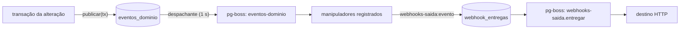
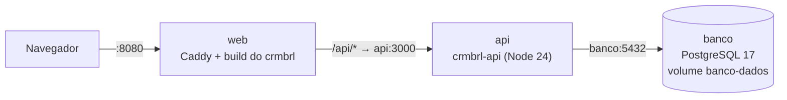
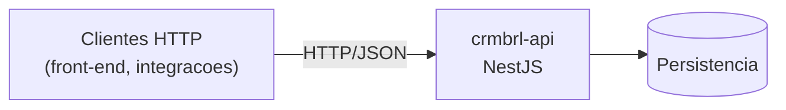

# Arquitetura — crmbrl-api

## Contexto

<!-- Escreva aqui, a mao, o porque das decisoes. Esta secao nunca e sobrescrita. -->

API HTTP do BRL CRM — a única fonte de regra de negócio do produto. Atende o
front-end `crmbrl`. A Fase 1 (núcleo do CRM) está implementada: autenticação por
sessão, usuários e hierarquia com desligamento e encaminhamento, contatos e
empresas com deduplicação e LGPD, funis em kanban com passagens automáticas e
rodízio, atividades com lembretes, auditoria e logs técnicos consultáveis,
webhooks de entrada e de saída, notificações internas e a configuração inicial.
As regras ficam em [REGRAS-DE-NEGOCIO.md](REGRAS-DE-NEGOCIO.md) (códigos R…,
citados nos testes); os 15 cenários de aceitação da seção 13 têm teste de
integração contra um PostgreSQL real.

### Inicialização

1. `src/main.ts` carrega o `.env` com `process.loadEnvFile()` **só se o arquivo
   existir** — no container as variáveis vêm do ambiente. O que já está definido
   no ambiente tem prioridade sobre o arquivo.
2. `lerAmbiente()` (`src/config/ambiente.ts`) lê e valida as variáveis. Erro de
   configuração encerra o processo (código 1) com a lista do que corrigir, sem
   repetir valores secretos (`DATABASE_URL`, chave, senhas). Avisos que não
   impedem a subida (ex.: chave de criptografia de desenvolvimento) vão para o log.
3. `criarLogger()` (`src/logs/logger.ts`) monta o `ConsoleLogger` do Nest: JSON
   em produção (`LOG_FORMATO`), com campos sensíveis mascarados.
4. `carregarObservabilidade()` (`src/observabilidade.ts`) importa o
   `@nestjs/observe` — import dinâmico, o pacote é só ESM — apenas quando
   `OBSERVE_APP_KEY` e `OBSERVE_APP_SECRET` existem.
5. `NestFactory.create(AppModule.forRoot(ambiente, observe), OPCOES_DA_APLICACAO)`
   — `bodyParser: false` (os parsers são registrados à mão, com limites) e
   `rawBody: true` (o corpo bruto fica em `req.rawBody`, para o HMAC dos
   webhooks). O módulo raiz é dinâmico: recebe o ambiente já validado.
6. `configurarAplicacao()` (`src/aplicacao.ts`, o mesmo dos testes): CORS (só
   com `CORS_ORIGENS`, com credenciais), prefixo global `api`, versionamento por
   URI com versão padrão `1` (`/api/v1/...`), `trust proxy` = 1 (a API fica atrás
   do Caddy), sem `X-Powered-By`, o **middleware de requisição**
   (`X-Request-Id`, contexto e log HTTP), os body parsers (JSON até 1 MB,
   formulário até 256 KB), a reabertura do contexto e o `ValidationPipe` global.
7. `configurarDocumentacao()` (`src/documentacao.ts`): Swagger em `/api/docs` e
   `/api/docs-json`; com `DOCS_PUBLICAS=false` (padrão em produção) um middleware
   exige sessão de Admin antes.
8. Na inicialização dos módulos (antes do `listen`): o `FilaService` sobe o
   pg-boss (schema `pgboss`; com o banco fora, tenta de novo em segundo plano);
   a **configuração inicial** (`SeedsService`) roda numa transação com trava
   consultiva e cria só o que falta — funis-base e etapas (R5.2), as duas
   passagens (R5.7), os rodízios por área (R5.8) e, com a base sem usuários, o
   Admin de `ADMIN_EMAIL` com troca de senha obrigatória (R2.6); com
   `PROCESSAR_FILAS=true`, os módulos registram os trabalhadores e agendamentos
   (abaixo) e o despachante da outbox começa a rodar a cada segundo.
9. `enableShutdownHooks()` e `listen(PORT ?? 3000)`. No SIGTERM o Nest para os
   módulos na ordem inversa: módulos de negócio, depois eventos e fila (o pg-boss
   espera os jobs em curso) e por último o Prisma, que encerra o pool.

### Ciclo de uma requisição

1. **Middleware de requisição** (`src/logs/requisicao.middleware.ts`): aceita o
   `X-Request-Id` do cliente (curto e sem caracteres estranhos) ou gera um,
   devolve-o em toda resposta (R3.7), cria o contexto da requisição (id, IP, user
   agent) e, ao terminar, escreve o log HTTP estruturado (R3.6). A rota do log é
   o padrão casado (`/api/v1/negocios/:id`), nunca a URL crua. `GET /api/saude`
   com 200 não entra no log.
2. **Body parsers** e **reabertura do contexto** (`AsyncLocalStorage`, em
   `src/comum/contexto`): `contextoAtual()` responde, em qualquer ponto do
   código, quem é o ator, o IP e o id da requisição.
3. **Guards globais** (`src/auth`), nesta ordem: `OrigemGuard` (CSRF por origem,
   R2.9: métodos que alteram dados precisam de `Origin`/`Referer` em
   `ORIGENS_PERMITIDAS`; `@SemVerificacaoDeOrigem()` isenta), `SessaoGuard`
   (cookie `crmbrl_sessao` → sessão válida de usuário ativo; `@Publico()` libera;
   troca de senha pendente só deixa passar `auth/eu`, `auth/senha` e `auth/sair`)
   e `PapeisGuard` (`@Papeis(...)`).
4. **`ValidationPipe`** com lista branca: campo desconhecido é erro.
5. **Handler** — toda alteração numa transação Prisma com a auditoria (R3.1), os
   eventos de domínio (R10.1) e as notificações (R10.2) da mesma operação.
6. **Filtro global de erros** (`src/comum/erros`): toda falha sai como
   `{ statusCode, erro, mensagem, detalhes?, requisicaoId }`. Erros do Prisma
   conhecidos viram 404/409 (deadlock e conflito de serialização viram 409
   "tente de novo"); 500 não mostra detalhe e vai para os logs técnicos.

### Contexto, auditoria e efeitos colaterais

Toda escrita segue o mesmo molde, dentro de **uma** `prisma.$transaction`:

```ts
await this.prisma.$transaction(async (tx) => {
  const negocio = await tx.negocio.update({ … });             // a mudança
  await this.auditoria.registrar(tx, { acao: 'negocio.movido', … }); // R3.1
  await this.eventos.publicar(tx, 'negocio.movido', { … });        // outbox, R10.1
  await this.notificacoes.notificar(tx, responsavelId, { … });     // R10.2
});
```

- **Quem fez**: o `AuditoriaService` e a outbox leem o ator de
  `contextoAtual()` — o usuário que o `SessaoGuard` pôs no contexto, com IP,
  user agent e id da requisição. Fora de uma requisição de usuário o código roda
  em `executarComoAtor(ator, fn)`: `WEBHOOK` (processamento de um recebimento,
  com o nome do ponto e o IP de quem chamou), `AUTOMACAO` (passagens entre
  funis, "Passagem <nome>", guardando quem disparou) e `SISTEMA` (configuração
  inicial, lembretes, retenção).
- **Linha do tempo** (R3.5): cada evento de auditoria guarda em `relacionados`
  as entidades ligadas (`contato:<id>`, `empresa:<id>`, `negocio:<id>`…). O
  `LinhaDoTempoService` (módulo de contatos, exportado) junta esses eventos e as
  atividades visíveis numa só lista paginada, para contato, empresa e negócio.
- **Concorrência**: deduplicação de contato (R4.2), CNPJ, negócio automático
  (R5.6), rodízio (R5.8), passagens (R5.7) e mudanças de hierarquia usam travas
  consultivas (`travarChave`) ou `SELECT … FOR UPDATE` antes de procurar; os
  índices únicos parciais são a última barreira. O desligamento é repetido
  sozinho quando o banco o aborta por deadlock.
- Se qualquer passo falha, nada fica: nem a mudança, nem a auditoria, nem o
  evento, nem a notificação. Os testes de integração conferem isso por módulo.

### Outbox, fila e jobs



1. `EventosDominioService.publicar(tx, tipo, dados)` grava o evento na mesma
   transação da alteração, com o ator.
2. O despachante (a cada 1 s, com `PROCESSAR_FILAS=true`) cria um job
   `eventos-dominio` por evento pendente, na mesma transação que marca
   `enfileiradoEm` (adapter `fromPrisma` do pg-boss): nada se perde se a API cair.
3. O trabalhador entrega o evento aos manipuladores registrados
   (`registrarManipulador(tipo, fn, nome)`) e guarda quais concluíram; numa
   falha, o pg-boss reentrega e só os que faltam rodam. Entrega "pelo menos uma
   vez": os manipuladores são idempotentes.

Manipuladores da Fase 1: `webhooks-saida:<evento>`, um por evento da R9.2, cria
uma entrega por destino ativo que assina o evento (única por destino e evento);
`webhooks-entrada:lgpd` e `webhooks-saida:lgpd`, em `contato.anonimizado`,
apagam os dados pessoais dos recebimentos e das entregas daquele contato
(R4.6). Notificações não passam pela outbox: são gravadas na própria transação.

| Fila (pg-boss) | Quem cria o job | O que faz |
| --- | --- | --- |
| `eventos-dominio` | despachante da outbox | entrega o evento aos manipuladores |
| `webhooks-entrada.processar` | `POST /webhooks/entrada/:token`, na transação do recebimento | mapeia, deduplica, cria ou reconverte o negócio, distribui (R8.5); até 3 tentativas, só para falha passageira |
| `webhooks-saida.entregar` | manipulador da outbox, reenvio, nova tentativa | envia o envelope assinado (R9.3); cada nova tentativa (1 min … 24 h, R9.4) é um job novo, agendado na transação do resultado |
| `atividades.lembretes` | agendamento `*/15 * * * *` (America/Sao_Paulo) | avisa 1 h antes do vencimento e uma vez no atraso (R6.5) |
| `administracao.retencao` | agendamento `30 3 * * *` (America/Sao_Paulo) | apaga logs técnicos e recebimentos de webhook com mais de 90 dias, em lotes (R3.6, R8.6) |

Nos testes, `PROCESSAR_FILAS=false`: nada roda sozinho, e os utilitários
`processarEventos()` e `drenarFilas()` executam a outbox e as filas na hora.

### Módulos

- `AppModule` (raiz, dinâmico) importa, nesta ordem: `ObserveModule` (quando
  ligado), `AmbienteModule`, `PrismaModule`, `LogsModule`, `ComumModule`,
  `EmailModule`, `FilaModule`, `EventosModule`, `AuditoriaModule`,
  `NotificacoesModule`, `AuthModule`, `SeedsModule`, `SaudeModule` e os módulos
  de negócio (`UsuariosModule`, `ContatosModule`, `FunisModule`,
  `AtividadesModule`, `AuditoriaConsultaModule`, `AdministracaoModule`,
  `WebhooksModule`). Os de infraestrutura são globais: qualquer módulo injeta os
  serviços deles sem importá-los.
- `AmbienteModule`: o ambiente validado, pelo token `AMBIENTE`. Nenhum outro
  arquivo de `src/` lê `process.env`.
- `PrismaModule`: o `PrismaService` (client gerado + `PrismaPg`) e o tipo `Tx`
  das transações; `travarChave()` (`src/prisma/travas.ts`) para travas
  consultivas.
- `LogsModule`: `LogsTecnicosService` — 5xx, avisos e falhas de jobs gravados em
  `logs_tecnicos` (R3.6).
- `ComumModule`: `CriptografiaService` (scrypt, tokens, SHA-256, AES-256-GCM,
  HMAC) e o filtro global de erros. Em `src/comum` ficam também o contexto, as
  exceções, a paginação, a validação e os utilitários de domínio (papéis e
  permissões, e-mail, telefone, CNPJ, etiquetas, UTM, valores).
- `EmailModule`: `EmailService` (nodemailer; sem SMTP só registra no log).
- `FilaModule`: `FilaService` sobre o pg-boss (schema `pgboss`).
- `EventosModule`: `EventosDominioService` — outbox (R10.1).
- `AuditoriaModule`: `AuditoriaService` — gravação da auditoria (R3.1).
- `NotificacoesModule`: `NotificacoesService` e os endpoints do usuário (R10.2).
- `AuthModule`: login, sessões, senhas e os guards globais (R2).
- `SeedsModule`: a configuração inicial idempotente, rodada a cada subida.
- `SaudeModule`: `GET /api/saude` (abaixo).

Módulos de negócio (Fase 1), cada um na sua pasta de `src/`:

| Módulo | Regras | O que expõe a outros módulos |
| --- | --- | --- |
| `UsuariosModule` (`usuarios/`) | R1, R2.8 (senha temporária, convite), R7 (desligamento, reativação), visão de equipe | `UsuariosService` (exportado; nenhum outro módulo usa na Fase 1) |
| `ContatosModule` (`contatos/`) | R4 (contatos e empresas), R3.5 (linha do tempo) | `ContatosService.encontrarOuCriar(tx, …)` (deduplicação, usada pelos webhooks) e `definirResponsavelSeVazio`, `EmpresasService`, `LinhaDoTempoService` |
| `FunisModule` (`funis/`) | R5 (funis, etapas, negócios, kanban, passagens, rodízio, visibilidade, métricas) | `NegociosService.criarAutomatico(tx, …)` (cria ou reconverte, distribui, notifica e roda as passagens) e `DistribuicaoService.escolherResponsavel(tx, …)` |
| `AtividadesModule` (`atividades/`) | R6, incluindo o job de lembretes | `AtividadesService`, `LembretesAtividadesService` (usados pelos testes) |
| `AuditoriaConsultaModule` (`auditoria/consulta/`) | R3.4 (consulta com filtros e cursor) | `AuditoriaConsultaService` |
| `AdministracaoModule` (`administracao/`) | logs técnicos e resumo do Admin, retenção de 90 dias (R3.6, R8.6) | `RetencaoService` |
| `WebhooksModule` (`webhooks/`) | R8 (entrada) e R9 (saída) | — |

Dependências entre eles: `WebhooksModule` importa `ContatosModule` e
`FunisModule`; `FunisModule` importa `ContatosModule` (linha do tempo do
negócio). O desligamento (`UsuariosModule`) escreve direto, na própria
transação, nas tabelas de atividades, negócios, contatos, empresas, rodízios,
webhooks de entrada e passagens (responsável fixo) — é o único ponto que mexe
em dados de vários módulos de uma vez; a anonimização de contato também
reescreve títulos de negócios e atividades. A visibilidade de negócios (R5.9) e
de atividades (R6.4) sai de `permissoesDoPapel` (`src/comum/dominio`), a mesma
matriz que o `auth/eu` devolve ao front.

### Jornada de um lead (como os módulos conversam)

1. `POST /api/v1/webhooks/entrada/{token}` (público, autenticado pelo token e,
   com segredo, pelo HMAC do corpo bruto) grava o recebimento e o job
   `webhooks-entrada.processar` na mesma transação e responde `202` (R8.4).
2. O job, como ator `WEBHOOK`, aplica o mapeamento (Genérico, Disparos BRL ou
   personalizado), chama `encontrarOuCriar` (cria o contato ou registra
   `contato.reconvertido`, R4.2) e `criarAutomatico` (negócio em Marketing /
   Novo lead, ou reconversão no aberto, R5.6), que escolhe o responsável pelo
   rodízio (R5.8) e o notifica; o contato sem responsável fica com o do negócio
   (R4.5).
3. Quem trabalha o lead move o negócio (`POST /negocios/:id/mover`). Ao entrar
   em "Qualificado (MQL)", a passagem Marketing → Comercial roda **na mesma
   transação** (ator `AUTOMACAO`): cria o negócio no Comercial / Novo, ligado ao
   de origem, distribuído e notificado — uma única vez por negócio de origem.
4. O Comercial ganha o negócio: status `GANHO`, `ganhoEm`, evento
   `negocio.ganho` e a passagem Comercial → CS (Boas-vindas, com valor e valor
   recorrente).
5. Cada passo fica na auditoria (consulta em `GET /auditoria`, linha do tempo
   em `/contatos/:id/linha-do-tempo` e `/negocios/:id/linha-do-tempo`) e os
   eventos públicos vão aos webhooks de saída pela outbox.
6. Quem é desligado (`POST /usuarios/:id/desligar`) perde o acesso na hora e o
   que estava aberto com ele vai para o líder (ou para o C-level, se era líder).

O teste `test/integracao.e2e-spec.ts` percorre essa jornada inteira.

### Persistência (Prisma 7)

- Schema em `prisma/schema.prisma`. Generator `prisma-client` com saída em
  `src/generated/prisma` (fora do git), `moduleFormat = "cjs"` e imports sem
  extensão (`importFileExtension = ""`) — assim o client funciona no `tsc`, no
  Jest e no Node sem mapeamento extra.
- `prisma.config.ts` define o schema, a pasta das migrations e o
  `datasource.url`. A URL vem de `process.env.DATABASE_URL`, e não do `env()` do
  Prisma, que falharia no `prisma generate` do build (onde não há banco). O
  arquivo também carrega o `.env` quando ele existe.
- Migrations em `prisma/migrations/`, geradas pelo `prisma migrate dev` e nunca
  editadas depois de aplicadas. O que o Prisma não gera — CHECKs e gatilhos — é
  acrescentado à mão no fim da migration (gerada com `--create-only`) antes da
  primeira aplicação; o `migrate dev` seguinte não propõe removê-lo. A primeira,
  `20261020183550_inicial`, cria o enum `papel` e a tabela `usuarios`; a
  segunda, `20261020224552_fase1_nucleo`, cria todo o modelo da Fase 1.
- Índices únicos parciais (preview `partialIndexes`, declarados no schema com
  `where`): e-mail e telefone de contatos não excluídos (R4.2), CNPJ de empresas
  não excluídas (R4.4), um funil-base por área (R5.1) e uma etapa de ganho e uma
  de perda por funil (R5.2). Eles aparecem no `findUnique` do client, mas não
  garantem registro único (excluídos repetem o valor): use `findFirst`.
- Escritos à mão na `fase1_nucleo`: e-mail do usuário e do contato normalizados,
  telefone em E.164, contato com algum meio de contato (ou excluído), formato do
  CNPJ (numérico ou alfanumérico) e da UF, valores não negativos, prazo e
  probabilidade das etapas, funil-base nunca excluído (R5.1), passagem entre
  funis diferentes, período da reunião;
  o gatilho que recusa `UPDATE`, `DELETE` e `TRUNCATE` em `eventos_auditoria`
  (R3.3) e o que recusa mudar a primeira origem do contato (R4.3, salvo na
  anonimização).
- Convenção: modelos em PascalCase, no singular e em português; tabelas e
  colunas em snake_case, tabelas no plural, via `@@map`/`@map`; datas em
  `timestamptz(3)`. `usuarios.lider_id` aponta para o líder (membro → líder da
  área; líder → C-level), com `ON DELETE SET NULL`. É a base da regra de
  desligamento: as atividades de quem sai vão para esse líder.
- O client é gerado antes de `build`, `test`, `test:e2e` e `lint` (scripts
  `pre*`) e depois de `prisma:migrar`, porque no Prisma 7 o `migrate dev` não
  gera mais sozinho.

### `GET /api/saude` — contrato com o front

Responde **200** quando a API e o banco respondem e **503**, com o mesmo corpo,
quando o banco falha. Vai com `Cache-Control: no-store`. É o que o healthcheck do
Docker consulta e o que o card "Status do sistema" do front mostra.

```json
{
  "status": "ok",
  "versao": "0.0.1",
  "ambiente": "production",
  "horario": "2026-10-20T18:00:00.000Z",
  "uptimeSegundos": 42,
  "banco": { "status": "ok", "latenciaMs": 3 },
  "migrations": { "aplicadas": 2, "ultima": "20261020224552_fase1_nucleo" }
}
```

Com o banco fora do ar (HTTP 503):

```json
{
  "status": "degradado",
  "versao": "0.0.1",
  "ambiente": "production",
  "horario": "2026-10-20T18:00:05.000Z",
  "uptimeSegundos": 47,
  "banco": {
    "status": "erro",
    "latenciaMs": 4,
    "erro": "Não foi possível conectar ao banco."
  },
  "migrations": null
}
```

| Campo                  | Tipo                    | Conteúdo                                                                                                                      |
| ---------------------- | ----------------------- | ----------------------------------------------------------------------------------------------------------------------------- |
| `status`               | `"ok"` ou `"degradado"` | `degradado` quando o banco falha (HTTP 503)                                                                                   |
| `versao`               | string                  | `version` do `package.json`                                                                                                   |
| `ambiente`             | string                  | `NODE_ENV`                                                                                                                    |
| `horario`              | string                  | momento da verificação, ISO 8601 em UTC                                                                                       |
| `uptimeSegundos`       | número inteiro          | segundos desde que o processo subiu                                                                                           |
| `banco.status`         | `"ok"` ou `"erro"`      | resultado do `SELECT 1`                                                                                                       |
| `banco.latenciaMs`     | número inteiro          | duração do `SELECT 1` (ou até a falha), em ms                                                                                 |
| `banco.erro`           | string, só com `"erro"` | mensagem curta e fixa por tipo de falha, com o código SQLSTATE quando houver; nunca traz host, usuário, senha nem o texto do driver |
| `migrations`           | objeto ou `null`        | `null` quando o banco falha                                                                                                   |
| `migrations.aplicadas` | número inteiro          | linhas de `_prisma_migrations` concluídas e não revertidas (0 se a tabela ainda não existe)                                   |
| `migrations.ultima`    | string ou `null`        | nome da migration concluída por último                                                                                        |

Cada consulta tem 3 s de prazo (o healthcheck do Docker espera 5 s). Se a
leitura das migrations falhar depois de um `SELECT 1` bem-sucedido, a resposta
também sai degradada. A verificação roda uma vez quando a API sobe, e o log do
servidor registra só as mudanças de estado do banco (caiu, voltou), com o
detalhe técnico que a resposta não mostra.

A tabela de endpoints do inventário abaixo lista as rotas sem o prefixo global:
na prática todas ficam em `/api`, e o que está fora dele responde 404.

### Endpoints da base — contrato com o front

Rotas em `/api/v1`. Toda resposta traz `X-Request-Id`. Requisições que alteram
dados precisam de `Origin` (ou `Referer`) permitido; o navegador manda sozinho.
O detalhe de cada campo está no Swagger (`/api/docs`).

**Erro padrão** (qualquer rota): `{ statusCode, erro, mensagem, detalhes?,
requisicaoId }`, com `erro` em `dados_invalidos` (400, `detalhes.campos: [{ campo,
mensagens }]`), `nao_autenticado` (401), `sem_permissao` (403), `nao_encontrado`
(404), `metodo_nao_permitido` (405), `conflito` (409), `desativado` (410),
`muito_grande` (413), `tipo_nao_suportado` (415), `regra_violada` (422,
`detalhes.regra`), `muitas_tentativas` (429, com `Retry-After`), `erro_interno`
(500) e `indisponivel` (503). Alguns 400 trazem também `detalhes.regra` (ex.:
`R4.1` sem meio de contato, `R5.5` perda sem motivo), e o 403 da troca de senha
pendente traz `detalhes: { regra: 'R2.7', motivo: 'troca_de_senha_pendente' }`.

| Método e rota | Login | Recebe | Devolve |
| --- | --- | --- | --- |
| `POST /auth/entrar` | não | `{ email, senha }` | 200 `Perfil` + cookie `crmbrl_sessao` (HttpOnly, SameSite=Lax, 30 dias); 401 credenciais (mensagem única), 403 desligado, 429 bloqueio (R2.5) |
| `POST /auth/sair` | sim | — | 204 e o cookie apagado |
| `GET /auth/eu` | sim | — | 200 `Perfil` |
| `POST /auth/senha` | sim | `{ senhaAtual, novaSenha }` (8 a 128) | 200 `Perfil`; encerra as outras sessões |
| `POST /auth/senha/esqueci` | não | `{ email }` | 202 `{ mensagem }` (igual exista o e-mail ou não); 422 `R2.8` sem SMTP |
| `POST /auth/senha/token` | não | `{ token }` | 200 `{ valido, tipo?, nome?, email?, expiraEm? }` |
| `POST /auth/senha/redefinir` | não | `{ token, novaSenha }` | 204; 422 `R2.8` se o link não vale |
| `GET /notificacoes?apenasNaoLidas&pagina&porPagina` | sim | — | 200 `{ itens, total, pagina, porPagina, naoLidas }` |
| `GET /notificacoes/nao-lidas/contagem` | sim | — | 200 `{ naoLidas }` |
| `POST /notificacoes/:id/marcar-lida` | sim | — | 200 `Notificacao`; 404 se não for do usuário |
| `POST /notificacoes/marcar-todas-lidas` | sim | — | 200 `{ marcadas }` |

`Perfil` = `{ usuario: { id, nome, email, papel, rotuloPapel, area, nivel, lider,
avatarUrl, telefone, ultimoAcessoEm }, deveTrocarSenha, permissoes, sessao: {
criadaEm, expiraEm } }`. `permissoes` traz a matriz da seção 12 das regras para o
papel: booleanos (`gerenciarUsuarios`, `anonimizarContatos`,
`configurarPassagens`, `gerenciarWebhooks`, `verAuditoria`, `verLogsTecnicos`,
`verDocumentacaoApi`, `verContatos`), alcances `TODOS`/`AREA`/`EQUIPE`/
`PROPRIOS`/`NENHUM` (`verUsuarios`, `configurarFunis`, `verNegocios`,
`reabrirNegocios`, `editarContatos`, `verAtividades`, `configurarRodizio`) e
`areasVisiveis`. Com `deveTrocarSenha`, as outras rotas devolvem 403 com
`detalhes.motivo = "troca_de_senha_pendente"` (R2.7). Os links dos e-mails levam
a `URL_PUBLICA/definir-senha?token=…` (convite) e
`URL_PUBLICA/redefinir-senha?token=…` (redefinição): telas a criar no front.

### Endpoints dos módulos de negócio — contrato com o front

Todas exigem login (exceto o endereço público do webhook de entrada) e ficam em
`/api/v1`. "Quem" é o papel exigido pela rota; dentro dela, o recorte de
visibilidade das regras (R1.5, R5.9, R6.4, §12) vale sempre: o que o usuário não
vê responde **404**, não 403. Listas paginadas respondem `{ itens, total, pagina,
porPagina }` (`?pagina&porPagina`, máximo 100); auditoria e logs, `{ itens,
proximoCursor }` (`?cursor&limite`). Valores em reais são strings decimais
(`"1500.00"`); datas, ISO 8601 com fuso. Campos e filtros completos: Swagger.

**Usuários** (`UsuariosController`, `DesligamentoController`)

| Método e rota | Quem | Recebe → devolve |
| --- | --- | --- |
| `GET /usuarios` | todos (C-level vê todos; líder, a equipe; membro, a si) | `?busca&papel&area&ativo&liderId` → página de `Usuario` |
| `GET /usuarios/equipes` | Admin, C-level, líderes | `?liderId&area` → `[{ lider, area, membros: [{ usuario, indicadores: { atividadesPendentes, atividadesAtrasadas, negociosAbertos, valorEmAberto, contatos }, aguardandoNovoLider }] }]` |
| `GET /usuarios/:id` | dentro do recorte | `Usuario` |
| `POST /usuarios` | Admin | `{ nome, email, papel, liderId?, telefone?, avatarUrl?, senhaTemporaria? }` → 201; sem senha temporária envia convite (422 `R2.8` sem SMTP); 409 `R1.1`; 422 `R1.2` |
| `PATCH /usuarios/:id` | Admin | mesmos campos (parciais) → 200; 422 `R1.2`/`R1.3` (com `detalhes.liderados`)/`R1.4` |
| `POST /usuarios/:id/senha-temporaria` | Admin | `{ senha }` → 200; revoga as sessões e exige troca (R2.8) |
| `POST /usuarios/:id/convite` | Admin | — → 202; 422 `R2.8` sem SMTP |
| `GET /usuarios/:id/desligamento/previa` | Admin | `?destinatarioId` → `{ usuario, destinatario, motivoDestinatario, explicacao, exigeEscolha, candidatos, ignorados, contagens, liderados, alertaEquipeSemLider }` (R7.1) |
| `POST /usuarios/:id/desligar` | Admin | `{ destinatarioId? }` (obrigatório para C-level) → 200 `{ usuario, destinatario, motivoDestinatario, contagens }`; 409 já desligado (R7.6) ou destinatário diferente do calculado |
| `POST /usuarios/:id/reativar` | Admin | `{ liderId?, papel? }` → 200; 422 `R1.2` (R7.5) |

**Contatos e empresas** (`ContatosController`, `EmpresasController`)

| Método e rota | Quem | Recebe → devolve |
| --- | --- | --- |
| `GET /contatos` | todos | busca por nome, e-mail ou telefone; filtros de responsável, empresa, origens, etiqueta e opt-out → página de `Contato` (com `podeEditar`) |
| `GET /contatos/etiquetas` | todos | → etiquetas em uso |
| `POST /contatos` | todos | `{ nome, email?, telefone?, cargo?, empresaId?, empresaNome?, responsavelId?, origem?, origemDetalhe?, utm?, etiquetas?, camposPersonalizados?, optOutMarketing?, consentimento? }` → 201 `{ criado, contato }` (também quando reconverte, R4.2); 400 `R4.1` |
| `GET /contatos/:id` · `PATCH /contatos/:id` | todos · quem edita (§12) | `Contato` · campos parciais → 200; 409 e-mail/telefone de outro contato |
| `POST /contatos/:id/anonimizar` | Admin | → 204 (R4.6) |
| `GET /contatos/:id/linha-do-tempo` | todos | `?incluir=tudo\|eventos\|atividades&pagina&porPagina` → página de `{ tipo: 'evento'\|'atividade', ocorridoEm, evento?, atividade? }` (R3.5) |
| `GET /empresas` · `GET /empresas/etiquetas` · `GET /empresas/:id` | todos | página de `Empresa` (com `cnpjFormatado`, `podeEditar`) · etiquetas · detalhe |
| `POST /empresas` · `PATCH /empresas/:id` | todos · quem edita | `{ nome, cnpj?, site?, email?, telefone?, segmento?, cidade?, uf?, responsavelId?, etiquetas?, camposPersonalizados? }` → 201/200; 409 CNPJ repetido; 400 CNPJ inválido (R4.4) |
| `GET /empresas/:id/linha-do-tempo` | todos | como a do contato |

**Funis, negócios, passagens e rodízio** (`FunisController`, `NegociosController`, `PassagensController`, `DistribuicaoController`)

| Método e rota | Quem | Recebe → devolve |
| --- | --- | --- |
| `GET /funis` · `GET /funis/:id` | quem vê a área | funis visíveis com as etapas em ordem |
| `POST /funis` · `PATCH /funis/:id` · `DELETE /funis/:id` | Admin, C-level, líder da área | `{ nome, area, descricao?, etapas? }` → 201; renomear, reordenar, arquivar, reativar; excluir só funil extra (R5.1) → 204 |
| `POST /funis/:id/etapas` · `POST /funis/:id/etapas/reordenar` · `PATCH`/`DELETE /funis/:id/etapas/:etapaId` | Admin, C-level, líder da área | etapa nova (aberta), nova ordem, nome/prazo/probabilidade; etapa com negócios não sai (R5.2) |
| `GET /funis/:id/quadro` | quem vê a área | kanban: etapas com cartões, totais, valor e parados; filtros meus/equipe/todos, sem responsável, responsável, busca, etiqueta |
| `GET /funis/:id/metricas` | quem vê a área | `?de&ate&responsavelId` → conversão, tempo médio por etapa, ciclo médio, parados (R5.10) |
| `GET /negocios` · `GET /negocios/:id` | recorte R5.9 | `?funilId&etapaId&status&contatoId&empresaId&parados…` → página de `Negocio` · detalhe |
| `POST /negocios` | quem vê o funil | `{ contatoId, funilId, etapaId?, titulo?, empresaId?, responsavelId?, valor?, valorRecorrente?, previsaoFechamento?, … }` → 201 (criação manual livre, R5.6) |
| `PATCH /negocios/:id` · `DELETE /negocios/:id` | recorte R5.9 · líder da área, C-level, Admin | dados do negócio (a etapa muda por `mover`) · exclusão lógica → 204 |
| `POST /negocios/:id/mover` | recorte R5.9 | `{ etapaId, motivoPerda?, antesDeId?, depoisDeId? }` → 200 `{ negocio, passagens: [{ negocioDestinoId, criado, responsavel }] }`; 400 `R5.5` perda sem motivo; 422 etapa de outro funil (R5.4); 403 `R5.5` tirar de etapa fechada sem poder reabrir |
| `POST /negocios/:id/reabrir` | líder da área, C-level, Admin | `{ etapaId? }` → 200 (R5.5) |
| `POST /negocios/:id/assumir` | recorte R5.9 (quem vê o negócio sem responsável) | → 200; 409 se já tem responsável (R5.9) |
| `GET /negocios/:id/movimentacoes` · `GET /negocios/:id/linha-do-tempo` | recorte R5.9 | histórico de etapas (R5.4) · linha do tempo (R3.5) |
| `GET`/`POST /passagens` · `GET`/`PATCH`/`DELETE /passagens/:id` | Admin, C-level | `{ nome, etapaGatilhoId, etapaDestinoId, estrategia?, responsavelFixoId?, ativa? }` (R5.7) |
| `GET /regras-distribuicao` · `GET`/`PATCH /regras-distribuicao/:area` | Admin, C-level, líder da área | rodízio da área: participantes em ordem, ajustes, próximo da vez · `{ incluirLideres }` |
| `PUT`/`DELETE /regras-distribuicao/:area/participantes/:usuarioId` | Admin, C-level, líder da área | `{ participa }` (ajuste manual) · desfaz o ajuste |

**Atividades** (`AtividadesController`)

| Método e rota | Quem | Recebe → devolve |
| --- | --- | --- |
| `POST /atividades` | todos | `{ tipo, titulo, descricao?, prioridade?, venceEm?, inicioEm?, fimEm?, responsavelId?, contatoId?, empresaId?, negocioId?, concluida? }` → 201 (reunião exige início e fim; nota nasce concluída) |
| `GET /atividades` | recorte R6.4 | `?escopo=MINHAS\|EQUIPE\|TODAS&tipo&status&prioridade&atrasadas&de&ate&contatoId&empresaId&negocioId&encaminhadas&busca&fusoHorario&ordem` → página de `Atividade` (com `atrasada` e `grupo` calculados, `encaminhadaDe`/`encaminhadaEm`) |
| `GET /atividades/agrupadas` | recorte R6.4 | `?limitePorGrupo&fusoHorario` → `ATRASADAS`, `HOJE`, `PROXIMOS_7_DIAS`, `MAIS_TARDE`, `SEM_DATA`, `CONCLUIDAS` com total e primeiras atividades |
| `GET`/`PATCH /atividades/:id` | recorte R6.4 | detalhe · alteração |
| `POST /atividades/:id/concluir` · `/cancelar` · `/reabrir` | recorte R6.4 | → 200; 409 mudança de status inválida; 422 `R6.2` em nota |

**Auditoria e administração** (`AuditoriaConsultaController`, `AdministracaoController`)

| Método e rota | Quem | Recebe → devolve |
| --- | --- | --- |
| `GET /auditoria` | Admin, C-level | `?de&ate&usuarioId&acao&entidade&entidadeId&texto&tipoAtor&requisicaoId&incluirRelacionados&cursor&limite` → `{ itens, proximoCursor }` (R3.4; `ate` exclusivo; texto sem acento nem maiúscula) |
| `GET /auditoria/filtros` | Admin, C-level | → `{ acoes, entidades, tiposAtor }` |
| `GET /auditoria/:id` | Admin, C-level | → detalhe com `alteracoes: [{ campo, antes, depois }]`, `dados`, `relacionados`, IP, user agent |
| `GET /administracao/logs-tecnicos` · `/:id` | Admin | `?nivel&de&ate&origem&usuarioId&requisicaoId&texto&cursor&limite` → `{ itens, proximoCursor }` · detalhe com a pilha (R3.6) |
| `GET /administracao/resumo` | Admin | `?horas` (1 a 168) → `{ periodo, auditoria, logsTecnicos, eventosDominio, webhooks, retencao }` |

**Webhooks** (`WebhooksEntradaController`, `WebhookEntradaPublicoController`, `WebhooksSaidaController`)

| Método e rota | Quem | Recebe → devolve |
| --- | --- | --- |
| `POST /webhooks/entrada/:token` | **público** (token na URL; `X-Assinatura: sha256=<hex>` se houver segredo) | JSON ou formulário até 256 KB → 202 `{ id, status }`; 401 assinatura (R8.3), 404 token, 410 desativado, 413, 415, 429 com `Retry-After` (R8.7) |
| `GET /webhooks/entradas/modelos` · `POST /webhooks/entradas/previa` | Admin | modelos `GENERICO`, `DISPAROS_BRL`, `PERSONALIZADO` · prévia do mapeamento sobre um JSON de exemplo |
| `GET`/`POST /webhooks/entradas` · `GET`/`PATCH`/`DELETE /webhooks/entradas/:id` | Admin | `{ nome, funilId?, etapaId?, estrategia?, responsavelFixoId?, modeloMapeamento?, mapeamento?, etiquetasFixas?, segredo?, gerarSegredo?, ativo? }` → 201 com `url` completa e `segredo` (só nesta resposta) |
| `POST /webhooks/entradas/:id/regenerar-token` · `POST`/`DELETE /webhooks/entradas/:id/segredo` · `POST /webhooks/entradas/:id/previa` | Admin | nova URL (a antiga dá 404 na hora) · define/remove o segredo HMAC · prévia sobre um recebimento guardado |
| `GET /webhooks/entradas/:id/recebimentos` · `/:recebimentoId` · `POST …/:recebimentoId/reprocessar` | Admin | recebimentos (R8.6) · detalhe com corpo e cabeçalhos · 202 reprocessa; 409 se já `PROCESSADO` |
| `GET /webhooks/saidas/eventos` | Admin | eventos assináveis (R9.2) |
| `GET`/`POST /webhooks/saidas` · `GET`/`PATCH`/`DELETE /webhooks/saidas/:id` | Admin | `{ nome, url, eventos, cabecalhos?, ativo? }` → 201 com o `segredo` (só nesta resposta); 422 `R9.1` URL interna/SSRF |
| `POST /webhooks/saidas/:id/regenerar-segredo` · `POST /webhooks/saidas/:id/testar` | Admin | novo segredo · envia `webhook.teste` na hora e devolve o resultado |
| `GET /webhooks/saidas/:id/entregas` · `/:entregaId` · `POST …/:entregaId/reenviar` | Admin | entregas (R9.5) · envelope e tentativas · 202 recomeça as tentativas |

**Envelope dos webhooks de saída** (R9.3): corpo `{ id, evento, ocorridoEm, dados }`
(o `id` é o do evento na outbox, igual em todas as tentativas — use-o para
idempotência, R9.6) e os cabeçalhos `X-CRM-Evento`, `X-CRM-Entrega`,
`X-CRM-Timestamp` e `X-CRM-Assinatura: sha256=<HMAC-SHA256(segredo, timestamp + "." + corpo)>`.
Eventos: `contato.criado`, `contato.atualizado`, `negocio.criado`,
`negocio.movido`, `negocio.ganho`, `negocio.perdido`, `atividade.criada`,
`atividade.concluida`, `usuario.desligado` e `webhook.teste`. Outros eventos de
domínio (`contato.reconvertido`, `contato.anonimizado`, `empresa.*`,
`negocio.atualizado`, `negocio.reaberto`, `negocio.reconvertido`,
`negocio.excluido`) ficam só na outbox, para uso interno.

**Notificações** (`tipo`, em `src/notificacoes/tipos-notificacao.ts`):
`negocio.atribuido`, `contato.atribuido`, `empresa.atribuida`,
`passagem.recebida`, `desligamento.itens_recebidos`, `atividade.vencendo`,
`atividade.atrasada`, `webhook_saida.falhou`, `webhook_saida.desativado` e
`equipe.sem_lider`. Os `link` apontam para telas do front (`/atividades?atividade=…`,
`/administracao/usuarios`, `/integracoes?webhookSaida=…`, …).

### Variáveis de ambiente

| Variável | Padrão | Uso |
| --- | --- | --- |
| `DATABASE_URL` | — (obrigatória) | Conexão com o PostgreSQL; lida também pelo CLI do Prisma e pelo pg-boss |
| `PORT` | `3000` | Porta HTTP |
| `NODE_ENV` | `development` | Ambiente; em `production` exige `URL_PUBLICA` e `CHAVE_CRIPTOGRAFIA` |
| `CORS_ORIGENS` | vazio | Origens do CORS (com credenciais); vazio = CORS desligado |
| `OBSERVE_APP_KEY`, `OBSERVE_APP_SECRET` | vazias | Chaves do `@nestjs/observe`; ele só liga com as duas |
| `URL_PUBLICA` | `http://localhost:4200` fora de produção | Base dos links de e-mail e dos endereços de webhook |
| `ORIGENS_PERMITIDAS` | a origem da `URL_PUBLICA` | Origens aceitas nas requisições que alteram dados (R2.9) |
| `COOKIE_SEGURO` | `true` em produção | `Secure` no cookie de sessão |
| `CHAVE_CRIPTOGRAFIA` | chave de desenvolvimento, com aviso | 32 bytes (base64/hex) do AES-256-GCM (R10.3) |
| `SESSAO_INATIVIDADE_DIAS`, `SESSAO_DURACAO_MAXIMA_DIAS`, `SESSAO_RENOVACAO_MINUTOS` | `7`, `30`, `5` | Validade das sessões (R2.2) |
| `ADMIN_EMAIL`, `ADMIN_NOME`, `ADMIN_SENHA_INICIAL` | vazio, `Administrador`, vazia | Admin do primeiro acesso (R2.6); sem senha, uma é gerada e mostrada no log |
| `SMTP_HOST`, `SMTP_PORTA`, `SMTP_SEGURO`, `SMTP_USUARIO`, `SMTP_SENHA`, `SMTP_REMETENTE` | vazias, `587` | E-mail; sem `SMTP_HOST`, convite e redefinição por e-mail ficam indisponíveis (R2.8) |
| `WEBHOOKS_PERMITIR_REDE_INTERNA` | `false` | Libera webhooks de saída para rede interna (R9.1) |
| `DOCS_PUBLICAS` | `true` fora de produção | `/api/docs` aberto; senão, só Admin |
| `PROCESSAR_FILAS` | `true` | Trabalhadores, agendamentos e despachante de eventos |
| `LOG_FORMATO` | `json` em produção | `json` ou `texto` |
| `MIGRAR_AO_INICIAR` | `true` | Só no container: `false` pula o `prisma migrate deploy` do entrypoint |
| `DATABASE_URL_TESTE` | — | Só nos testes de integração (banco descartável) |

O `docker-compose.yml` lê ainda `BANCO_USUARIO`, `BANCO_SENHA`, `BANCO_NOME`,
`BANCO_PORTA`, `API_PORTA`, `WEB_PORTA` e `FRONT_DIR`, e monta as variáveis da
API a partir do `.env` ao lado dele, com padrões para uso local em http. Todas
estão documentadas no `.env.example`.

### Topologia (Docker)



- Projeto compose `crmbrl`, versionado neste repositório. O serviço `web` é
  construído a partir de `${FRONT_DIR:-../crmbrl}`.
- Portas publicadas: `web` em 8080 (a porta de entrada do CRM), `api` só em
  `127.0.0.1:3000` e `banco` só em `127.0.0.1:5434`. O front fala com a API pela
  rede do compose (`api:3000`), pelo Caddy.
- Ordem de subida pelos healthchecks: `banco` saudável (`pg_isready`) → `api`
  (o entrypoint aplica as migrations; o `HEALTHCHECK` da imagem consulta
  `/api/saude`) saudável → `web`.
- Imagem da API em quatro estágios: dependências com `oven/bun:1-alpine`, build
  com `node:24-alpine` (`npm run build`), dependências de produção com o Bun de
  novo e runtime `node:24-alpine` como usuário `node`, com `NODE_ENV=production`
  e `CHECKPOINT_DISABLE=1` (o CLI do Prisma não consulta atualização a cada
  partida). O `docker-entrypoint.sh` roda `prisma migrate deploy` (a menos que
  `MIGRAR_AO_INICIAR=false`) e faz `exec node dist/main.js`: o Node vira o PID 1
  e recebe o SIGTERM do `docker stop`.

### Consumidores

O front-end `crmbrl` (Angular) vive em um repositório separado, com ciclo de release
próprio. Não há pacote compartilhado nem tipo exportado para ele: o contrato é só o
HTTP, então **toda mudança na tabela de endpoints do inventário é mudança de
contrato** e precisa ser descrita aqui — o que o endpoint espera e o que devolve.
O tipo da resposta de saúde fica em `src/saude/saude.service.ts` (`Saude`) e é
espelhado à mão no front.

## Inventario tecnico

<!-- doc-updater:inicio — gerado automaticamente, nao edite a mao -->

> Atualizado por `tools/doc-updater` em 21/10/2026, 16:47 a partir do commit `8ea7e65`.

### Resumo

| Item | Valor |
| --- | --- |
| Projeto | `crmbrl-api` |
| Versao | 0.0.1 |
| Framework | NestJS ^12.0.1 |
| Papel | Back-end / API |
| Gerenciador de pacotes | bun |
| Arquivos versionaveis | 269 |
| Linhas de codigo | 54.010 |
| Arquivos de teste | 56 |
| Branch | main |
| Commit documentado | `8ea7e65` |
| Repositorio remoto | https://github.com/GitBRL/crmbrl-api.git |


### Topologia



### Estrutura de pastas

| Caminho | Arquivos |
| --- | --- |
| `src/funis` | 30 |
| `src/comum` | 28 |
| `test` | 25 |
| `src/usuarios` | 24 |
| `src/webhooks` | 24 |
| `src/contatos` | 22 |
| `(raiz)` | 17 |
| `src/atividades` | 15 |
| `src/auditoria` | 13 |
| `src/auth` | 13 |
| `test/utils` | 9 |
| `src` | 7 |
| `src/administracao` | 6 |
| `src/saude` | 6 |
| `src/notificacoes` | 5 |
| `src/logs` | 4 |
| `prisma/migrations` | 3 |
| `src/config` | 3 |
| `src/email` | 3 |
| `src/eventos` | 3 |
| `src/prisma` | 3 |
| `src/seeds` | 3 |
| `src/fila` | 2 |
| `prisma` | 1 |


### Modulos

| Modulo | Arquivo |
| --- | --- |
| `AdministracaoModule` | `src/administracao/administracao.module.ts` |
| `AppModule` | `src/app.module.ts` |
| `AtividadesModule` | `src/atividades/atividades.module.ts` |
| `AuditoriaModule` | `src/auditoria/auditoria.module.ts` |
| `AuditoriaConsultaModule` | `src/auditoria/consulta/auditoria-consulta.module.ts` |
| `AuthModule` | `src/auth/auth.module.ts` |
| `ComumModule` | `src/comum/comum.module.ts` |
| `AmbienteModule` | `src/config/ambiente.module.ts` |
| `ContatosModule` | `src/contatos/contatos.module.ts` |
| `EmailModule` | `src/email/email.module.ts` |
| `EventosModule` | `src/eventos/eventos.module.ts` |
| `FilaModule` | `src/fila/fila.module.ts` |
| `FunisModule` | `src/funis/funis.module.ts` |
| `LogsModule` | `src/logs/logs.module.ts` |
| `NotificacoesModule` | `src/notificacoes/notificacoes.module.ts` |
| `PrismaModule` | `src/prisma/prisma.module.ts` |
| `SaudeModule` | `src/saude/saude.module.ts` |
| `SeedsModule` | `src/seeds/seeds.module.ts` |
| `UsuariosModule` | `src/usuarios/usuarios.module.ts` |
| `WebhooksModule` | `src/webhooks/webhooks.module.ts` |


### Endpoints HTTP

| Metodo | Rota | Controller | Handler |
| --- | --- | --- | --- |
| `GET` | `/administracao/resumo` | `AdministracaoController` | `resumo` |
| `GET` | `/administracao/logs-tecnicos` | `AdministracaoController` | `listarLogs` |
| `GET` | `/administracao/logs-tecnicos/:id` | `AdministracaoController` | `detalharLog` |
| `POST` | `/atividades` | `AtividadesController` | `criar` |
| `GET` | `/atividades` | `AtividadesController` | `listar` |
| `GET` | `/atividades/agrupadas` | `AtividadesController` | `agrupar` |
| `GET` | `/atividades/:id` | `AtividadesController` | `detalhar` |
| `PATCH` | `/atividades/:id` | `AtividadesController` | `atualizar` |
| `POST` | `/atividades/:id/concluir` | `AtividadesController` | `concluir` |
| `POST` | `/atividades/:id/cancelar` | `AtividadesController` | `cancelar` |
| `POST` | `/atividades/:id/reabrir` | `AtividadesController` | `reabrir` |
| `GET` | `/auditoria` | `AuditoriaConsultaController` | `listar` |
| `GET` | `/auditoria/filtros` | `AuditoriaConsultaController` | `filtros` |
| `GET` | `/auditoria/:id` | `AuditoriaConsultaController` | `detalhar` |
| `POST` | `/auth/entrar` | `AuthController` | `entrar` |
| `POST` | `/auth/sair` | `AuthController` | `sair` |
| `GET` | `/auth/eu` | `AuthController` | `eu` |
| `POST` | `/auth/senha` | `AuthController` | `trocarSenha` |
| `POST` | `/auth/senha/esqueci` | `AuthController` | `esqueciSenha` |
| `POST` | `/auth/senha/token` | `AuthController` | `consultarToken` |
| `POST` | `/auth/senha/redefinir` | `AuthController` | `redefinirSenha` |
| `GET` | `/contatos` | `ContatosController` | `listar` |
| `GET` | `/contatos/etiquetas` | `ContatosController` | `etiquetas` |
| `POST` | `/contatos` | `ContatosController` | `criar` |
| `GET` | `/contatos/:id` | `ContatosController` | `detalhar` |
| `PATCH` | `/contatos/:id` | `ContatosController` | `atualizar` |
| `POST` | `/contatos/:id/anonimizar` | `ContatosController` | `anonimizar` |
| `GET` | `/contatos/:id/linha-do-tempo` | `ContatosController` | `linhaDoTempo` |
| `GET` | `/empresas` | `EmpresasController` | `listar` |
| `GET` | `/empresas/etiquetas` | `EmpresasController` | `etiquetas` |
| `POST` | `/empresas` | `EmpresasController` | `criar` |
| `GET` | `/empresas/:id` | `EmpresasController` | `detalhar` |
| `PATCH` | `/empresas/:id` | `EmpresasController` | `atualizar` |
| `GET` | `/empresas/:id/linha-do-tempo` | `EmpresasController` | `linhaDoTempo` |
| `GET` | `/regras-distribuicao` | `DistribuicaoController` | `listar` |
| `GET` | `/regras-distribuicao/:area` | `DistribuicaoController` | `detalhar` |
| `PATCH` | `/regras-distribuicao/:area` | `DistribuicaoController` | `atualizar` |
| `PUT` | `/regras-distribuicao/:area/participantes/:usuarioId` | `DistribuicaoController` | `definirParticipacao` |
| `DELETE` | `/regras-distribuicao/:area/participantes/:usuarioId` | `DistribuicaoController` | `removerAjuste` |
| `GET` | `/funis` | `FunisController` | `listar` |
| `POST` | `/funis` | `FunisController` | `criar` |
| `GET` | `/funis/:id` | `FunisController` | `detalhar` |
| `PATCH` | `/funis/:id` | `FunisController` | `atualizar` |
| `DELETE` | `/funis/:id` | `FunisController` | `excluir` |
| `POST` | `/funis/:id/etapas` | `FunisController` | `criarEtapa` |
| `POST` | `/funis/:id/etapas/reordenar` | `FunisController` | `reordenarEtapas` |
| `PATCH` | `/funis/:id/etapas/:etapaId` | `FunisController` | `atualizarEtapa` |
| `DELETE` | `/funis/:id/etapas/:etapaId` | `FunisController` | `excluirEtapa` |
| `GET` | `/funis/:id/quadro` | `FunisController` | `quadro` |
| `GET` | `/funis/:id/metricas` | `FunisController` | `metricasDoFunil` |
| `GET` | `/negocios` | `NegociosController` | `listar` |
| `POST` | `/negocios` | `NegociosController` | `criar` |
| `GET` | `/negocios/:id` | `NegociosController` | `detalhar` |
| `PATCH` | `/negocios/:id` | `NegociosController` | `atualizar` |
| `DELETE` | `/negocios/:id` | `NegociosController` | `excluir` |
| `POST` | `/negocios/:id/mover` | `NegociosController` | `mover` |
| `POST` | `/negocios/:id/reabrir` | `NegociosController` | `reabrir` |
| `POST` | `/negocios/:id/assumir` | `NegociosController` | `assumir` |
| `GET` | `/negocios/:id/movimentacoes` | `NegociosController` | `movimentacoes` |
| `GET` | `/negocios/:id/linha-do-tempo` | `NegociosController` | `linhaDoTempo` |
| `GET` | `/passagens` | `PassagensController` | `listar` |
| `POST` | `/passagens` | `PassagensController` | `criar` |
| `GET` | `/passagens/:id` | `PassagensController` | `detalhar` |
| `PATCH` | `/passagens/:id` | `PassagensController` | `atualizar` |
| `DELETE` | `/passagens/:id` | `PassagensController` | `excluir` |
| `GET` | `/notificacoes` | `NotificacoesController` | `listar` |
| `GET` | `/notificacoes/nao-lidas/contagem` | `NotificacoesController` | `contarNaoLidas` |
| `POST` | `/notificacoes/marcar-todas-lidas` | `NotificacoesController` | `marcarTodasComoLidas` |
| `POST` | `/notificacoes/:id/marcar-lida` | `NotificacoesController` | `marcarComoLida` |
| `GET` | `/saude` | `SaudeController` | `consultar` |
| `GET` | `/usuarios/:id/desligamento/previa` | `DesligamentoController` | `previa` |
| `POST` | `/usuarios/:id/desligar` | `DesligamentoController` | `desligar` |
| `POST` | `/usuarios/:id/reativar` | `DesligamentoController` | `reativar` |
| `GET` | `/usuarios` | `UsuariosController` | `listar` |
| `GET` | `/usuarios/equipes` | `UsuariosController` | `equipes` |
| `GET` | `/usuarios/:id` | `UsuariosController` | `detalhar` |
| `POST` | `/usuarios` | `UsuariosController` | `criar` |
| `PATCH` | `/usuarios/:id` | `UsuariosController` | `atualizar` |
| `POST` | `/usuarios/:id/senha-temporaria` | `UsuariosController` | `definirSenhaTemporaria` |
| `POST` | `/usuarios/:id/convite` | `UsuariosController` | `enviarConvite` |
| `GET` | `/webhooks/entradas/modelos` | `WebhooksEntradaController` | `modelos` |
| `POST` | `/webhooks/entradas/previa` | `WebhooksEntradaController` | `previa` |
| `GET` | `/webhooks/entradas` | `WebhooksEntradaController` | `listar` |
| `POST` | `/webhooks/entradas` | `WebhooksEntradaController` | `criar` |
| `GET` | `/webhooks/entradas/:id` | `WebhooksEntradaController` | `detalhar` |
| `PATCH` | `/webhooks/entradas/:id` | `WebhooksEntradaController` | `atualizar` |
| `DELETE` | `/webhooks/entradas/:id` | `WebhooksEntradaController` | `excluir` |
| `POST` | `/webhooks/entradas/:id/regenerar-token` | `WebhooksEntradaController` | `regenerarToken` |
| `POST` | `/webhooks/entradas/:id/segredo` | `WebhooksEntradaController` | `definirSegredo` |
| `DELETE` | `/webhooks/entradas/:id/segredo` | `WebhooksEntradaController` | `removerSegredo` |
| `POST` | `/webhooks/entradas/:id/previa` | `WebhooksEntradaController` | `previaDoWebhook` |
| `GET` | `/webhooks/entradas/:id/recebimentos` | `WebhooksEntradaController` | `listarRecebimentos` |
| `GET` | `/webhooks/entradas/:id/recebimentos/:recebimentoId` | `WebhooksEntradaController` | `detalharRecebimento` |
| `POST` | `/webhooks/entradas/:id/recebimentos/:recebimentoId/reprocessar` | `WebhooksEntradaController` | `reprocessar` |
| `POST` | `/webhooks/entrada/:token` | `WebhookEntradaPublicoController` | `receber` |
| `GET` | `/webhooks/saidas/eventos` | `WebhooksSaidaController` | `eventos` |
| `GET` | `/webhooks/saidas` | `WebhooksSaidaController` | `listar` |
| `POST` | `/webhooks/saidas` | `WebhooksSaidaController` | `criar` |
| `GET` | `/webhooks/saidas/:id` | `WebhooksSaidaController` | `detalhar` |
| `PATCH` | `/webhooks/saidas/:id` | `WebhooksSaidaController` | `atualizar` |
| `DELETE` | `/webhooks/saidas/:id` | `WebhooksSaidaController` | `excluir` |
| `POST` | `/webhooks/saidas/:id/regenerar-segredo` | `WebhooksSaidaController` | `regenerarSegredo` |
| `POST` | `/webhooks/saidas/:id/testar` | `WebhooksSaidaController` | `testar` |
| `GET` | `/webhooks/saidas/:id/entregas` | `WebhooksSaidaController` | `listarEntregas` |
| `GET` | `/webhooks/saidas/:id/entregas/:entregaId` | `WebhooksSaidaController` | `detalharEntrega` |
| `POST` | `/webhooks/saidas/:id/entregas/:entregaId/reenviar` | `WebhooksSaidaController` | `reenviar` |


### Providers / servicos

| Classe | Arquivo |
| --- | --- |
| `LogsTecnicosConsultaService` | `src/administracao/logs-tecnicos-consulta.service.ts` |
| `ResumoAdministracaoService` | `src/administracao/resumo-administracao.service.ts` |
| `RetencaoService` | `src/administracao/retencao.service.ts` |
| `AtividadesService` | `src/atividades/atividades.service.ts` |
| `LembretesAtividadesService` | `src/atividades/lembretes-atividades.service.ts` |
| `AuditoriaService` | `src/auditoria/auditoria.service.ts` |
| `AuditoriaConsultaService` | `src/auditoria/consulta/auditoria-consulta.service.ts` |
| `ParseIdSequencialPipe` | `src/auditoria/consulta/parse-id-sequencial.pipe.ts` |
| `AuthService` | `src/auth/auth.service.ts` |
| `ForcaBrutaService` | `src/auth/forca-bruta.service.ts` |
| `OrigemGuard` | `src/auth/guards/origem.guard.ts` |
| `PapeisGuard` | `src/auth/guards/papeis.guard.ts` |
| `SessaoGuard` | `src/auth/guards/sessao.guard.ts` |
| `SenhasService` | `src/auth/senhas.service.ts` |
| `SessoesService` | `src/auth/sessoes.service.ts` |
| `CriptografiaService` | `src/comum/criptografia/criptografia.service.ts` |
| `ParseIdPipe` | `src/comum/validacao/parse-id.pipe.ts` |
| `ContatosService` | `src/contatos/contatos.service.ts` |
| `EmpresasService` | `src/contatos/empresas.service.ts` |
| `LinhaDoTempoService` | `src/contatos/linha-do-tempo.service.ts` |
| `PermissoesContatosService` | `src/contatos/permissoes-contatos.service.ts` |
| `EmailService` | `src/email/email.service.ts` |
| `EventosDominioService` | `src/eventos/eventos-dominio.service.ts` |
| `FilaService` | `src/fila/fila.service.ts` |
| `DistribuicaoService` | `src/funis/distribuicao.service.ts` |
| `FunisService` | `src/funis/funis.service.ts` |
| `MetricasService` | `src/funis/metricas.service.ts` |
| `MotorDeNegociosService` | `src/funis/motor-de-negocios.service.ts` |
| `NegociosConsultaService` | `src/funis/negocios-consulta.service.ts` |
| `NegociosService` | `src/funis/negocios.service.ts` |
| `ParseAreaPipe` | `src/funis/parse-area.pipe.ts` |
| `PassagensService` | `src/funis/passagens.service.ts` |
| `LogsTecnicosService` | `src/logs/logs-tecnicos.service.ts` |
| `NotificacoesService` | `src/notificacoes/notificacoes.service.ts` |
| `PrismaService` | `src/prisma/prisma.service.ts` |
| `SaudeService` | `src/saude/saude.service.ts` |
| `SeedsService` | `src/seeds/seeds.service.ts` |
| `DesligamentoService` | `src/usuarios/desligamento.service.ts` |
| `UsuariosService` | `src/usuarios/usuarios.service.ts` |
| `ProcessamentoEntradaService` | `src/webhooks/entrada/processamento-entrada.service.ts` |
| `RecebimentosService` | `src/webhooks/entrada/recebimentos.service.ts` |
| `WebhooksEntradaService` | `src/webhooks/entrada/webhooks-entrada.service.ts` |
| `EntregasService` | `src/webhooks/saida/entregas.service.ts` |
| `WebhooksSaidaService` | `src/webhooks/saida/webhooks-saida.service.ts` |


### Chamadas HTTP saindo deste projeto

| Metodo | URL | Arquivo |
| --- | --- | --- |
| `POST` | `/api/v1/negocios/${negocioId}/mover` | `test/funis-apoio.ts` |
| `POST` | `/api/v1/negocios` | `test/utils/clientes.ts` |
| `POST` | `/api/v1/auth/entrar` | `test/utils/clientes.ts` |
| `POST` | `/api/v1/contatos` | `test/utils/index.ts` |
| `POST` | `/api/v1/webhooks/entrada/${token}` | `test/webhooks-apoio.ts` |


### Scripts disponiveis

| Comando | Executa |
| --- | --- |
| `bun run build` | `prisma generate && nest build` |
| `bun run deploy` | `nest deploy` |
| `bun run docs` | `node tools/doc-updater/index.mjs` |
| `bun run format` | `prettier --write "src/**/*.ts" "test/**/*.ts"` |
| `bun run format:verificar` | `prettier --check "src/**/*.ts" "test/**/*.ts"` |
| `bun run start` | `nest start` |
| `bun run start:dev` | `nest start --watch` |
| `bun run start:debug` | `nest start --debug --watch` |
| `bun run start:prod` | `node dist/main` |
| `bun run prisma:gerar` | `prisma generate` |
| `bun run prisma:migrar` | `prisma migrate dev` |
| `bun run postprisma:migrar` | `prisma generate` |
| `bun run prisma:aplicar` | `prisma migrate deploy` |
| `bun run prelint` | `prisma generate` |
| `bun run lint` | `oxlint --type-aware src/ test/` |
| `bun run pretest` | `prisma generate` |
| `bun run test` | `node --experimental-vm-modules ./node_modules/jest/bin/jest.js` |
| `bun run test:watch` | `node --experimental-vm-modules ./node_modules/jest/bin/jest.js --watch` |
| `bun run test:cov` | `node --experimental-vm-modules ./node_modules/jest/bin/jest.js --coverage` |
| `bun run test:debug` | `node --inspect-brk --experimental-vm-modules -r tsconfig-paths/register -r ts-node/register node_modules/.bin/jest --runInBand` |
| `bun run pretest:e2e` | `prisma generate` |
| `bun run test:e2e` | `node --experimental-vm-modules ./node_modules/jest/bin/jest.js --config ./test/jest-e2e.json` |


### Variaveis de ambiente usadas no codigo

- `DATABASE_URL`
- `DATABASE_URL_TESTE`


### Dependencias de producao

| Pacote | Versao |
| --- | --- |
| `@nestjs/common` | ^12.0.1 |
| `@nestjs/core` | ^12.0.1 |
| `@nestjs/observe` | ^0.3.0 |
| `@nestjs/platform-express` | ^12.0.1 |
| `@nestjs/swagger` | ^12.0.2 |
| `@prisma/adapter-pg` | 7.10.1 |
| `@prisma/client` | 7.10.1 |
| `class-transformer` | ^0.5.1 |
| `class-validator` | ^0.15.1 |
| `nodemailer` | ^10.1.7 |
| `pg` | ^8.23.1 |
| `pg-boss` | 12.35.1 |
| `prisma` | 7.10.1 |
| `reflect-metadata` | ^0.2.2 |
| `rxjs` | ^7.8.1 |


<details><summary>Dependencias de desenvolvimento (19)</summary>

| Pacote | Versao |
| --- | --- |
| `@nestjs/cli` | ^12.0.0 |
| `@nestjs/mau` | ^0.2.6 |
| `@nestjs/schematics` | ^12.0.0 |
| `@nestjs/testing` | ^12.0.1 |
| `@types/express` | ^5.0.0 |
| `@types/jest` | ^30.0.0 |
| `@types/node` | ^24.0.0 |
| `@types/supertest` | ^7.0.0 |
| `jest` | ^30.0.0 |
| `oxlint` | ^1.58.0 |
| `oxlint-tsgolint` | ^7.0.2001 |
| `prettier` | ^3.4.2 |
| `source-map-support` | ^0.5.21 |
| `supertest` | ^7.0.0 |
| `ts-jest` | ^29.4.0 |
| `ts-loader` | ^9.5.2 |
| `ts-node` | ^10.9.2 |
| `tsconfig-paths` | ^4.2.0 |
| `typescript` | ^6.0.2 |


</details>

<!-- doc-updater:fim -->

## Decisoes de arquitetura

<!-- Registre aqui trade-offs, padroes adotados e o que foi descartado. -->

Decisões da Fase 1 — base (2026-10-20):

- **Versionamento por URI**: rotas de negócio em `/api/v1/...` (versão padrão
  `1` do Nest); `/api/saude` fica `VERSION_NEUTRAL`, sem versão, para o
  healthcheck e o front não mudarem.
- **Validação com class-validator/class-transformer** (aprovados para a fase):
  `ValidationPipe` global com `whitelist`, `forbidNonWhitelisted` e `transform`.
  As mensagens dos DTOs são escritas em português; as padrão do class-validator,
  em inglês, são traduzidas no `exceptionFactory` (rede de proteção).
- **Formato de erro único** num filtro global (`FiltroDeErros`):
  `{ statusCode, erro, mensagem, detalhes?, requisicaoId }`. Exceções próprias
  (`RegraVioladaException('R5.5', …)`, `ConflitoException`…) carregam código e
  mensagem; erros conhecidos do Prisma viram 404/409 (P2002 informa os campos e a
  restrição); 500 nunca mostra o erro e vai para os logs técnicos.
- **Sessões no Postgres com token opaco** (R2.2): 32 bytes aleatórios no cookie
  `crmbrl_sessao` (HttpOnly, SameSite=Lax), só o SHA-256 no banco, validade
  deslizante (7 dias sem uso, 30 no máximo, renovação gravada a cada 5 min).
  Cada requisição confere a sessão e o usuário no banco — desligar corta o acesso
  na hora (R2.4). Descartado JWT: não dá para revogar na hora sem lista no banco.
- **Cookies pela API nativa do Nest 12** (`httpAdapter.setCookie`/`clearCookie`);
  a leitura no guard é um parser de 20 linhas. Descartado `cookie-parser`.
- **CSRF por origem, com lista** (`OrigemGuard`, R2.9): `POST`/`PUT`/`PATCH`/
  `DELETE` exigem `Origin` (ou, sem ele, a origem do `Referer`) em
  `ORIGENS_PERMITIDAS`; `@SemVerificacaoDeOrigem()` isenta os webhooks de entrada.
  Descartado o `app.enableCsrfProtection()` nativo do Nest 12 (Fetch Metadata),
  que aceita pedidos sem `Origin` e não olha o `Referer` — a regra pede a lista.
  Descartados tokens CSRF: `SameSite=Lax` + origem cobrem o caso.
- **Força bruta pela tabela `tentativas_login`** (R2.5), sem throttler: 5 falhas
  de credencial do mesmo e-mail em 15 min (sem sucesso no meio) bloqueiam o
  e-mail por 15 min a partir da 5ª; 30 tentativas sem sucesso do mesmo IP em 15
  min bloqueiam o IP (interpretação: sucessos não contam, para não travar um
  escritório atrás do mesmo IP). A senha atual errada na troca de senha conta.
  Login de e-mail inexistente gasta o mesmo scrypt (tempo constante).
- **scrypt nativo** (R2.1) gravado como `scrypt$N$r$p$sal$hash`; com parâmetros
  diferentes dos atuais, o hash é refeito no próximo login.
- **Contexto por `AsyncLocalStorage`** (`contextoAtual()`): id da requisição,
  IP, user agent e ator, para auditoria, logs e outbox sem passar parâmetro. O
  contexto é um objeto compartilhado que o `SessaoGuard` completa com o usuário
  (um `enterWith` dentro do guard assíncrono não voltaria para o handler). Jobs,
  webhooks e a configuração inicial usam `executarComoAtor`.
- **Logs**: `ConsoleLogger` nativo do Nest 12 em JSON (`flattenParams`,
  `redact` de senhas/tokens/cookies), um registro por requisição no middleware
  (R3.6) e, no banco (`logs_tecnicos`), 5xx, avisos e falhas de jobs. O healthcheck
  respondendo 200 fica fora do log (a cada 10 s, seria quase todo o volume).
- **Auditoria somente inclusão** (R3.3): gatilho que recusa `UPDATE`, `DELETE`
  e também `TRUNCATE`; sem chave estrangeira para `usuarios` (o registro não
  depende de nada que mude). `relacionados` (`text[]` com índice GIN) guarda
  `entidade:id` das entidades ligadas, base da linha do tempo (R3.5). Os dados
  passam por um sanitizador que tira senhas, tokens e segredos.
- **Outbox em duas etapas sobre o pg-boss** (R10.1): `publicar(tx, …)` grava o
  evento na transação da alteração; o despachante leva os pendentes para a fila
  `eventos-dominio` numa transação própria (o job é criado com o adapter
  `fromPrisma` do pg-boss, na mesma transação que marca `enfileiradoEm`); o
  trabalhador entrega aos manipuladores registrados, guardando quais já
  concluíram — na reentrega (espera exponencial do pg-boss) só os que faltam
  rodam. Entrega "pelo menos uma vez": manipuladores idempotentes.
- **pg-boss 12.35.1, versão fixa**, no schema `pgboss` do mesmo banco. A 12.36+
  passou a exigir `@opentelemetry/api` como peer, e atualizar o pg-boss migra o
  schema dele: subir de versão é decisão explícita. A fila sobe e para com o
  Nest; com o banco fora na subida, a API sobe e a fila tenta de novo em segundo
  plano. `PROCESSAR_FILAS=false` desliga trabalhadores, agendamentos e
  despachante (réplica só HTTP, testes); nos testes, `drenar()` executa na hora.
  Jobs que dependem de uma alteração são criados na mesma transação (`{ tx }`).
- **Índices únicos parciais no schema** com o preview `partialIndexes` do Prisma
  7.10, para o `migrate dev` conhecê-los (escritos só no SQL, o próximo
  `migrate dev` proporia apagá-los). CHECKs e gatilhos ficam à mão na migration.
- **CNPJ alfanumérico**: a validação (R4.4) e o CHECK aceitam o formato da
  Receita a partir de julho de 2026 (12 caracteres alfanuméricos + 2 dígitos,
  mesmo módulo 11).
- **E-mail opcional e fora da transação**: o envio acontece depois de confirmar
  a transação que emitiu o token; o token nunca vai para a fila (lá ficaria em
  claro no banco, contra R2.8). Sem SMTP, convite e "esqueci a senha" respondem
  422 `R2.8` e o Admin usa senha temporária.
- **Admin do primeiro acesso** (R2.6) na configuração inicial; sem
  `ADMIN_SENHA_INICIAL`, a senha é gerada e mostrada uma única vez no log (só no
  console, nunca nos logs técnicos), com troca obrigatória.
- **Configuração inicial idempotente a cada subida** (`SeedsService`), numa
  transação com trava consultiva (réplicas não duplicam): cria só o que falta,
  identificado por `chave` (etapas e passagens) ou por área (funis-base e
  rodízios), e nunca altera o que foi configurado depois.
- **Swagger** (`@nestjs/swagger`) em `/api/docs`, gerado dos DTOs com
  `@ApiProperty` explícito (sem o plugin do CLI, que o Jest não aplicaria);
  em produção, um middleware exige sessão de Admin antes da interface e do JSON.
- **Body parsers registrados à mão**: JSON até 1 MB, formulário até 256 KB e
  `rawBody` para o HMAC dos webhooks (R8.3); o limite de 256 KB do webhook (R8.2)
  é conferido pelo `rawBody` na rota dele.
- **Módulos de infraestrutura globais** e importados antes dos de negócio: o
  desligamento segue a ordem inversa, então fila e eventos param com o Prisma
  ainda conectado.
- **Testes de integração contra um Postgres real** (`DATABASE_URL_TESTE`,
  recusando o banco do compose), em série, com a API inteira (`criarAppTeste`),
  `limparBanco` (TRUNCATE + configuração inicial), fábricas e e-mail falso. O e2e
  da saúde continua sem banco (`PrismaService` falso, módulo mínimo).
- **`@types/nodemailer` não instalado**: o nodemailer 10 já traz os tipos
  (`dist/cjs/nodemailer.d.ts`); o pacote de tipos, feito para a versão 8, não
  seria usado pelo TypeScript.

Decisões da Fase 1 — módulos de negócio e integração (2026-10-20):

- **Um módulo por área de regra, com contratos de serviço pequenos** entre eles
  (`encontrarOuCriar`, `criarAutomatico`, `escolherResponsavel`,
  `LinhaDoTempoService`), todos recebendo o `tx` de quem chama: quem orquestra
  (webhook, passagem) controla a transação inteira. Descartado: eventos internos
  para encadear regras — a R5.7 pede a passagem na mesma transação.
- **O que o usuário não vê responde 404**, não 403 (negócios, atividades,
  usuários fora do recorte): não revela que o registro existe. 403 fica para o
  papel errado numa rota (`@Papeis`) e para regras de papel (reabrir, R5.5).
- **400 com `detalhes.regra` para dado obrigatório que falta** (R4.1 sem meio de
  contato, R5.5 perda sem motivo, como pede o cenário 11): o front trata como
  erro de campo. 422 fica para regra de negócio violada com dados bem formados.
- **Desligamento numa transação só, com trava e repetição em deadlock** (R7.3):
  trava os rodízios antes dos itens, um evento de auditoria por item encaminhado
  (aparece na linha do tempo de cada um) mais o `usuario.desligado` com as
  contagens. Também passa ao destinatário o responsável fixo de webhooks de
  entrada e passagens, e tira o usuário dos rodízios (`participa = false`; a
  reativação devolve a regra padrão da área).
- **Rodízio com ponteiro tolerante**: a ordem é estável (quem entrou primeiro no
  CRM, depois o id) e o próximo é o primeiro depois da posição do último
  escolhido, mesmo que ele tenha saído da lista; a linha da regra fica travada
  (`FOR UPDATE`) durante a escolha.
- **Passagens**: rodam como ator `AUTOMACAO`, reaproveitam o contato do negócio
  de origem (sem nova reconversão), também disparam na criação direta numa
  etapa-gatilho e na reabertura, e se encadeiam até 5 níveis sem repetir a
  mesma passagem (um ciclo termina numa reconversão). Execução única por
  `(passagem, negócio de origem)` com índice único + trava.
- **Kanban com posição fracionária** (`double precision`), renumerando a coluna
  quando a folga acaba; reposicionar na mesma etapa não é movimentação.
- **Linha do tempo em SQL (`UNION ALL`)** de auditoria (`relacionados`, índice
  GIN) e atividades, paginada no banco; a visibilidade de atividades (R6.4) e de
  eventos de negócio (R5.9) é aplicada na consulta. Vale para contato, empresa e
  negócio (a do negócio foi ligada na integração, reaproveitando o serviço de
  contatos).
- **Busca sem acento por `translate()` + `lower()`** na auditoria e nos logs
  (sem a extensão `unaccent`, para não mexer no schema na Fase 1); SQL cru
  sempre parametrizado (`Prisma.sql`).
- **Webhook de entrada**: recebimento e job criados na mesma transação; a
  resposta é 202 imediato; só falha passageira (banco, deadlock) volta para a
  fila — erro de dados vai direto para `ERRO`, porque repetiria igual. O limite
  de 60/min conta os recebimentos gravados, sob trava consultiva (vale com
  chamadas simultâneas). Os modelos Genérico e Disparos BRL vêm do código (o do
  Disparos BRL conferido no sistema de disparos atual).
- **Webhook de saída**: uma entrega por destino e evento (índice único), cada
  tentativa registrada; novas tentativas são jobs novos, agendados na transação
  do resultado; a marcação da tentativa é atômica (`UPDATE … RETURNING`), então
  jobs duplicados não enviam duas vezes. Proteção contra SSRF resolvendo o DNS
  no cadastro e antes de cada envio; redirecionamentos não são seguidos.
- **Lembretes de atividade sem auditoria**: os marcadores `lembreteEnviadoEm` e
  `atrasoNotificadoEm` são controle técnico (como o `lidaEm` das notificações) e
  são gravados com `UPDATE … RETURNING … FOR UPDATE SKIP LOCKED`, em lotes.
- **Retenção de 90 dias num job só** (`administracao.retencao`), em lotes de
  5.000, cada lote com o próprio evento `retencao.executada`; a auditoria nunca
  é apagada.
- **Datas com fuso obrigatório na entrada** (`Z` ou `±hh:mm`): sem fuso é 400,
  para não depender do fuso do servidor. Agrupamentos de atividades usam
  `America/Sao_Paulo` por padrão (`Intl`, sem biblioteca).
- **Integração**: os 15 cenários da §13 ficaram nos testes de cada módulo (com
  "cenário N" no nome) e `test/integracao.e2e-spec.ts` cobre o que só aparece
  com os módulos juntos (jornada completa, linha do tempo do negócio, "atrasada"
  igual em todas as telas). O `tools/doc-updater` passou a ler
  `@Controller({ path })`, decorators com parênteses aninhados e dois
  controllers no mesmo arquivo, e ignora as classes de apoio em `test/`.
- **Nome do produto: BRL CRM.** Repositórios, pastas, banco, imagens Docker,
  projeto compose, cookie (`crmbrl_sessao`) e cabeçalhos técnicos (`X-CRM-*`,
  `User-Agent: CRM-BRL-Webhooks/1.0`) continuam com os nomes antigos, para não
  quebrar ambientes nem consumidores.

Decisões da etapa de base (2026-10-20):

- **PostgreSQL 17** (`postgres:17-alpine`) como banco, no compose e nos testes
  manuais.
- **Prisma 7 com `@prisma/adapter-pg`.** O Prisma 7 exige um driver adapter; o
  `pg` é o driver padrão do Node para PostgreSQL. `prisma`, `@prisma/client` e
  `@prisma/adapter-pg` ficam fixados em `7.10.1` — a dist-tag `latest` do
  `prisma` aponta para um RC da 8, e CLI e client precisam andar juntos.
  Generator novo `prisma-client` (TypeScript, saída em `src/generated`, fora do
  git) no lugar do legado `prisma-client-js`.
- **Migrations aplicadas no start do container** (`prisma migrate deploy` no
  `docker-entrypoint.sh`, desligável com `MIGRAR_AO_INICIAR=false`). Basta para
  uma réplica da API; por isso o `prisma` fica em `dependencies`. Se a migration
  falhar, o container para em vez de subir com o banco fora do schema.
- **A API sobe sem banco** e responde `degradado` (503) no `/api/saude` em vez de
  cair: o problema fica visível no healthcheck, no log e no front. Descartado:
  conectar no boot e abortar, que transformaria uma queda do banco em
  reinicializações em loop da API.
- **`docker-compose.yml` completo neste repositório** (banco, API e front),
  construindo o front de `../crmbrl`. Fica aqui porque é a API que define banco,
  credenciais e migrations; do front ele só precisa do `API_UPSTREAM`.
- **Caddy no front** (`caddy:2.10-alpine`) servindo o build e encaminhando
  `/api/*` para a API com o prefixo mantido: front e API na mesma origem, sem
  CORS em produção.
- **Prefixo global `/api`** em todas as rotas, para o proxy ser uma regra só (no
  Caddy e no `ng serve`). O versionamento (`/api/v1`) veio na Fase 1 (acima).
- **CORS desligado por padrão**, ligado só com `CORS_ORIGENS` (lista de origens
  exatas). **`trust proxy` = 1**: um salto, o Caddy.
- **Observe por variável de ambiente.** O `@nestjs/observe` só é carregado com
  `OBSERVE_APP_KEY` e `OBSERVE_APP_SECRET` definidas; sem elas não há módulo nem
  instrumentação. Descartado: importar sempre com `enabled: false`, que
  carregaria o pacote à toa. `/api/saude` fica fora dos traces (`http.ignore`):
  o healthcheck a cada 10 s gastaria quase toda a cota gratuita de eventos.
- **Configuração sem biblioteca**: `process.loadEnvFile()` nativo e validação
  própria em `src/config/ambiente.ts`, injetada pelo token `AMBIENTE`.
  Descartados `@nestjs/config` e `dotenv`, para não somar dependências.
- **Resposta de saúde sem segredo**: `banco.erro` usa mensagens fixas por tipo de
  falha; o texto do driver (host, usuário, nome do banco) só vai para o log.

Decisões já visíveis no scaffold (2026-10-20):

- **NestJS sobre Express** (`@nestjs/platform-express`). Fastify foi descartado por
  ora; só `src/aplicacao.ts` (`trust proxy`, `X-Powered-By`) e o `@Res` do
  `SaudeController` dependem do Express.
- **Bun como gerenciador de pacotes** (`bun.lock`), mas o runtime continua sendo
  Node — os scripts chamam `nest`, `prisma` e `node`. No Docker o Bun só instala
  as dependências; build e execução usam o Node 24.
- **oxlint com `--type-aware`** no lugar do ESLint, e **Jest** (com
  `--experimental-vm-modules`) para unitários e e2e. Na Fase 1 os e2e passaram a
  rodar contra um Postgres de teste (acima); só o da saúde usa um `PrismaService`
  falso.
- **Porta por variável de ambiente** (`PORT`), com 3000 como padrão.

Decisões que valem para os dois repositórios:

- **Repositórios separados**, sem monorepo e sem pacote compartilhado — o contrato
  com o `crmbrl` é só o HTTP.
- **Documentação versionada junto com o código**, em `docs/`, atualizada por
  [`tools/doc-updater`](../tools/doc-updater/README.md). Nada de documentação fora
  do repositório. O scanner ignora pastas `generated` (o Prisma Client).
- **TypeScript 6** e **Prettier** nos dois lados.

Pendente de decisão — registrar aqui quando resolvido:

- Migrations com mais de uma réplica da API: mover o `migrate deploy` para uma
  etapa de release em vez do start de cada container.
- Tamanho da imagem: o CLI do Prisma em produção traz cerca de 370 MB de
  `node_modules` (Studio, PGlite, compiladores de consulta de todos os bancos).
  Avaliar uma imagem só de migração.
- Retenção de `tentativas_login`, `sessoes` expiradas, `eventos_dominio`
  processados, `webhook_entregas` e `webhook_entrega_tentativas`: as regras só
  fixam 90 dias para logs técnicos e recebimentos de webhook.
- LGPD residual (decisão jurídica e de retenção): depois da anonimização (R4.6)
  continuam com dados pessoais a auditoria anterior (imutável pela R3.3), o
  `dados` dos `eventos_dominio`, o trecho de resposta das tentativas de entrega
  e recebimentos com erro que nunca se ligaram ao contato.
- Exclusão de empresa: o schema tem `excluido_em`, mas as regras e a matriz §12
  não dizem quem exclui nem o que acontece com contatos e negócios ligados —
  não há endpoint.
- Webhook de entrada excluído (lógico) prende a etapa dele (`etapa_id` com
  `Restrict`): a etapa não sai mais. Opções: `etapa_id` anulável com `SetNull`,
  ou exclusão física do ponto (os recebimentos iriam junto).
- Convidados que ainda não definiram a senha entram no rodízio; dá para tirá-los
  com um ajuste manual (`participa = false`) ou filtrar por senha definida.
- Busca por texto na auditoria e nos logs sem índice (`LIKE` sobre
  `translate/lower`): com volume, avaliar `pg_trgm` + `unaccent` (muda o schema
  e as extensões).
- SSRF residual nos webhooks de saída: o `fetch` nativo resolve o DNS de novo
  depois da conferência; fixar o IP exigiria um dispatcher próprio (undici ou
  `node:https` com `lookup`), fora das dependências aprovadas.
- Prisma 7.10 + `pg` 8: consultas com `include` de várias relações dentro de
  transação interativa disparam o aviso do `pg` "client.query() when the client
  is already executing a query" (o interpretador do Prisma busca as relações em
  paralelo na mesma conexão). Não quebra hoje; não subir para o `pg` 9 antes de
  o Prisma corrigir.
- Limite de requisições genérico (além do login e dos webhooks de entrada):
  hoje não há.
- Telas do front: links de e-mail (`/definir-senha`, `/redefinir-senha?token=…`),
  troca de senha obrigatória, integrações (pontos de entrada com URL e segredo
  mostrados uma vez, prévia, recebimentos, destinos, entregas, reenvio, teste) e
  os destinos dos links das notificações (`/atividades?atividade=…`,
  `/administracao/usuarios`, `/integracoes?webhookSaida=…`).
